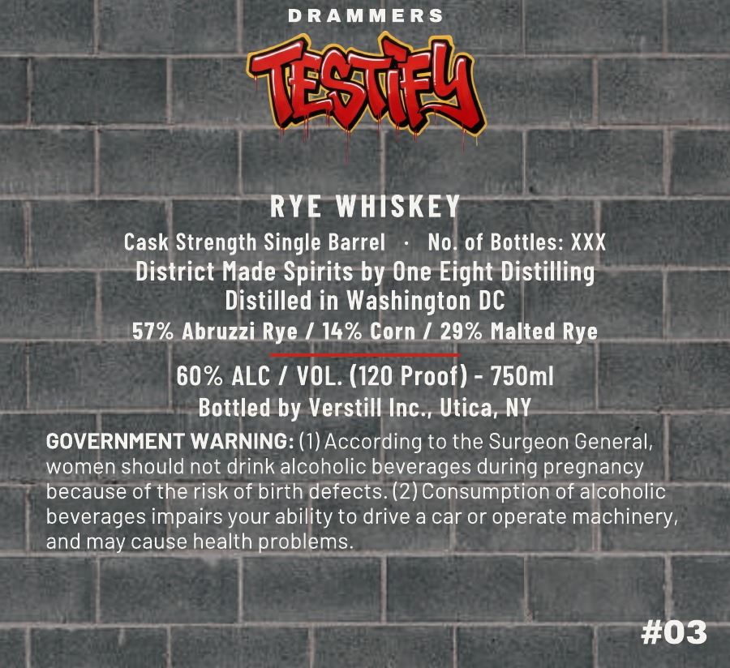
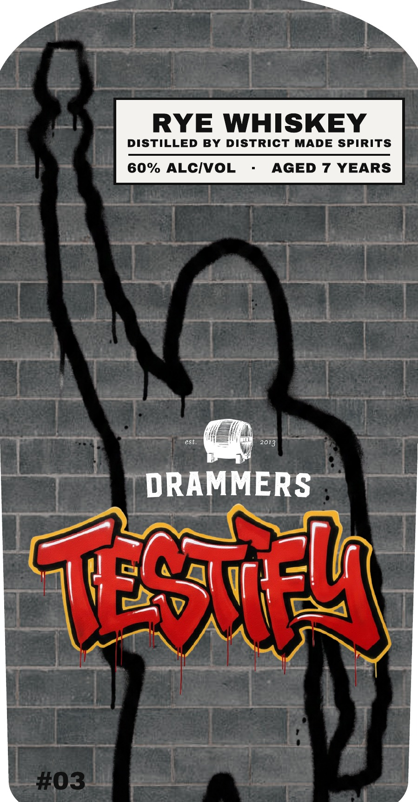

# TTB COLA Label Images - TTBID 26314001000321

**Brand Name:** DRAMMERS

**Fanciful Name:** TESTIFY

**Issue Date:** 11/17/2026

**Origin Code:** 02

**Product Class/Type:** 142

**Source:** [TTB Public COLA Registry](https://ttbonline.gov/colasonline/viewColaDetails.do?action=publicFormDisplay&ttbid=26314001000321)

## Label Images

### Back Label

### Front Label

## Extracted Label Text

*Text extracted via OCR - may contain errors*

**Detected Proof:** 120
**Detected Age:** 7 Years

### Back Label

DRAMMERS

fee

RYE WHISKEY

No. of Bottles: XXX

Cask Strength Single Barrel

District Made Spirits by One Eight Distilling

Distilled in Washington DC

57% Abruzzi Rye / 14% Corn / 29% Malted Rye

60% ALC / VOL. (120 Proof) - 750ml!

Bottled by Verstill Inc., Utica, NY.

GOVERNMENT WARNING: (1) According to the Surgeon General

women should not drink alcoholic beverages during pregnancy

because of the risk of birth defects. (2) Consumption of alcoholic

beverages impairs your ability to drive a car or operate machinery,

and may cause health problems.

——

eg

~

|

#03

### Front Label

RYE
WHISKEY
DISTILLED BY
DISTRICT
MADE SPIRITS
60% ALCIVOL
AGED 7
YEARS
esb,
2013
DRAMMERS
Wen h
#03
