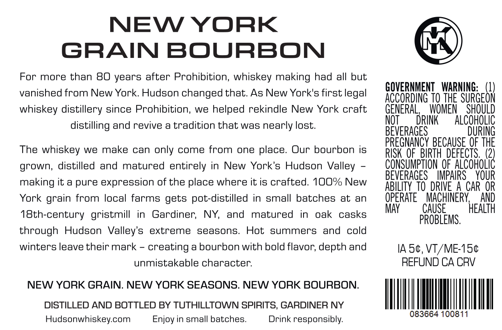
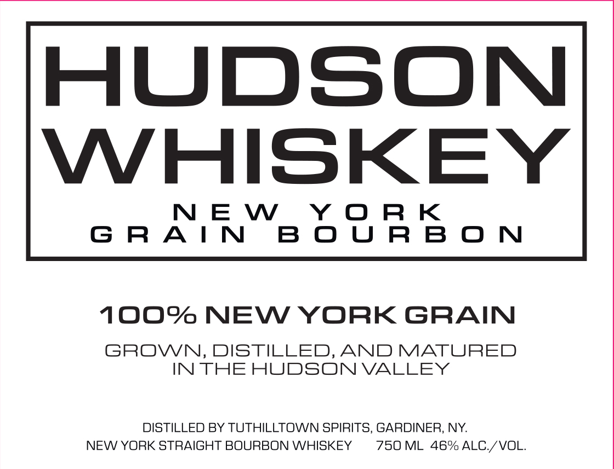

# TTB COLA Label Images - TTBID 26314001000514

**Brand Name:** HUDSON WHISKEY

**Fanciful Name:** NEW YORK GRAIN BOURBON

**Issue Date:** 11/16/2026

**Origin Code:** 02

**Product Class/Type:** 101

**Source:** [TTB Public COLA Registry](https://ttbonline.gov/colasonline/viewColaDetails.do?action=publicFormDisplay&ttbid=26314001000514)

## Label Images

### Back Label

### Front Label

## Extracted Label Text

*Text extracted via OCR - may contain errors*

**Detected Proof:** 92

### Back Label

NEW YORK
GRAIN BOURBON
For
more than 80 years after Prohibition, whiskey making had all but
GOVERNMENT
WARNING:
vanished from New York Hudson changed that. As New York's first legal
ACCORDING TO the SuRGeoN
whiskey distillery since Prohibition, we helped rekindle New York craft
GENERAL
WOMEN
SHOULD
distilling and revive a tradition that was nearly lost.
NOT
DrInk
ALCOHOLIc
BEVERAGES
DURING
PREGNANCY BECAUSE QF THE
The whiskey we
make
can only come from one place.
Our bourbon is
RISK   OF_BIRTH  defects .  (2)
grown, distilled and matured entirely in New York's Hudson Valley
CONSUMPTION  OF ALCOHOLIC
BEVERAGES
IMPAIRS
YOUR
making it a pure expression of the place where it is crafted. 1OO% New
ABILITY TO DRIVE
H
CAR OR
York grain from local farms gets pot-distilled in small batches at
an
OPERATE
MACHINERY,
AND
18th-century gristmill in
Gardiner;
NY,
and
matured
in
oak
casks
MAy
CAUSE
hEALTH
PROBLEMS ,
through
Hudson Valley's
extreme
seasons_
Hot
summers
and
cold
winters leave their mark
creating a bourbon with bold flavor; depth and
IA 5c, VT/MEISc
unmistakable character:
REFUND CA CRV
NEW YORK GRAIN. NEW YORK SEASONS. NEW YORK BOURBON.
DISTILLED AND BOTTLED BY TUTHILLTOWN SPIRITS, GARDINER NY
083664 100811
Hudsonwhiskeycom
Enjoy in small batches
Drink responsibly:

### Front Label

HUDSON

WHISKEY

NEW YORK

GRAIN BOURBON

100% NEW YORK GRAIN

GROWN, DISTILLED, AND MATURED

IN THE HUDSON VALLEY

DISTILLED BY TUTHILLTOWN SPIRITS, GARDINER, NY.

NEW YORK STRAIGHT BOURBON WHISKEY

750 ML 46% ALC./VOL.
