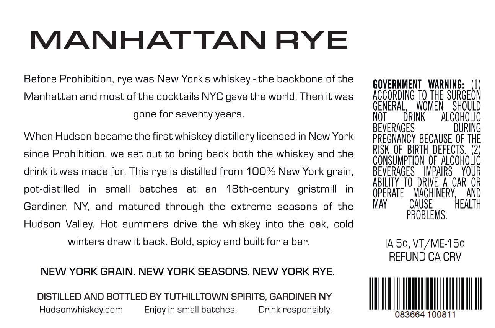
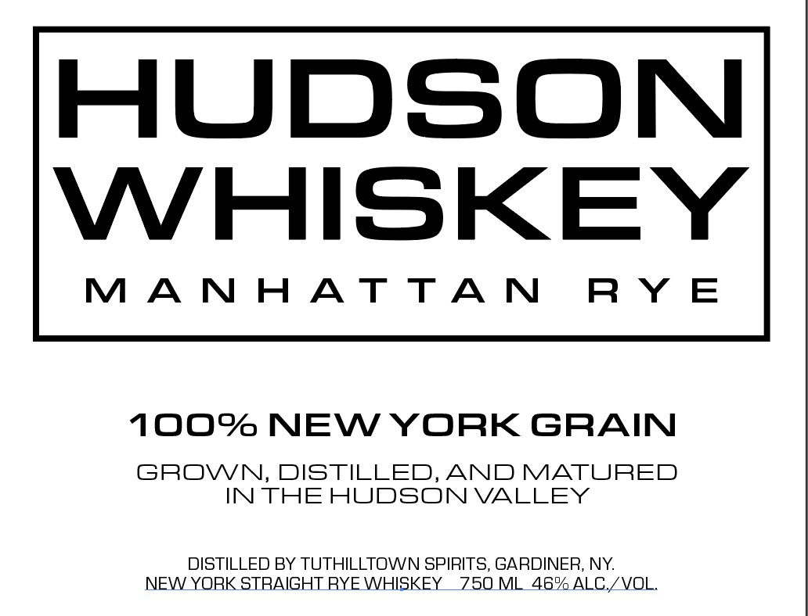

# TTB COLA Label Images - TTBID 26314001000525

**Brand Name:** HUDSON WHISKEY

**Fanciful Name:** MANHATTAN RYE

**Issue Date:** 11/20/2026

**Origin Code:** 02

**Product Class/Type:** 142

**Source:** [TTB Public COLA Registry](https://ttbonline.gov/colasonline/viewColaDetails.do?action=publicFormDisplay&ttbid=26314001000525)

## Label Images

### Back Label

### Front Label

## Extracted Label Text

*Text extracted via OCR - may contain errors*

**Detected Proof:** 92

### Back Label

MANHATTAN RYE
Before Prohibition, rye was New York's whiskey -
the backbone of the
GOVERNMENI  WARNING:; _ (1)
Manhattan and most of the cocktails NYC gave the world: Then it was
ACCORDING TO THE SURGEON
GENERAL
WOMEN
SHOULD
gone for seventy years_
NOt
DRInk
ALCOHOLIC
BEVERAGES
DURING
When Hudson became the first whiskey distillery licensed in New York
PREGNANCY BECAuSe QF THE
since Prohibition, we set out to bring back both the whiskey and the
RISK oF_BIRTH  deFECTS   (2)
CONSUMPTION of.AlcohOlIc
drink it was made for: This rye is distilled from 1OO% New York grain,
BEVERAGES
IMPAIRS
YOUR
ABILITY_TO  DRIVE A CAR OR
pot-distilled
in
small
batches
at
an
18th-century
gristmill
in
OPERATE
MACHINERY
AND
Gardiner;
NY, and
matured through the
extreme
seasons
of
the
MAy
CAUSE
HeAlth
PROBLEMS .
Hudson Valley:
Hot summers
drive the whiskey into the
oak;
cold
winters draw it back. Bold, spicy and built for a bar:
IA 50, VT/ME15c
REFUND CA CRV
NEW YORK GRAIN. NEW YORK SEASONS: NEW YORK RYE:
DISTILLED AND BOTTLED BY TUTHILLTOWN SPIRITS, GARDINER NY
Hudsonwhiskeycom
Enjoy in small batches:
Drink responsibly:
083664 100811

### Front Label

HUDSON

WHISKEY

MANHATTAN RYE

100% NEW YORK GRAIN

ZT

IVVN,

IN THE HUDSON VALLEY

STIL

ED, AND MATURED

DISTILLED BY TUTHILLTOWN SPIRITS, GARDINER, NY.

NEW YORK STRAIGHT RYE WHISKEY 750 ML 46% ALC./VOL.
