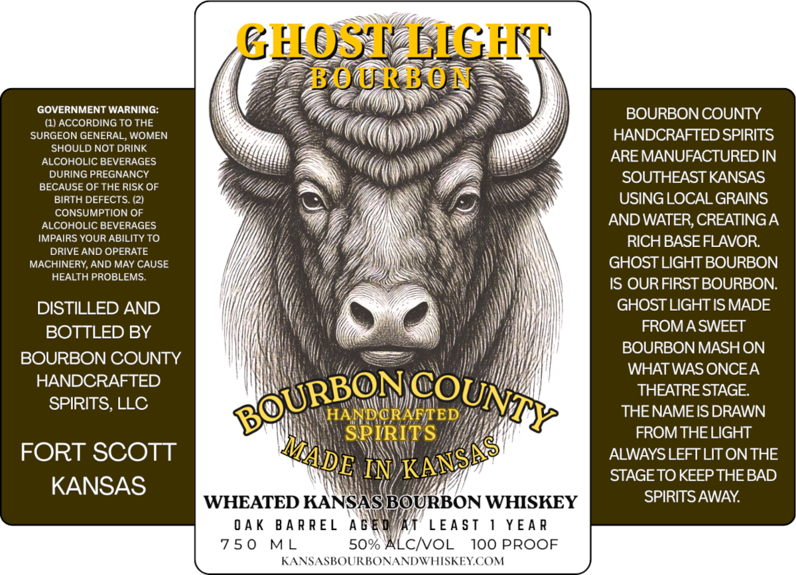

# TTB COLA Label Images - TTBID 26314001000592

**Brand Name:** BOURBON COUNTY HANDCRAFTED SPIRITS

**Fanciful Name:** GHOST LIGHT BOURBON

**Issue Date:** 11/18/2026

**Origin Code:** 21

**Product Class/Type:** 141

**Source:** [TTB Public COLA Registry](https://ttbonline.gov/colasonline/viewColaDetails.do?action=publicFormDisplay&ttbid=26314001000592)

## Label Images

### Label 1

## Extracted Label Text

*Text extracted via OCR - may contain errors*

**Detected Proof:** 100

### Label 1

GHOSILEGFKI'
BOURBON
GOVERNMENT WARNING:
BOURBON COUNTY
(1) ACCORDING TO THE
SURGEON GENERAL, WOMEN
HANDCRAFTED SPIRITS
SHOULD NOT DRINK
ALCOHOLIC BEVERAGES
ARE MANUFACTURED IN
DURING PREGNANCY
SOUTHEAST KANSAS
BECAUSE OF THE RISK OF
BIRTH DEFECTS: (2)
USING LOCAL GRAINS
CONSUMPTION OF
ALCOHOLIC BEVERAGES
AND WATER, CREATINGA
IMPAIRS YOUR ABILITY TO
RICH BASE FLAVOR
DRIVE AND OPERATE
MACHINERY, AND MAY CAUSE
GHOST LIGHT BOURBON
HEALTH PROBLEMS:
IS OUR FIRST BOURBON:
DISTILLED AND
GHOST LIGHT ISMADE
BOTTLED BY
FROMA SWEET
BOURBONMASH ON
BOURBON COUNTY
WHAT WAS ONCEA
HANDCRAFTED
THEATRE STAGE
SPIRITS, LLC
HAND@RAFTED
THENAMEIS DRAWN
SPIRITS
FROM THELIGHT
FORT SCOTT
ALWAYSLEFT LIT ONTHE
IN
STAGE TO KEEP THE BAD
KANSAS
SPIRITSAWAY
WHEATED KANSAS BOURBON WHISKEY
0 A K
B A R R E L
A G E D
AT
LEA ST
YEA R
7 5 0
M L
50% ALCNOL
100 PROOF
KANSASROURRONANDWHISKEYCOM
BOURBONC
COUNTY
MADE
KANSAS
