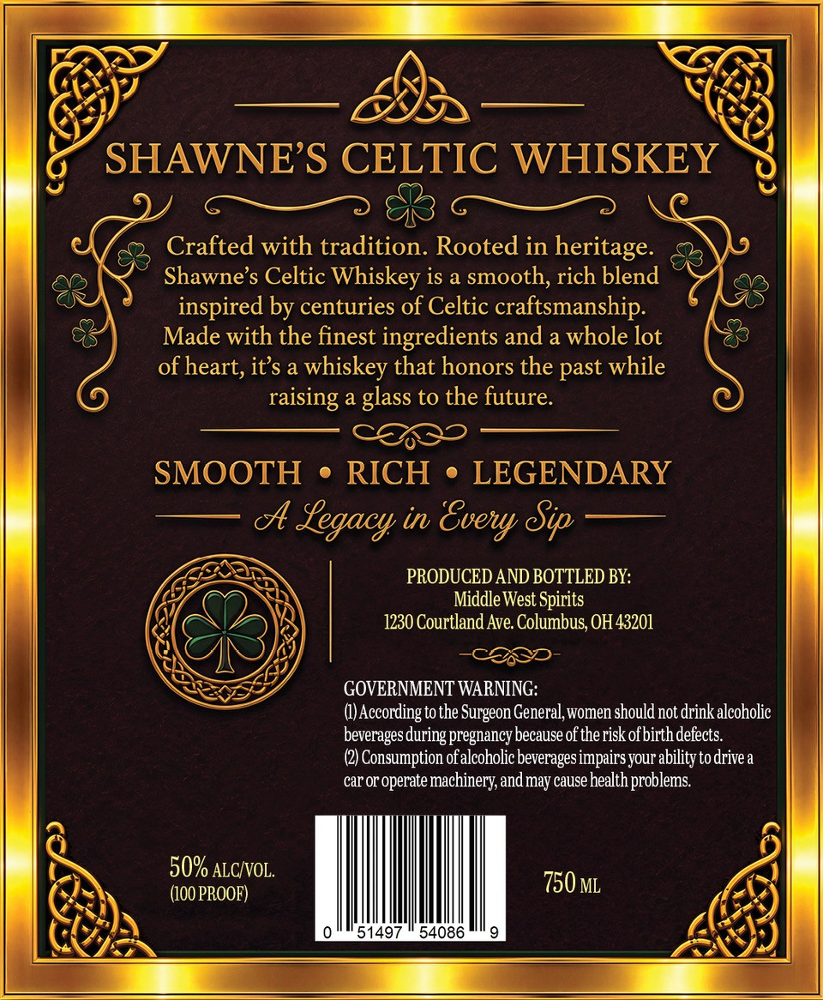
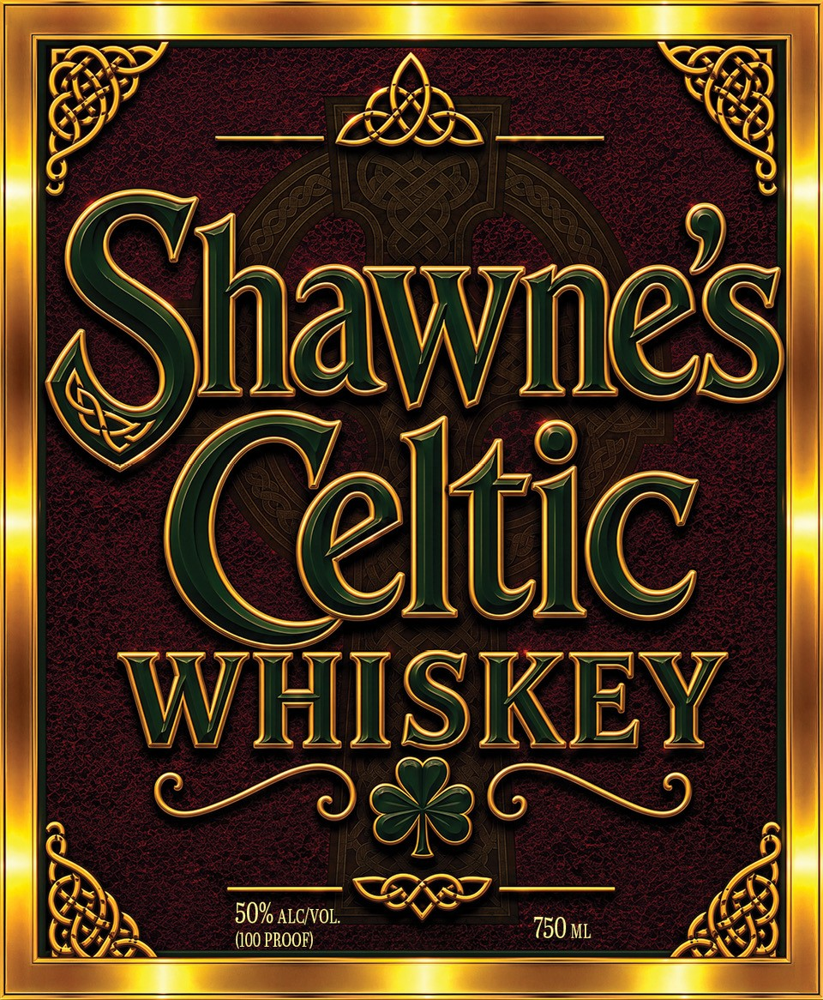
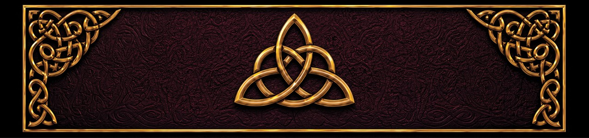

# TTB COLA Label Images - TTBID 26314001000670

**Brand Name:** SHAWNE'S CELTIC

**Issue Date:** 11/18/2026

**Origin Code:** 09

**Product Class/Type:** 140

**Source:** [TTB Public COLA Registry](https://ttbonline.gov/colasonline/viewColaDetails.do?action=publicFormDisplay&ttbid=26314001000670)

## Label Images

### Back Label

### Front Label

### Label 3

## Extracted Label Text

*Text extracted via OCR - may contain errors*

*2 image(s) excluded: text did not meet readability threshold*

**Detected Proof:** 100

### Back Label

SHAWNES CELTIC WHISKEY
Crafted with tradition. Rooted in heritage.
Shawne's Celtic Whiskey is a smooth, rich blend
inspired by centuries of Celtic craftsmanship:
Made with the finest ingredients and a whole lot
of heart, its a whiskey that honors the past while
raising a glass to the future.
SMOOTH
RICH
LEGENDARY
A Segacy in
Sip
PRODUCED AND BOTTLED BY:
Middle West Spirits
1230 Courtland Ave. Columbus; OH 43201
GOVERNMENT WARNING:
(I)According to the Surgeon General, women should not drink alcoholic
beveragesduring pregnancy because of therisk ofbirth defects:
Consumption ofalcoholic beverages impairs your ability to drive a
caror operate machinery,and may cause health problems:
50% ALCIVOL.
(100 PROOE)
750 ML
51497
54086
'Evety :
