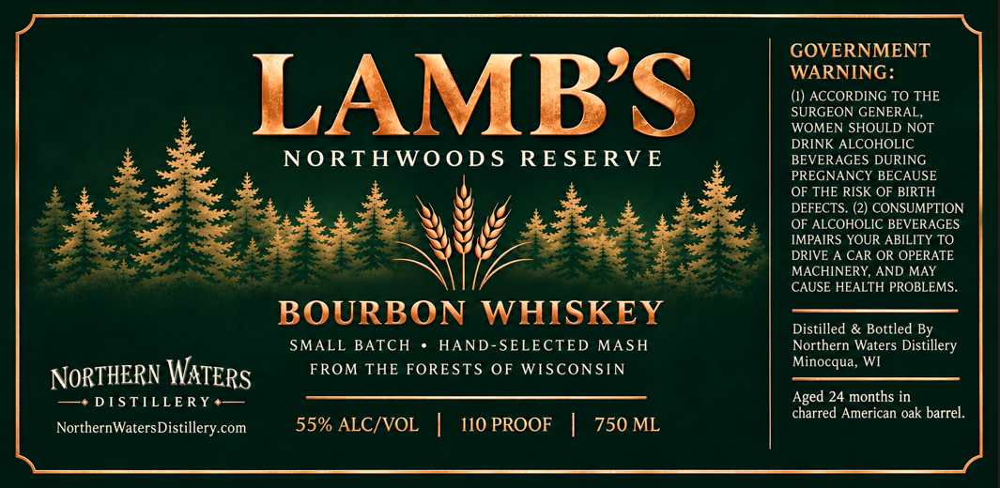

# TTB COLA Label Images - TTBID 26314001000693

**Brand Name:** LAMB'S NORTHWOODS RESERVE

**Issue Date:** 11/18/2026

**Origin Code:** 48

**Product Class/Type:** 141

**Source:** [TTB Public COLA Registry](https://ttbonline.gov/colasonline/viewColaDetails.do?action=publicFormDisplay&ttbid=26314001000693)

## Label Images

### Back Label

## Extracted Label Text

*Text extracted via OCR - may contain errors*

**Detected Proof:** 110

### Back Label

GOVERNMENT
WARNING:
LAMBS
(I) ACCORDING TO THE
SURGEON GENERAL,
WOMEN SHOULD NOT
DRINK ALCOHOLIC
NO RTHWOOD S
RE SERV E
BEVERAGES DURING
PREGNANCY BECAUSE
OF THE RISK OF BIRTH
DEFECTS. (2) CONSUMPTION
OF ALCOHOLIC BEVERAGES
IMPAIRS YOUR ABILITY TO
DRIVE
CAR OR OPERATE
MACHINERY, AND MAY
CAUSE HEALTH PROBLEMS
BOURBON
WHISKEY
Distilled & Bottled By
SMALL BATCH
HAND-SELECTED
MASH
Northern Waters Distillery
NORTHERN WTERS
FROM THE FORESTS OF WISCONSIN
Minocqua, WI
D [ STILLE RY
Aged 24 months in
charred American oak barrel:
NorthernWatersDistillery com
55% ALC/VOL
110 PROOF
750 ML
