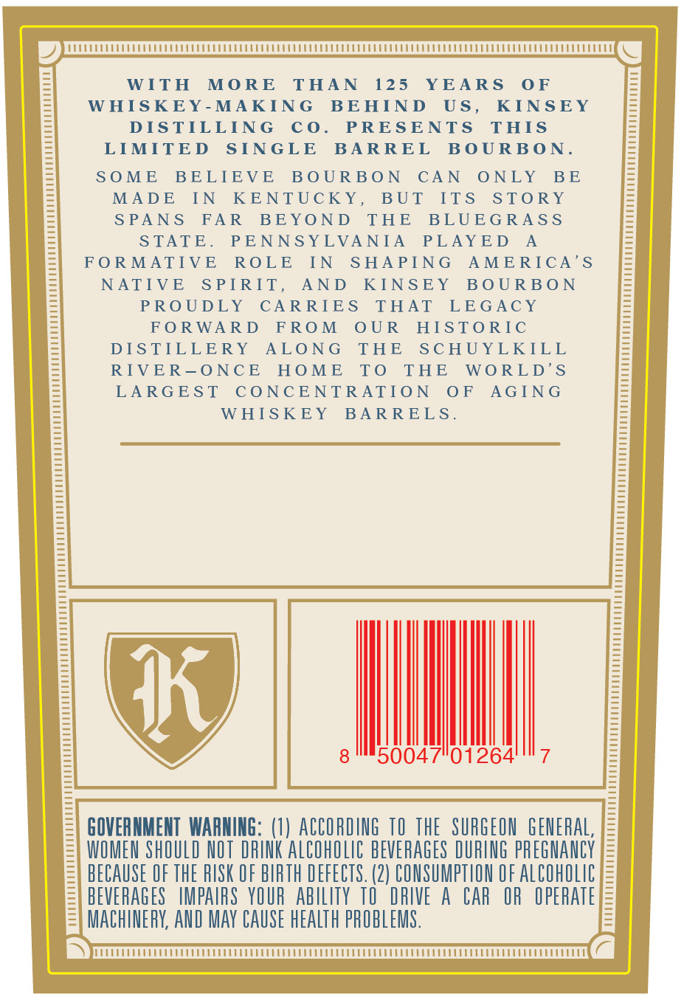
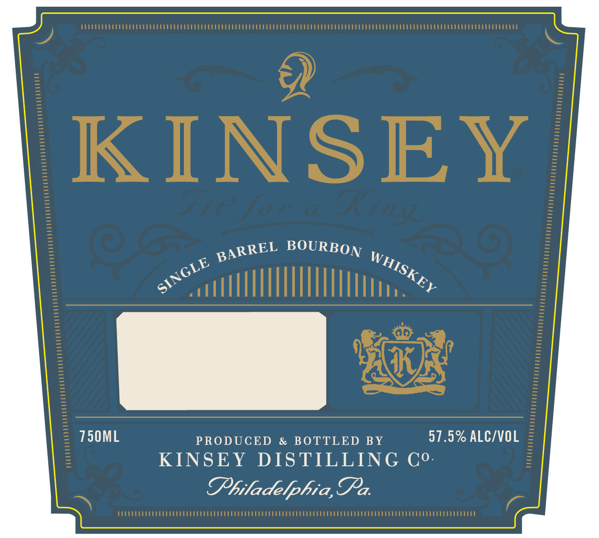
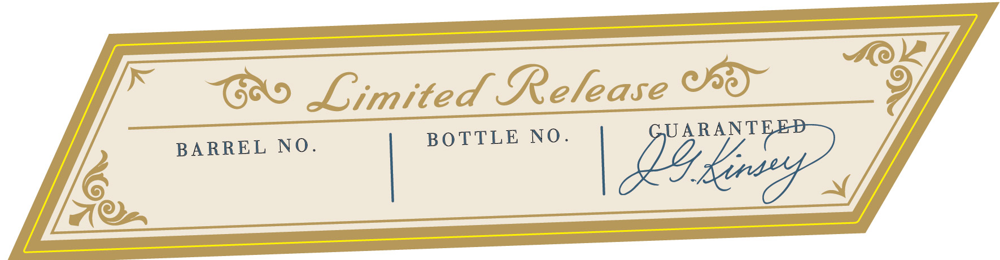

# TTB COLA Label Images - TTBID 26314001000695

**Brand Name:** KINSEY

**Issue Date:** 11/18/2026

**Origin Code:** 39

**Product Class/Type:** 141

**Source:** [TTB Public COLA Registry](https://ttbonline.gov/colasonline/viewColaDetails.do?action=publicFormDisplay&ttbid=26314001000695)

## Label Images

### Back Label

### Front Label

### Label 3

## Extracted Label Text

*Text extracted via OCR - may contain errors*

**Detected Proof:** 115

### Back Label

iY)

Ss

WITH MORE THAN

125 YEARS OF

WHISKEY-MAKING BEHIND US, KINSEY

DISTILLING CO. PRESENTS THIS

LIMITED SINGLE BARREL BOURBON

SOME BELIEVE BOURBON CAN ONLY BE

MADE IN KENTUCKY, BUT ITS STORY

SPANS FAR BEYOND THE BLUEGRASS

STATE. PENNSYLVANIA PLAYED A

FORMATIVE ROLE IN SHAPING AMERICA’S

NATIVE SPIRIT, AND KINSEY BOURBON

PROUDLY CARRIES THAT LEGACY

FORWARD FROM OUR HISTORIC

DISTIEEERY VALONG THE SCHUYE RIEL

RIVER-ONCE HOME TO THE WORLD’S

LARGEST CONCENTRATION OF AGING

WHISKEY BARRELS

‘8 IM,

GOVERNMENT WARNING: (1) ACCORDING TO THE SURGEON GENERAL

=| WOMEN SHOULD NOT DRINK ALCOHOLIC BEVERAGES DURING PREGNANCY |=

=) BECAUSE OF THE RISK OF BIRTH DEFECTS. (2) CONSUMPTION OF ALCOHOLIC j=

Ee

=) BEVERAGES IMPAIRS YOUR ABILITY 10 DRIVE A CAR OR OPERATE) =

=) MACHINERY, AND MAY CAUSE HEALTH PROBLEMS.

®:

a

### Front Label

KINSEY
ie faf

BOURBON
750ML
PRODUCED
&
BOTTLED BY
57.5% ALCIVOL
KINSEY
DISTILLING Co:
OPhiladelphia,TPa.
Uines
BARREL
WHISKEY
SINGLE

### Label 3

S@)k

Kr Gao Limited R elease Che

UARANT

|

loan
