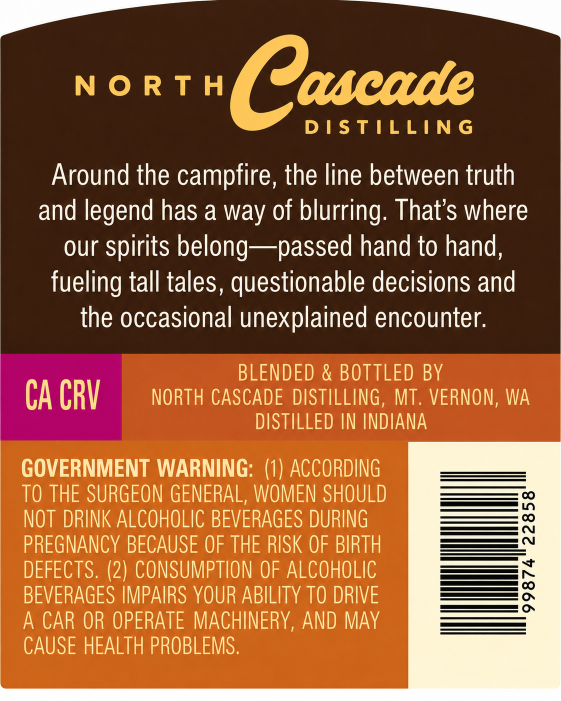
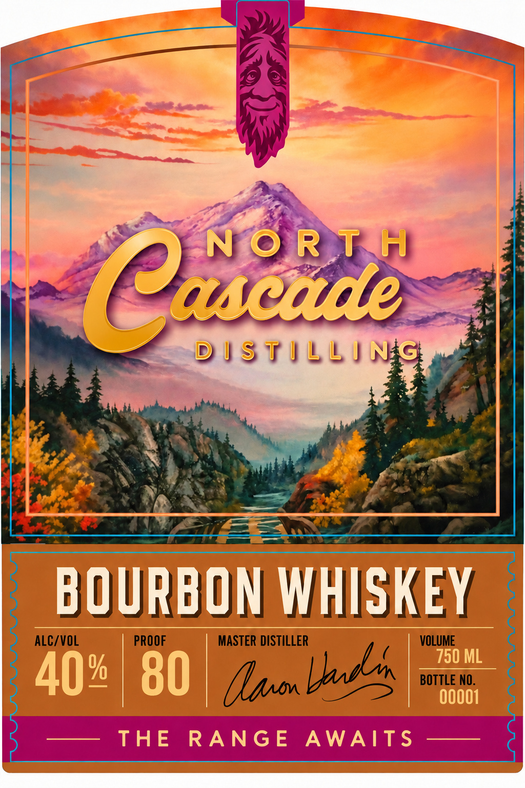
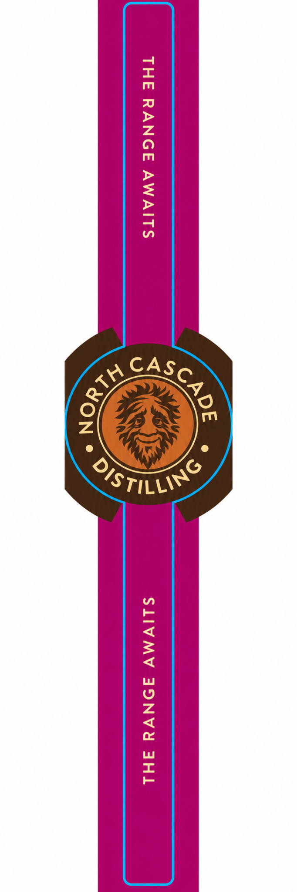

# TTB COLA Label Images - TTBID 26314001000845

**Brand Name:** NORTH CASCADE DISTILLING

**Issue Date:** 11/18/2026

**Origin Code:** 07

**Product Class/Type:** 141

**Source:** [TTB Public COLA Registry](https://ttbonline.gov/colasonline/viewColaDetails.do?action=publicFormDisplay&ttbid=26314001000845)

## Label Images

### Back Label

### Front Label

### Label 3

## Extracted Label Text

*Text extracted via OCR - may contain errors*

### Back Label

NORTH

ascntle

DISTILLING

Around the campfire, the line between truth

and legend has a way of blurring. That’s where

our spirits belong—passed hand to hand,

fueling tall tales, questionable decisions and

the occasional unexplained encounter.

BLENDED & BOTTLED BY

NORTH CASCADE DISTILLING, MT. VERNON, WA

DISTILLED IN INDIANA

GOVERNMENT WARNING: (1) ACCORDING

TO THE SURGEON GENERAL, WOMEN SHOULD

[$9

NOT DRINK ALCOHOLIC BEVERAGES DURING

}-—___fig\}

PREGNANCY BECAUSE OF THE RISK OF BIRTH

DEFECTS. (2) CONSUMPTION OF ALCOHOLIC

BEVERAGES IMPAIRS YOUR ABILITY T0 DRIVE

A CAR OR OPERATE MACHINERY, AND MAY

CAUSE HEALTH PROBLEMS.

### Front Label

—
DISTILLI ES allie
BUURBUN WHISKEY
ALC/VOL PROOF MASTER DISTILLER ( VOLUME
Sm bese BOTTLE NO.

### Label 3

THE RANGE AWAITS SLIVMV JAONVYU AHL
