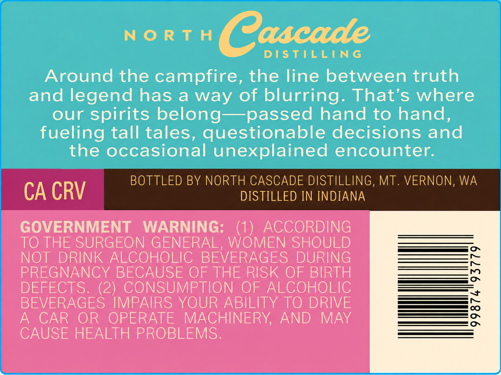
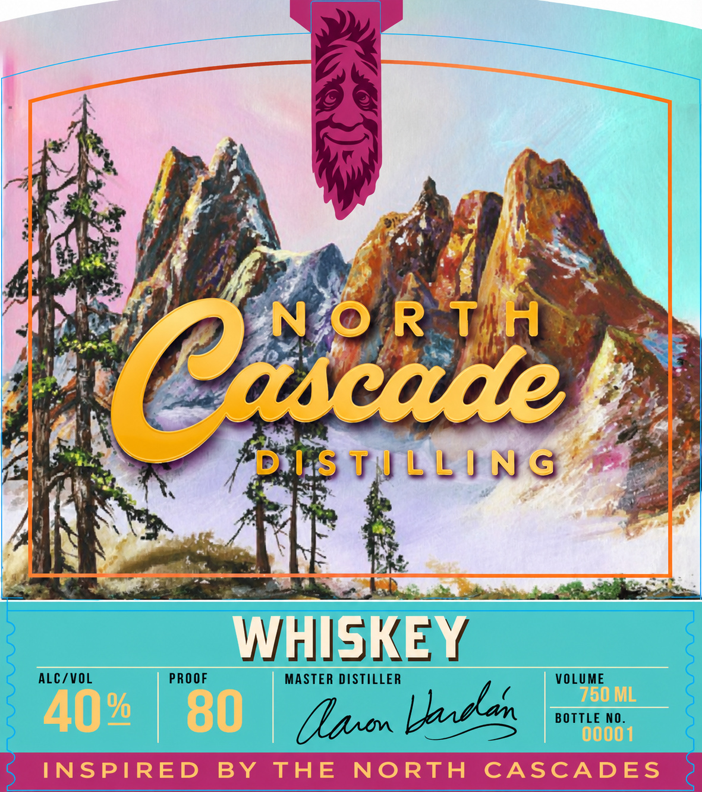
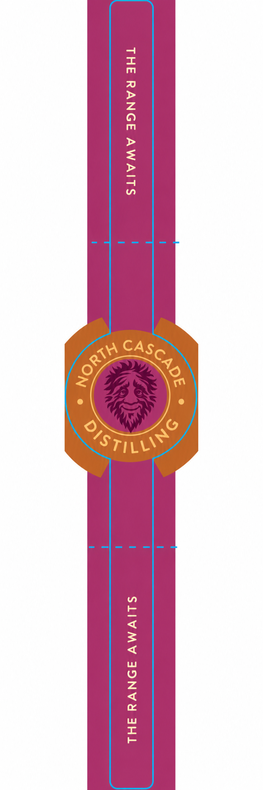

# TTB COLA Label Images - TTBID 26314001000850

**Brand Name:** NORTH CASCADE DISTILLING

**Issue Date:** 11/18/2026

**Origin Code:** 07

**Product Class/Type:** 140

**Source:** [TTB Public COLA Registry](https://ttbonline.gov/colasonline/viewColaDetails.do?action=publicFormDisplay&ttbid=26314001000850)

## Label Images

### Back Label

### Front Label

### Label 3

## Extracted Label Text

*Text extracted via OCR - may contain errors*

### Back Label

N 0 R t H
Cascade
DI S TILLING
Around the campfire, the line between truth
and legend has a way of blurring. That's where
our
spirits belong  ~passed hand to hand,
fueling tall tales, questionable decisions and
the occasional unexplained encounter.
BOTTLED BY NORTH CASCADE DISTILLING, MT. VERNON, WA
CA CRV
DISTILLED IN INDIANA
GOVERNMENT
WARNING:
(1)
ACCORDING
TO THE SURGEON GENERAL,
WOMEN SHOULD
NOT
DRINK ALCOHOLIC BEVERAGES
DURING
6
PREGNANCY BECAUSE OF THE RISK OF BIRTH
DEFECTS.
(2) CONSUMPTION
OF ALCOHOLIC
BEVERAGES IMPAIRS YOUR ABILITY TO DRIVE
{
A
CAR
OR
OPERATE
MACHINERY
AND
MAY
CAUSE HEALTH PROBLEMS.

### Front Label

eg NFO RTA oat
gm , Pn
ANE uc TTP $3 .
WHISKE Y
Whine
ALC/VOL PROOF MASTER DISTILLER y VOLUME
/lyoon Laslen BOTTLE NO.
S INSPIRED BY THE NORTH CASCADES 2

### Label 3

THE RANGE AWAITS SLIVMV JAONVA FHL
