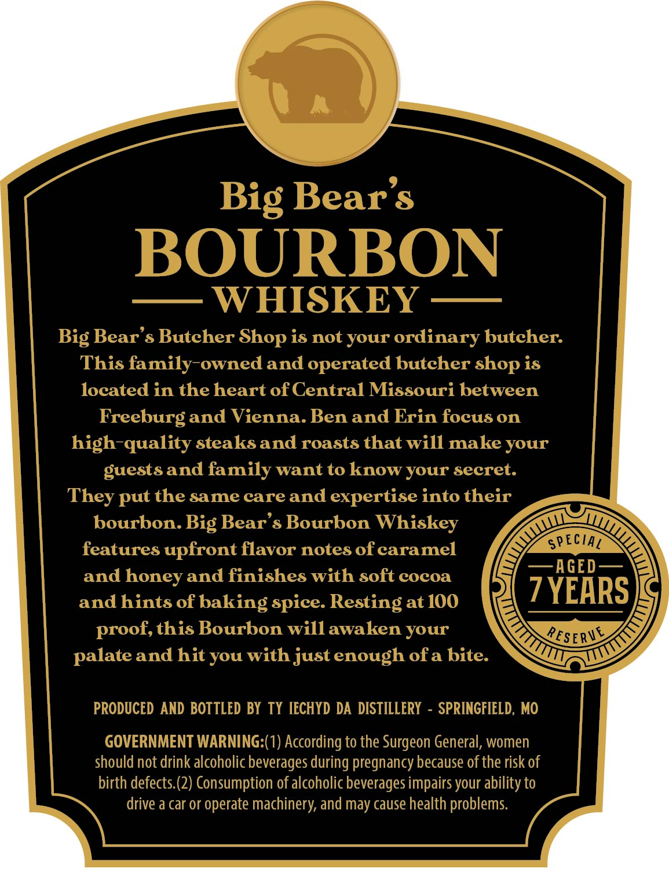
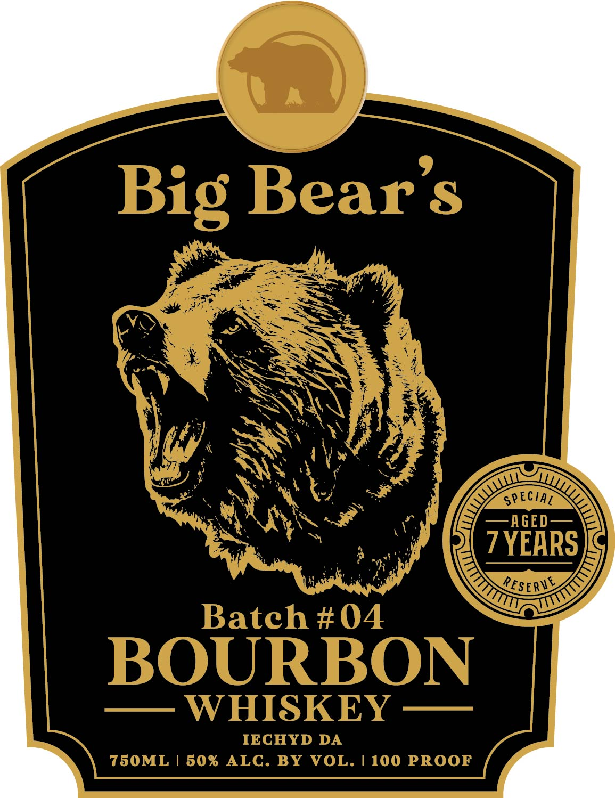
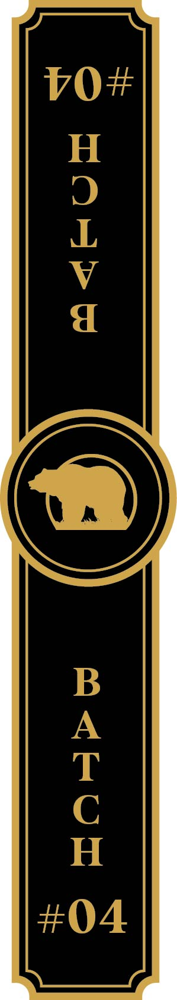

# TTB COLA Label Images - TTBID 26315001000067

**Brand Name:** BIG BEAR'S

**Issue Date:** 11/16/2026

**Origin Code:** 29

**Product Class/Type:** 141

**Source:** [TTB Public COLA Registry](https://ttbonline.gov/colasonline/viewColaDetails.do?action=publicFormDisplay&ttbid=26315001000067)

## Label Images

### Back Label

### Front Label

### Label 3

## Extracted Label Text

*Text extracted via OCR - may contain errors*

*1 image(s) excluded: text did not meet readability threshold*

**Detected Proof:** 100
**Detected Age:** 7 Years

### Back Label

Big Bears
BOURBON
WHISKEY
Big Bear' s Butcher Shop is not your ordinary butcher:
This family-owned and operated butcher shop is
located in the heart of Central Missouri between
Freeburgand Vienna. Ben and Erin focus on
high-quality steaksand roasts that will make your
guestsand family want to know your secret:
the same care and expertise into their
bourbon. Big Bear s Bourbon Whiskey
features upfront flavor notes of caramel
SPEcIAL
AGED
and honey and finishes with soft cocoa
and hints of
'baking
Resting at 100
7 YEARS
proof;this Bourbon will awaken your
RESERUE
palate and hit you with just enough ofa bite:
PRODUCED AND BOTTLED BY  TY [ECHYD DA DISTILLERY
SPRINGFIELD , MO
GOVERNMENT WARNING:(1) According to the Surgeon General, women
should not drink alcoholic beverages during pregnancy because of the risk of
birth defects (2) Consumption of alcoholic beverages impairs your ability to
drive a car or operate machinery, and may cause health problems.
They
put
spice.

### Front Label

Big Bear$
SPEcial
AGED
7 YEARS
RESERUE
Batch #04
BOURBON
WHISKEY
IECHYD DA
750ML
50% ALC. BY VOL.
100 PROOF
