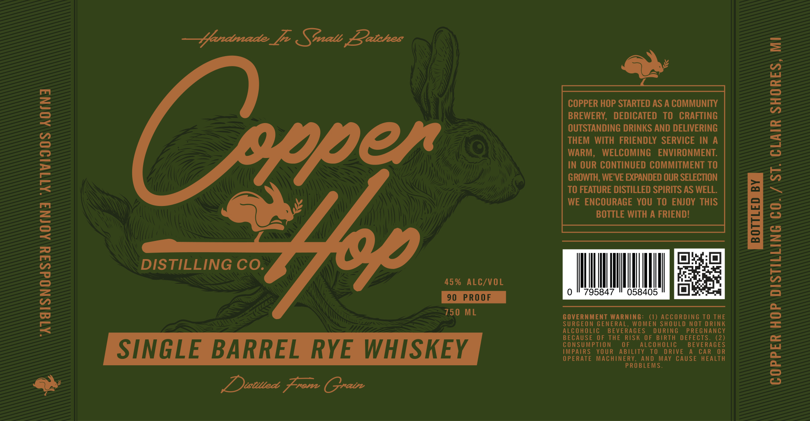

# TTB COLA Label Images - TTBID 26315001000456

**Brand Name:** COPPER HOP DISTILLING CO.

**Issue Date:** 11/17/2026

**Origin Code:** 06

**Product Class/Type:** 142

**Source:** [TTB Public COLA Registry](https://ttbonline.gov/colasonline/viewColaDetails.do?action=publicFormDisplay&ttbid=26315001000456)

## Label Images

### Label 1

## Extracted Label Text

*Text extracted via OCR - may contain errors*

**Detected Proof:** 90

### Label 1

AVGISNOdSIY ADIN] ATIVIDOS ADIN

2

DISTILLING CO.

45% ALC/VOL

90 PROOF

750 ML

SINGLE BARREL RYE WHISKEY

COPPER HOP STARTED AS A COMMUNITY
BREWERY, DEDICATED TO CRAFTING
OUTSTANDING DRINKS AND DELIVERING
THEM WITH FRIENDLY SERVICE IN A
WARM, WELCOMING ENVIRONMENT.
IN OUR CONTINUED COMMITMENT TO
GROWTH, WE'VE EXPANDED OUR SELECTION
TO FEATURE DISTILLED SPIRITS AS WELL.
WE ENCOURAGE YOU TO ENJOY THIS
BOTTLE WITH A FRIEND!

0 " 795847 " 058405

GOVERNMENT WARNING: (1) ACCORDING TO THE
SURGEON GENERAL, WOMEN SHOULD NOT DRINK
ALCOHOLIC BEVERAGES DURING PREGNANCY
BECAUSE OF THE RISK OF BIRTH DEFECTS. (2)
CONSUMPTION OF ALCOHOLIC BEVERAGES
IMPAIRS YOUR ABILITY TO DRIVE A CAR OR
OPERATE MACHINERY, AND MAY CAUSE HEALTH
PROBLEMS

BOTTLED BY
COPPER HOP DISTILLING CO:\/ ST.. CLAIR SHORES, MI
