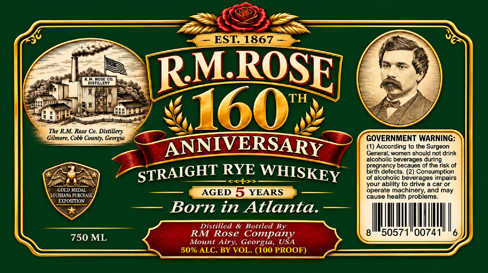
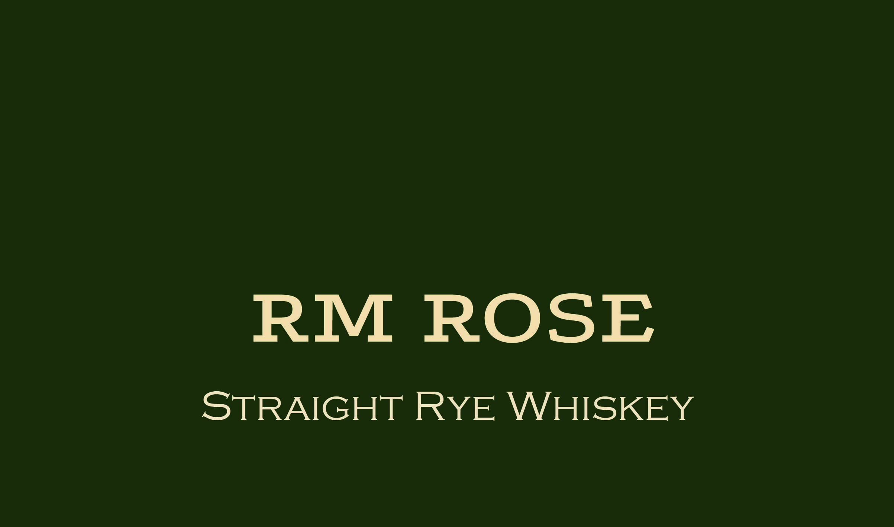

# TTB COLA Label Images - TTBID 26315001000507

**Brand Name:** RM ROSE

**Issue Date:** 11/16/2026

**Origin Code:** 08

**Product Class/Type:** 102

**Source:** [TTB Public COLA Registry](https://ttbonline.gov/colasonline/viewColaDetails.do?action=publicFormDisplay&ttbid=26315001000507)

## Label Images

### Label 1

### Label 2

## Extracted Label Text

*Text extracted via OCR - may contain errors*

*1 image(s) excluded: text did not meet readability threshold*

**Detected Proof:** 100

### Label 1

EST 1867
REISFGEEECO
RMROSE
TH
160
The RM Rose Co. Distillery
Gilmore, Cobb County, Georgia
GOVERNMENT WARNING:
ANNIVERSARY
(1) According to the Surgeon
General, women should not drink
alcoholic beverages during,
becayes of the risk of
RYE
Bregraeccbeczjeconshepsion
00
of alcoholic beverages impairs
your ability to drive a car or
GOLD MEDAL
AGED5
YEARS
operate machinery, and may
LOUISIANA PURCHASE
cause health problems.
EXPOSITION
Born in Atlanta.
Distilled
&
Bottled By
RM
Rose Company
8
50571"00741
6
750 ML
Mount
Georgia,
USA
50% ALC. BY VOL (100 PROOF)
STRAIGHT
WHISKEY
Airy,
