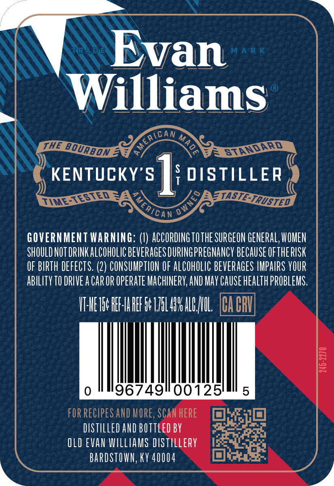
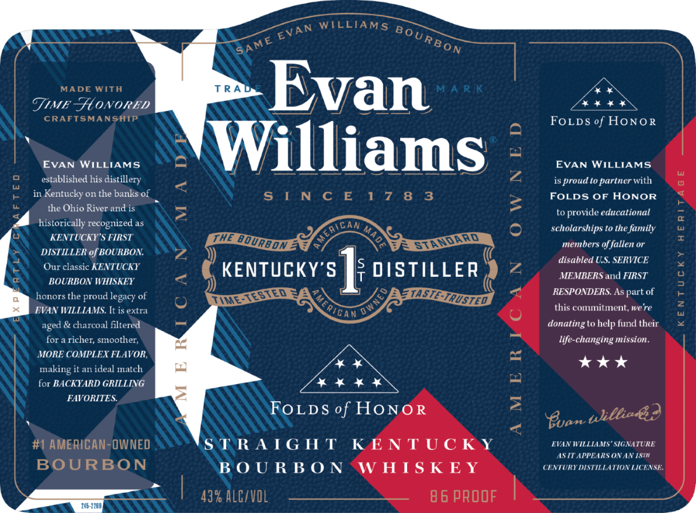
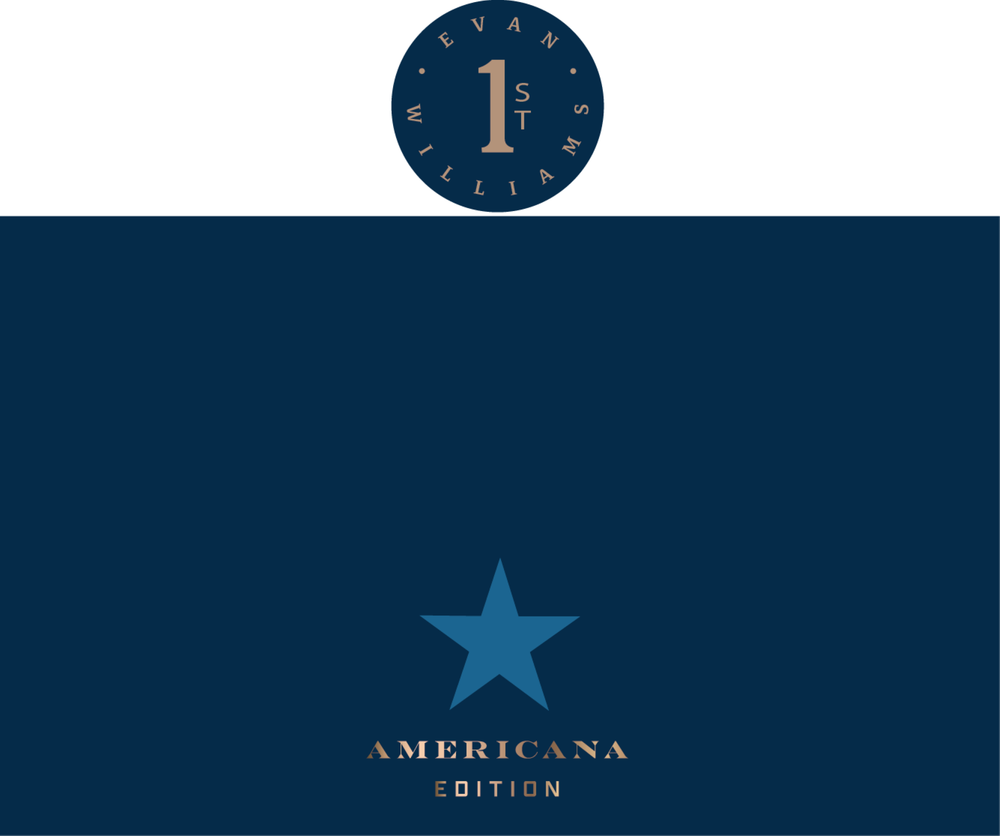

# TTB COLA Label Images - TTBID 26315001000554

**Brand Name:** EVAN WILLIAMS

**Fanciful Name:** BLACK AMERICANA EDITION

**Issue Date:** 11/16/2026

**Origin Code:** 22

**Product Class/Type:** 101

**Source:** [TTB Public COLA Registry](https://ttbonline.gov/colasonline/viewColaDetails.do?action=publicFormDisplay&ttbid=26315001000554)

## Label Images

### Back Label

### Label 1

### Label 3

## Extracted Label Text

*Text extracted via OCR - may contain errors*

*1 image(s) excluded: text did not meet readability threshold*

**Detected Proof:** 98

### Back Label

Evan
Williams
THE
S
KENTUCKY'5
T
DISTILLER
BEETEATUSTED
GOVERNMENT VARnING:
ACCORDING TOTHE SURGEON GENERAL, WOMEN
SHOULD NOT DRINKALCOHOLIC BEVERAGES DURINGPREGNANCY BECAUSE OFTHERISK
OF BIRTH dEfects; (2) CONSUMPTION OF ALCOHOLIC BEVERAGES IMPAIRS YOUR
abIlIty TO DRIVE A CAR OR OPERATE MACHINERY,AND May CAUSE health PRObLEMS.
HTHEYSF HEF HAREF SPL76L488 HBHUL   |CA CRUL
5
96749
001251
5
FOR recipes AND MORE, Scan heRe
DiStILLED anD bOttled BY
OLD EvAN wILLIAMS iIStILLeRy
BARDSTOwN, KY 40004
Merican
9
STANDARD
BOURBON
IMe-TESTED
AmERICAY
OWnES

### Label 1

N WILLIAMS

AME

BOR

MADE WITH

TIME HONORED

CV

SS ret

n

VAI

CRAFTSMANSA#IP

Fo.ps of HONOR

EVAN WILLIAMS

EVAN WILLIAMS

Williams

established his distillery

is proud to partner with

KE

in Kentucky on the banks of

Ss

I

NCE

178 3

FOLDS OF HONOR

u

the Ohio River and is

to provide educational

Miisicricaly recognized as

CAN

scholarships to the family

fe)

KENTUCKY'S FIRST

aS

~ =

THE 20U pp, ON

SS

Sv

psss

members of fallen or

DISTILLER of BOURBON.

SERVICE

Our classic KENTUCKY

disabled U.

( xentucky’s [3

DISTILLER

MEMBERS and FIRST

BOURBON WHISKEY

AAS

TAST,

RESPONDERS. As part of

honors the proud legacy of

) AWE:

ARSAEO

xe ep

TRUSTED

BVAN WILLIAMS. It is extra

LUTTE>

this commitment, we're

aged & charcoal filtered

donating to help fund their

for a richer, smoother,

life-changing mission.

MORE COMPLEX FLAVOR,

kak

making it an ideal match

for BACKYARD GRILLING

FAVORITES.

1

FoLps of HON

Buon willie?

EVAN WILLIAMS’ SIGNATURE

#1 AMERICAN-OWNED

STRAIGHT

18 IT APPEARS ON AN 181

BOURBON

BOURBON

CENTURY DISTILLATION LICENSE.

49% ALC/VOL
