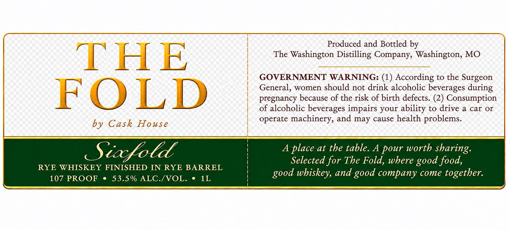

# TTB COLA Label Images - TTBID 26316001000104

**Brand Name:** THE FOLD

**Fanciful Name:** SIXFOLD

**Issue Date:** 11/17/2026

**Origin Code:** 29

**Product Class/Type:** 142

**Source:** [TTB Public COLA Registry](https://ttbonline.gov/colasonline/viewColaDetails.do?action=publicFormDisplay&ttbid=26316001000104)

## Label Images

### Label 1

## Extracted Label Text

*Text extracted via OCR - may contain errors*

**Detected Proof:** 107

### Label 1

Produced and Bottled by
THE
The
Washington Distilling Company, Washington, MO
GOVERNMENT WARNING: (1) According to the Surgeon
General, women should not drink alcoholic beverages during
FOLD
pregnancy because of the risk of birth defects  (2) Consumption
of alcoholic beverages impairs your ability to drive &
car
or
operate machinery, and may cause health problems
by Cask House
Siofold
A place at the table.
A pour worth
sharing:
Selected for The Fold, wbere
food,
RYE WHISKEY FINISHED IN RYE BARREL
wbiskey; and
company come together.
107 PROOF
53.5% ALC-/VOL.
1L
good
good
good
