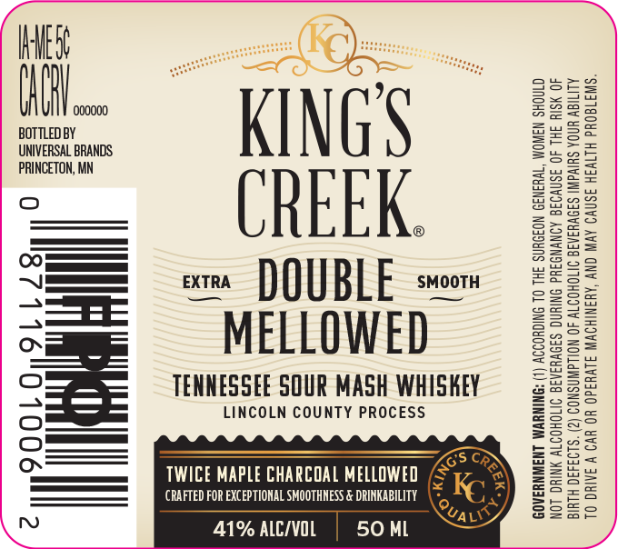

# TTB COLA Label Images - TTBID 26316001000121

**Brand Name:** KING'S CREEK

**Fanciful Name:** DOUBLE MELLOWED

**Issue Date:** 11/17/2026

**Origin Code:** 27

**Product Class/Type:** 140

**Source:** [TTB Public COLA Registry](https://ttbonline.gov/colasonline/viewColaDetails.do?action=publicFormDisplay&ttbid=26316001000121)

## Label Images

### Label 1

## Extracted Label Text

*Text extracted via OCR - may contain errors*

### Label 1

900LO19LL 28

Hil

2

CREEK.

com DOUBLE =
MELLOWED

TENNESSEE SOUR MASH WHISKEY

LINCOLN COUNTY PROCESS

TWICE MAPLE CHARCOAL MELLOWED
(CRAFTED FOR EXCEPTIONAL SMOOTHNESS & DRINKABILITY

AI%ALC/VOL | SOML
