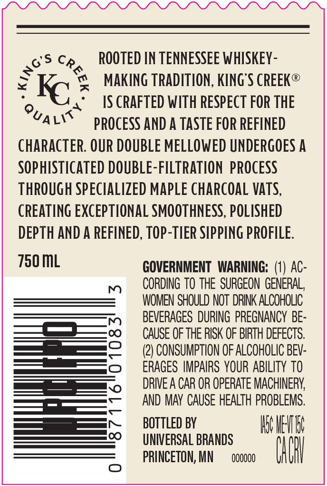
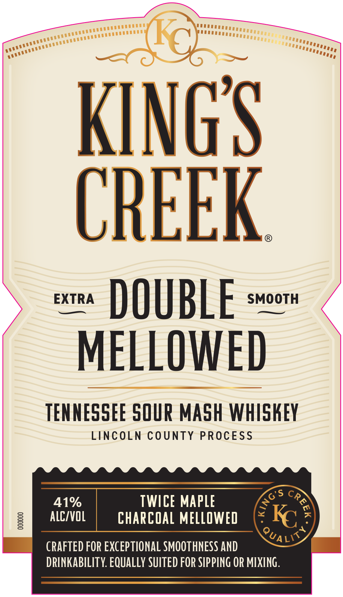

# TTB COLA Label Images - TTBID 26316001000126

**Brand Name:** KING'S CREEK

**Fanciful Name:** DOUBLE MELLOWED

**Issue Date:** 11/17/2026

**Origin Code:** 27

**Product Class/Type:** 140

**Source:** [TTB Public COLA Registry](https://ttbonline.gov/colasonline/viewColaDetails.do?action=publicFormDisplay&ttbid=26316001000126)

## Label Images

### Back Label

### Label 1

### Label 3

## Extracted Label Text

*Text extracted via OCR - may contain errors*

**Detected Proof:** 82

### Back Label

5
ROOTED IN TENNESSEE WHISKEY -
MAKING TRADITION , KINGS CREEKS
Kc
IS CRAFTED WITH RESPECT FOR THE
pROCESS AND A taSTe FOR REFINED
CHARACTER: OUR DOUBLE MELLOWED UNDERGOES A
SOPHISTICATED DOUBLE-FILTRATION  PROCeSS
THROUGH SPECIALIZED MAPLe CHARCOAL VaTS,
CREATING EXCEPTIONAL SMOOTHNESS, POLISHED
DEPTH AND A REFINED, TOP-TIER SIPPING PROFILE:
750 ML
GOVERNMENT  WARNING:
1) Ac
CORDING TO THE  SURGEON  GENERAL,
WOMEN SHOULD NOT DRINK ALCOHOLIC;
BEVERAGES DURING  PREGNANCY BE-
CAUSE OF THE RISK OF BIRTH DEFECTS.
(2) CONSUMPTION OF ALCOHOLIC BEV-
ERAGES IMPAIRS YOUR ABILITY TO
DRIVE A CAR OR OPERATE MACHINERV;
AND MAV  CAUSE HEALTH PROBLEMS,
BOTtLed BY
HF HEVHF
UNIVERSAL BRANDS
PRINCETON; MN
OOOOOO
OHOH
0
{
QUA`
LIT

### Label 1

KINGS
CREEK
EXTRA
DOUBLE
SMOOTH
MELLOWED
TENNFSSEF SOuR MASH WHISKEY
LincOLN county
PROcEsS
5
41%
TWICE MAPLE
1
aLCIVOL
CHARCOAL MELLOWED
Kc
4
CRAFTED FOR EXCEPTIONAL SMOOTHNESS AND
DRINKABILITY. eQualLY SUITED FOR SIPPING OR MIXING.
9
QuALIS

### Label 3

PUPP P PPP

PERE PEEE EERE

MAAUI SONY

KING'S CREEK:

PREP PP P PRP

PEPPER PE

©)
