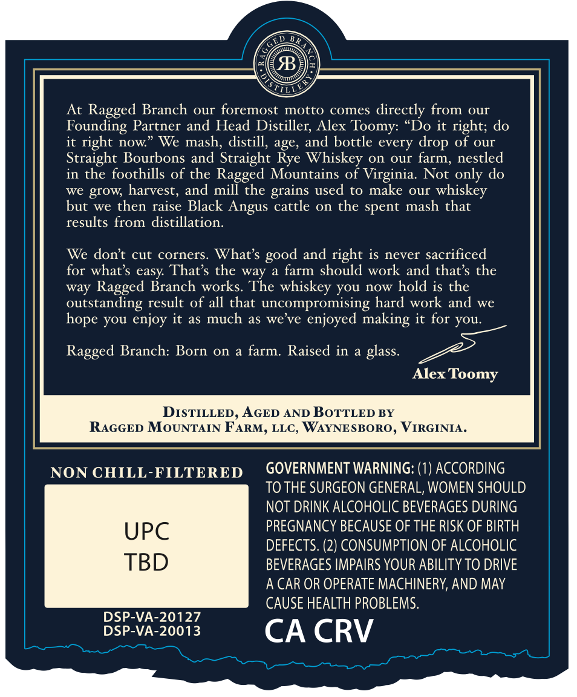
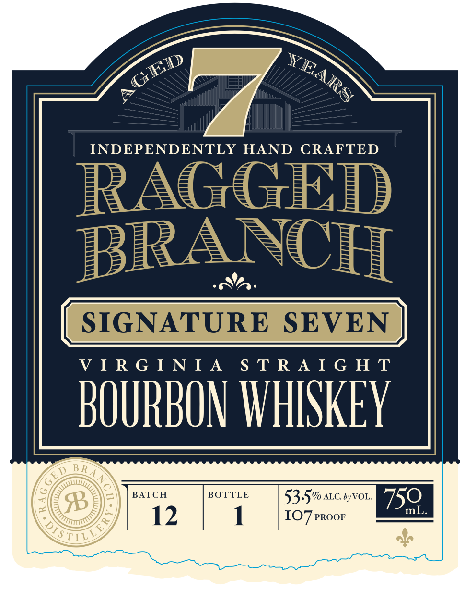

# TTB COLA Label Images - TTBID 26316001000157

**Brand Name:** RAGGED BRANCH

**Fanciful Name:** SIGNATURE SEVEN

**Issue Date:** 11/17/2026

**Origin Code:** 05

**Product Class/Type:** 101

**Source:** [TTB Public COLA Registry](https://ttbonline.gov/colasonline/viewColaDetails.do?action=publicFormDisplay&ttbid=26316001000157)

## Label Images

### Back Label

### Front Label

## Extracted Label Text

*Text extracted via OCR - may contain errors*

### Back Label

B
At
Ragged Branch our foremost motto comes directly from OuI
Founding Partner and Head Distiller; Alex Toomy: "Do it right; do
it right now
We mash, distill, age, and bottle every drop of our
Straight Bourbons and Straight Rye Whiskey on our
nestled
in the foothills of the Ragged Mountains of Virginia. Not only do
we grow; harvest, and mill the
used to
make our
whiskey
but we then raise Black Angus cattle on the spent mash that
results from distillation:
We dont cut corners. What $
and right is never sacrificed
what'$ easy That s the way
should work and that'$ the
way
Ragged Branch works
The whiskey you now hold is the
outstanding result of all that uncompromising hard work and
we
hope you enjoy it as much as we
enjoyed making it for you.
Ragged Branch: Born
on
farm
Raised in
glass:
Alex Toomy
DISTILLED, AGED AND BOTTLED BY
RAGGED MOUNTAIN FARM, LLC, WAYNESBORO, VIRGINIA.
NON CHILL-FILTERED
GOVERNMENT WARNING: (1) ACCORDING
TO THE SURGEON GENERAL, WOMEN SHOULD
NOT DRINK ALCOHOLIC BEVERAGES DURING
UPC
PREGNANCY BECAUSE OF THE RISK OF BIRTH
DEFECTS. (2) CONSUMPTION OF ALCOHOLIC
TBD
BEVERAGES IMPAIRS YOUR ABILITY TO DRIVE
A CAR OR OPERATE MACHINERY, AND MAY
CAUSE HEALTH PROBLEMS.
DSP-VA-20127
DSP-VA-20013
CA CRV
farm,
grains
good
for
farm
've

### Front Label

INDEPENDENTLY HAND CRAFTED

VIRGINIA STRAIGHT

BOURBON WHISKEY

BOTTLE 535%
107 proor
