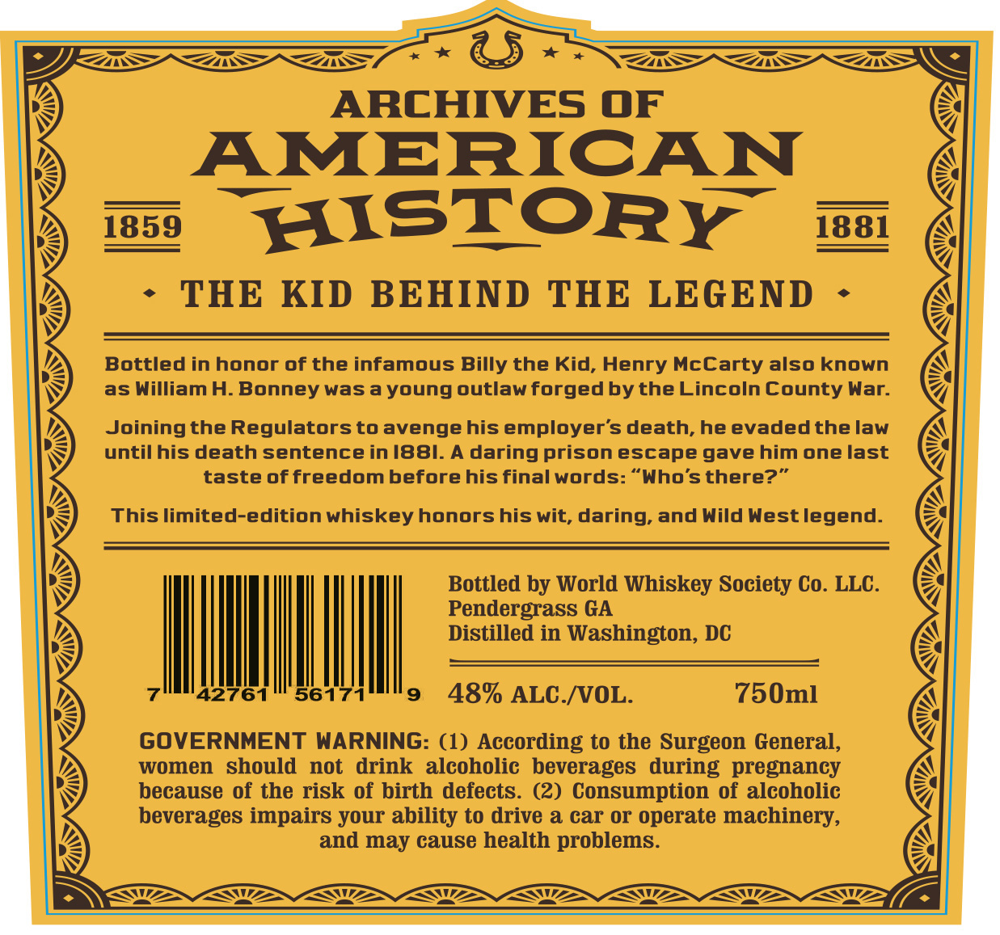
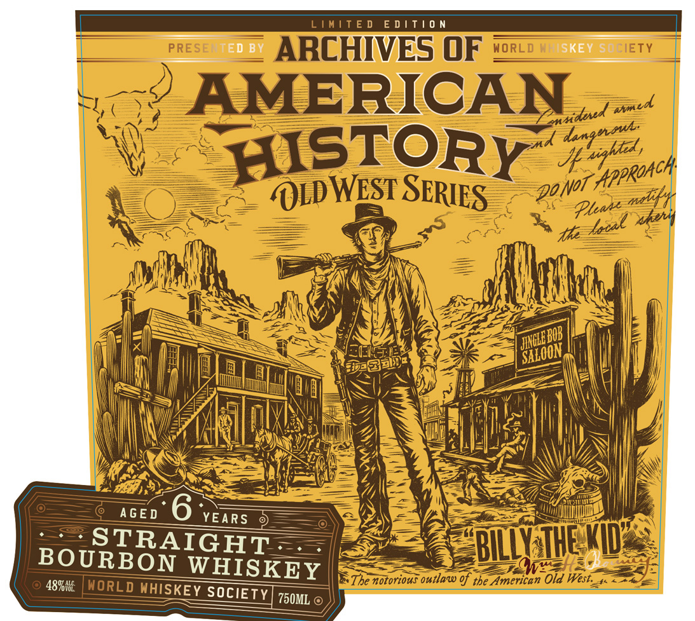
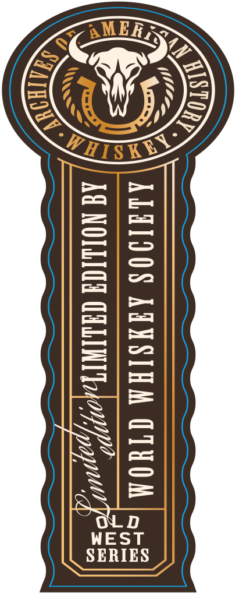
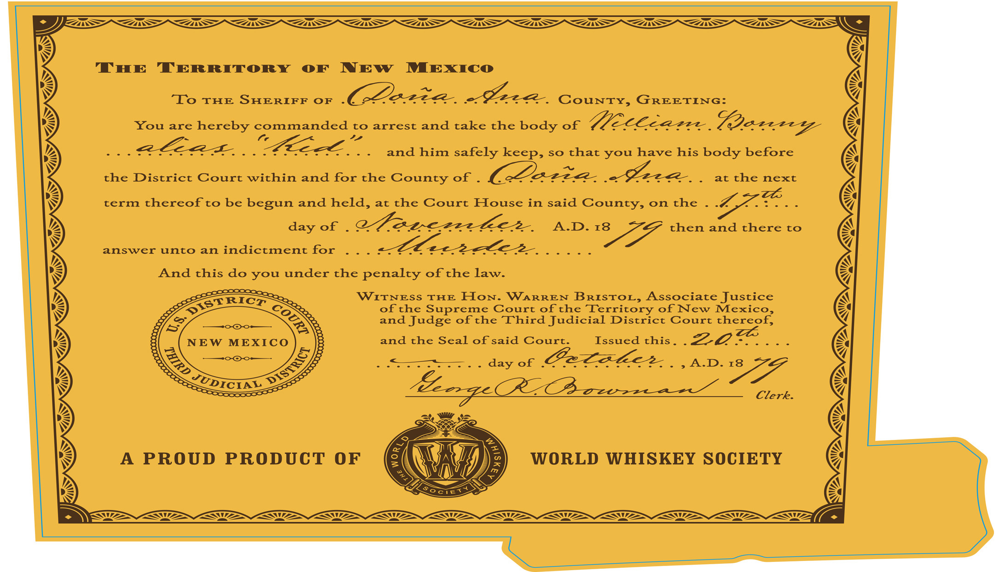

# TTB COLA Label Images - TTBID 26316001000197

**Brand Name:** ARCHIVES OF AMERICAN HISTORY

**Issue Date:** 11/17/2026

**Origin Code:** 08

**Product Class/Type:** 101

**Source:** [TTB Public COLA Registry](https://ttbonline.gov/colasonline/viewColaDetails.do?action=publicFormDisplay&ttbid=26316001000197)

## Label Images

### Back Label

### Front Label

### Label 3

### Label 4

## Extracted Label Text

*Text extracted via OCR - may contain errors*

**Detected Proof:** 96
**Detected Age:** 6 Years

### Back Label

ARCHIVES OF

AMERICAN
= PBISTORY

- THE KID BEHIND THE LEGEND -

Bottled in honor of the infamous Billy the Kid, Henry McCarty also known
as William H. Bonney was a young outlaw forged by the Lincoln County War.

Joining the Regulators to avenge his employer's death, he evaded the law
until his death sentence in I88I. A daring prison escape gave him one last
taste of freedom before his final words: “Who's there?”

This limited-edition whiskey honors his wit, daring, and Wild West legend.

Bottled by World Whiskey Society Co. LLC.
Pendergrass GA
Distilled in Washington, DC

742761" 56171"""9 48% ALC./VOL. 750ml

GOVERNMENT WARNING: (1) According to the Surgeon General,

women should not drink alcoholic beverages during pregnancy

because of the risk of birth defects. (2) Consumption of alcoholic

beverages impairs your ability to drive a car or operate machinery,
and may cause health problems.

1
VNINNN NRO

AW

### Front Label

LimITE D
E D |T|0
PRESE
TED BY
ARCHIVES OF
WORLD Wi IETy
AMERICAN
HISTORY
@LDWEST Z
20 ,
Plean mIh
AGE D
6
YEARS
STRAIGHT .
buiy tHeKW
BOURBON WHISKEY
r7
The notorious Outlar %f the Americen Old West: 4
48%8E |WoRLD WHISKEY SOCIETY
750ML
aved
Snsidevd
danansu;
Jf"ohtd ,
"APPROAcH;
Not >
SERIES
Aet
Iscal
(JINGLEBOB |
SALOON

### Label 3

S\e\\ ALTOS ATUSTHM CTUOM |n

1 NOTION OALINTT 27 /Py nae fP=E

### Label 4

THE
TERRITORY
OF
NEw
MEXIco
To THE SHERIFF
OF
2224&.
8R.
CouNTY, GREETING:
You
are
hereby commanded
to arrest and take the body of
Tresetr %oarr%
2224.
and him safely keep, so that you have his
body before
the District Court within and for the County of
3222
9R-
at the next
T
term thereofto be
begun and held, at the Court House in said County, on the
of
2/2292422.
A.D_
18
then and there
to
answer
unto
an indictment for
{427422
And this do you under the
penalty ofthe law-
WITNESS
THE
HoN- WARREN BRISTOL, Associate Justice
ofthe
Supreme Ceurt ofthe Territory of New Mexice?
and Judge ofthe Third Judicial District Court thereof;
NEW
MEXICO
and the Seal of said Court-
Issued this .
87ze
A.D. 18
2ZuzeLAL
Clerk-
A
PROUD PRODUCT
OF
WORLD WHISKEY SOCIETY
day
CeO
SETRCT
1
3
2234
0
DISTRICS
of
day
JUDICIAL
He2g
0
m
