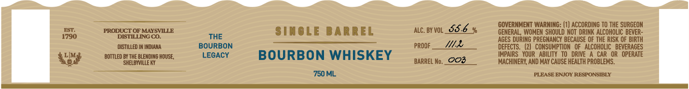
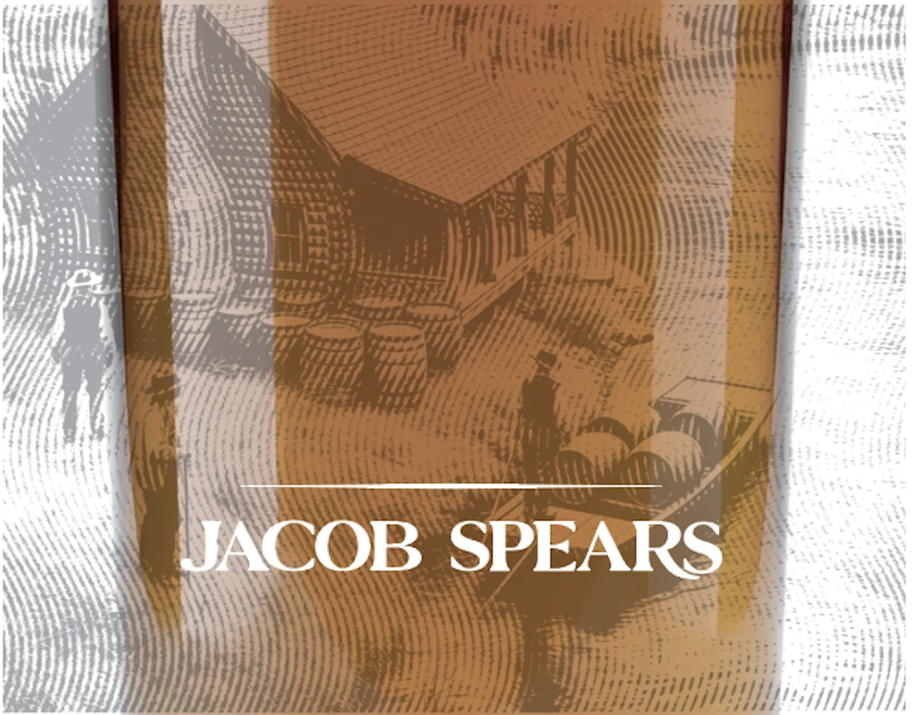
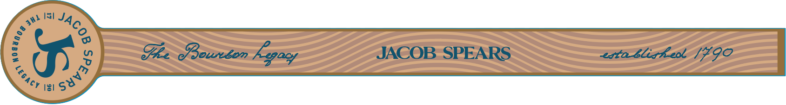
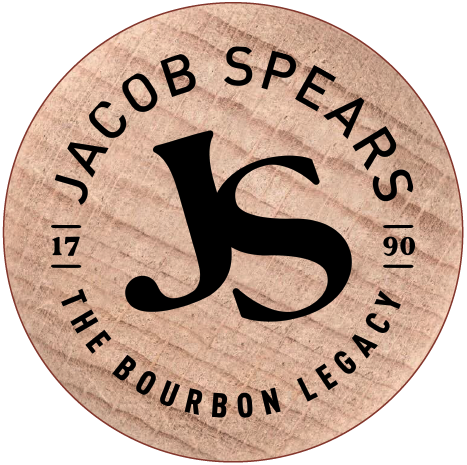

# TTB COLA Label Images - TTBID 26316001000243

**Brand Name:** JACOB SPEARS

**Fanciful Name:** SINGLE BARREL BOURBON WHISKEY

**Issue Date:** 11/17/2026

**Origin Code:** 22

**Product Class/Type:** 141

**Source:** [TTB Public COLA Registry](https://ttbonline.gov/colasonline/viewColaDetails.do?action=publicFormDisplay&ttbid=26316001000243)

## Label Images

### Label 1

### Label 2

### Label 3

### Label 4

## Extracted Label Text

*Text extracted via OCR - may contain errors*

*2 image(s) excluded: text did not meet readability threshold*

### Label 1

55.6
GOVERNMENT WARNING: (1) ACCORDING TO THE SURGEOH
PRODUCT OF MAYSVILLE
SNOLE BARREL
ALC. BY VOL _
GENERAL, WOMEN SHOULD NOT DRINK ALCOHOLIC BEVER-
1790
DISTILING CO:
THE
AGES DURING PREGHANCY BECAUSE OF THE RISK OF BIRTH
DISTILLED IN INDIANA
BOURBON
PROof
IILk
DEFECTS_
CONSUMPTION  OF   ALCOHOLIC   BEVERAGES
BOTTLED BY THE BLEMOING HOUSE,
LEGACY
BOURBON WHISKEY
IMPAIRS
VOUR   ABILITY
TO   DRIVE
CAR  OR
OPERATE
SHELBWVILLE KY
BARREL No._0Q3
MACHINERY, AND MAY CAUSE HEALTH PROBLEMS
750 ML
PLEASE ENJOY RESPONSIBLY

### Label 3

I5i
3
Sh couekom Fgocy
JACOB SPEARS
eta BlisAeol /790
131
JACOB
10
{
)
legacv
