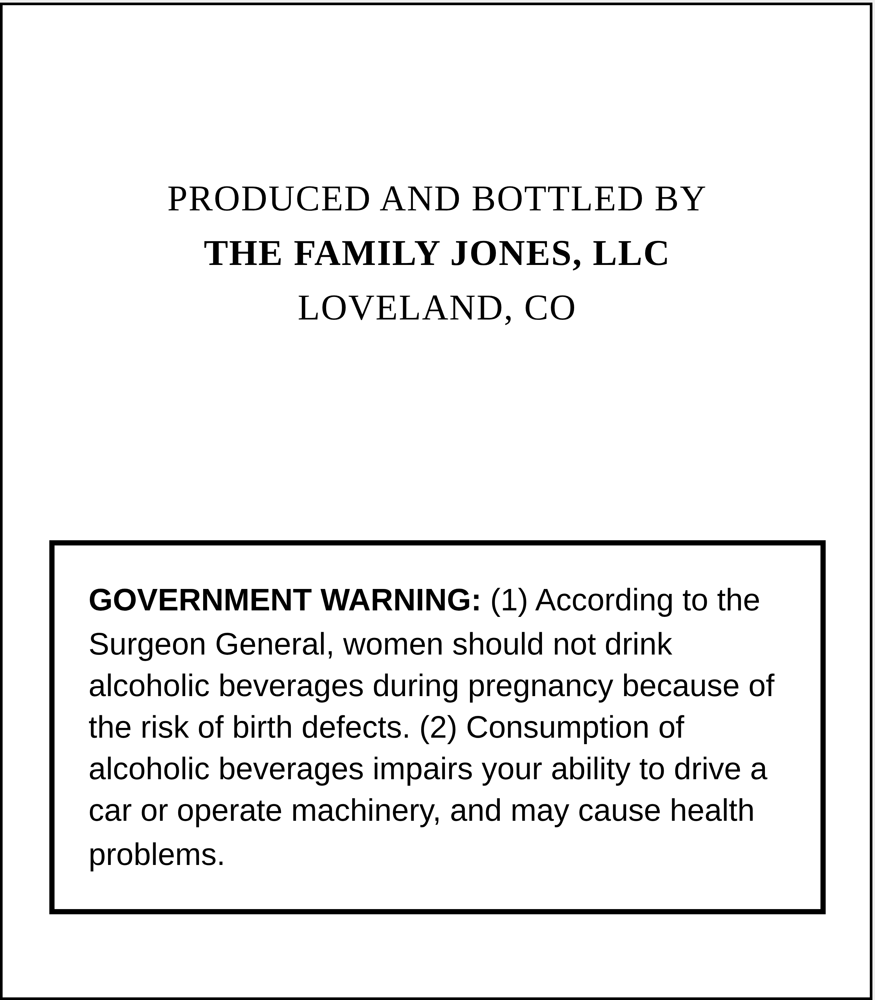
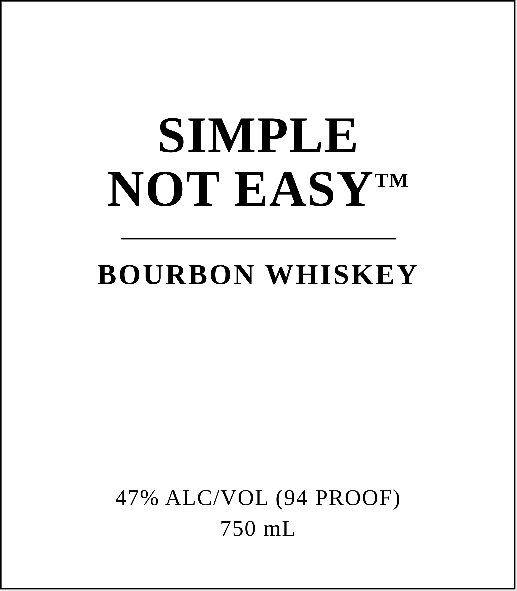

# TTB COLA Label Images - TTBID 26316001000332

**Brand Name:** SIMPLE NOT EASY

**Issue Date:** 11/17/2026

**Origin Code:** 13

**Product Class/Type:** 141

**Source:** [TTB Public COLA Registry](https://ttbonline.gov/colasonline/viewColaDetails.do?action=publicFormDisplay&ttbid=26316001000332)

## Label Images

### Back Label

### Front Label

## Extracted Label Text

*Text extracted via OCR - may contain errors*

**Detected Proof:** 94

### Back Label

PRODUCED AND BOTTLED BY

THE FAMILY JONES, LLC

LOVELAND, CO

GOVERNMENT WARNING: (1) According to the

Surgeon General, women should not drink

alcoholic beverages during pregnancy because of

the risk of birth defects. (2) Consumption of

alcoholic beverages impairs your ability to drive a

Car or operate machinery, and may cause health

problems.

### Front Label

SIMPLE
NOT EASYTM
BOURBON
WHISKEY
47% ALCIVOL (94 PROOF)
750 mL
