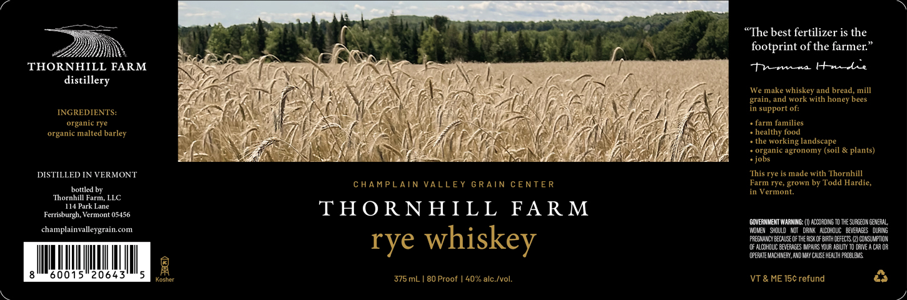

# TTB COLA Label Images - TTBID 26316001000375

**Brand Name:** THORNHILL FARM

**Issue Date:** 11/16/2026

**Origin Code:** 46

**Product Class/Type:** 142

**Source:** [TTB Public COLA Registry](https://ttbonline.gov/colasonline/viewColaDetails.do?action=publicFormDisplay&ttbid=26316001000375)

## Label Images

### Label 1

## Extracted Label Text

*Text extracted via OCR - may contain errors*

**Detected Proof:** 80

### Label 1

~The best fertilizer is the
footprint of the farmer:
THORNHILL FARM
Tnmaa Hu::
distillery
We make whiskey and bread, mill
grain, and work with honey bees
INGREDIENTS:
in support of:
organic rye
arm families
organic malted barley
healthy food
the working
landscape
organic agronomy (soil & plants)
jobs
DISTILLED IN VERMONT
This rye is made with Thornhill
CHAMPLAIN VALLEY
G RAIN CENTE R
Farm rye;
by Todd Hardie,
bottled by
in Vermont.
Thornhill Farm, LLC
14 Park Lane
THO RN HILL
FARM
Ferrisburgh, Vermont 05456
GONERMMEMT WARNING:
ALCALING TO IHE SuFGeoh generaL
champlainvalleygrain com
MOME
NcuLD = NOT   DPINK   NDhouc   bevePIGES   durILG
rye whiskey
FEEGRNLY BeCauSE €F THE RIS @F BIRIH @eFECTS (2) colsunpnoy
CF ACFOUC E veFages MPAIRS YO JA AELUT T0 @aMV A Ca OR
CFcFaTE WUACHNER, AND May CALGE HEALTH pfCeLBS
60015
2064
A
375 mL
80 Proof
40% alc Ivol.
VT & ME I5c refund
erown
Koshcr
