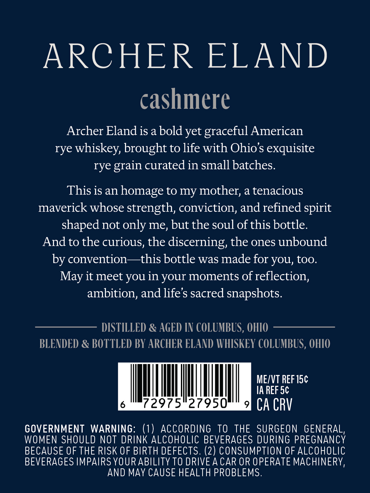
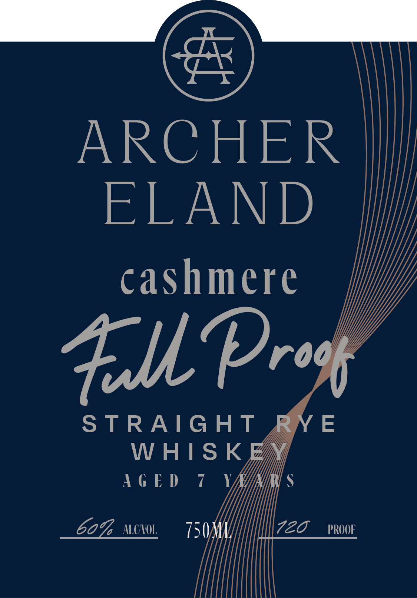

# TTB COLA Label Images - TTBID 26316001000431

**Brand Name:** ARCHER ELAND

**Fanciful Name:** CASHMERE

**Issue Date:** 11/17/2026

**Origin Code:** 09

**Product Class/Type:** 102

**Source:** [TTB Public COLA Registry](https://ttbonline.gov/colasonline/viewColaDetails.do?action=publicFormDisplay&ttbid=26316001000431)

## Label Images

### Back Label

### Front Label

## Extracted Label Text

*Text extracted via OCR - may contain errors*

### Back Label

ARCHER
ELAND
cashmere
Archer Eland is a bold yet graceful American
rye whiskey, brought to life with Ohios exquisite
rye
curated in small batches:
This is an
homage to my mother; a tenacious
maverick whose strength; conviction, and refined spirit
shaped not only me; but the soul ofthis bottle:
And to the curious, the discerning, the ones unbound
by convention
this bottle was made for yOU, too:
it meet you in your moments of reflection,
ambition, and lifes sacred snapshots.
DISTILLED & AGED IN COLUMBUS, OHIO
BLENDED & BOTTLED BY ARCHER ELAND WHISKEY COLUMBUS, OHIO
ME/VT REF I5c
IA REF 5c
2975"27950
CA CRV
GOVERNMENT
WARNING:
(1)
ACCORDING
TO
THE
SURGEON
GENERAL,
WOMEN SHOULD NOT DRINK ALCOHOLIC BEVERAGES DURING PREGNANCY
BECAUSE OF THE RISK OF BIRTH DEFECTS. (2) CONSUMPTION OF ALCOHOLIC
BEVERAGES IMPAIRS YOURABILITY TO DRIVEA CAR OR OPERATE MACHINERY,
AND MAY CAUSE HEALTH PROBLEMS.
grain
May

### Front Label

moe)
ARCHER
ELAND

cashmere

STRAIGHT MVE

\

AGED 7 \
60% Novo  75(4 720 vROOF
