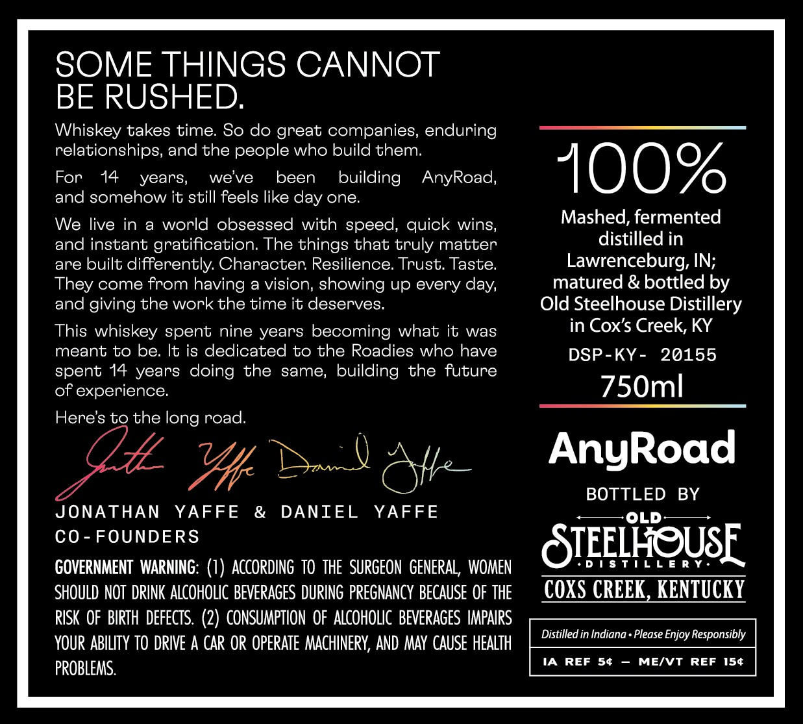
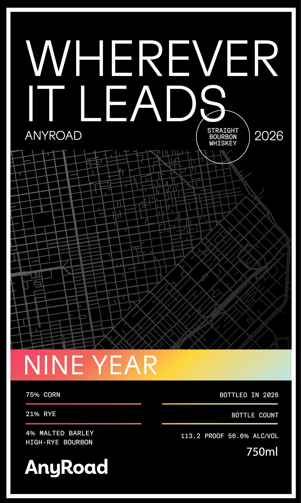

# TTB COLA Label Images - TTBID 26316001000453

**Brand Name:** ANYROAD

**Issue Date:** 11/20/2026

**Origin Code:** 22

**Product Class/Type:** 101

**Source:** [TTB Public COLA Registry](https://ttbonline.gov/colasonline/viewColaDetails.do?action=publicFormDisplay&ttbid=26316001000453)

## Label Images

### Back Label

### Front Label

## Extracted Label Text

*Text extracted via OCR - may contain errors*

**Detected Proof:** 113.2
**Detected Age:** 14 Years

### Back Label

SOME THINGS CANNOT

BE RUSHED

Whiskey takes time. So do great companies, enduring

relationships, and the people who build them

ixels

14 years,

weve

been

building AnyRoad

100%

and somehow it still feels like day one

We live in a world obsessed with speed, quick wins

Mashed, fermented

distilled in

and instant gratification. The things that truly matter

are built differently. Character. Resilience. Trust. Taste.

Lawrenceburg, IN

They come from having a vision, showing up every day,

matured & bottled by

and giving the work the time it deserves.

Old Steelhouse Distillery

This whiskey spent nine years becoming what it was

in Cox's Creek, KY

meant to be. It is dedicated to the Roadies who have

DSP-KY- 20155

spent 14 years doing the same, building the future

of experience.

750ml

Here's to the long road

AnyRoad

pe > Atte

aaone BY

JONATHAN YAFFE & DANIEL YAFFE

CO-FOUNDERS

Ell 4OUS

GOVERNMENT WARNING: (1)

ACCORDING TO THE SURGEON GENERAL, WOMEN OIFEI

DISTILLER

a

SHOULD NOT DRINK ALCOHOLIC BEVERAGES DURING PREGNANCY BECAUSE OF THE

COXS CREEK, KENTUCKY

RISK OF BIRTH DEFECTS. (2) CONSUMPTION OF ALCOHOLIC BEVERAGES IMPAIRS

YOUR ABILITY TO DRIVE A CAR OR OPERATE MACHINERY, AND MAY CAUSE HEALTH

Distilled in Indiana « Please Enjoy Responsibly

PROBLEMS

IA REF 5¢ — ME/VT REF 15¢

### Front Label

WHEREVER
IT LEADS
STRAIGHT
ANYROAD
BOURBON
2026
WHISKEY
NINE YEAR
75%  CORN
BOTTLED
IN
2026
21%
RYE
BOTTLE
COUNT
4%   MALTED
BARLEY
113.2
PROOF
56 . 6% ALCIVOL
HIGH-RYE
BOURBON
750ml
AnyRoad
