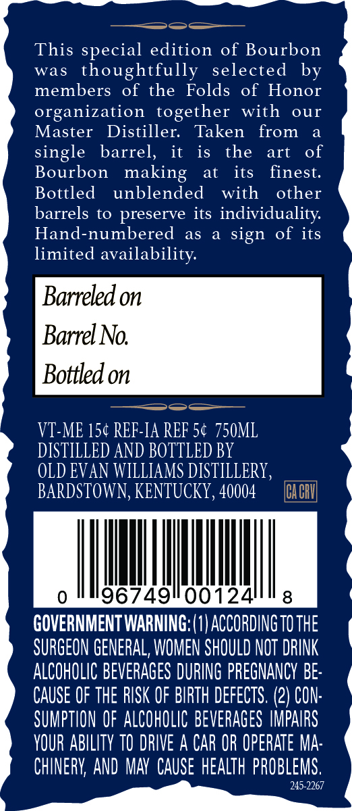
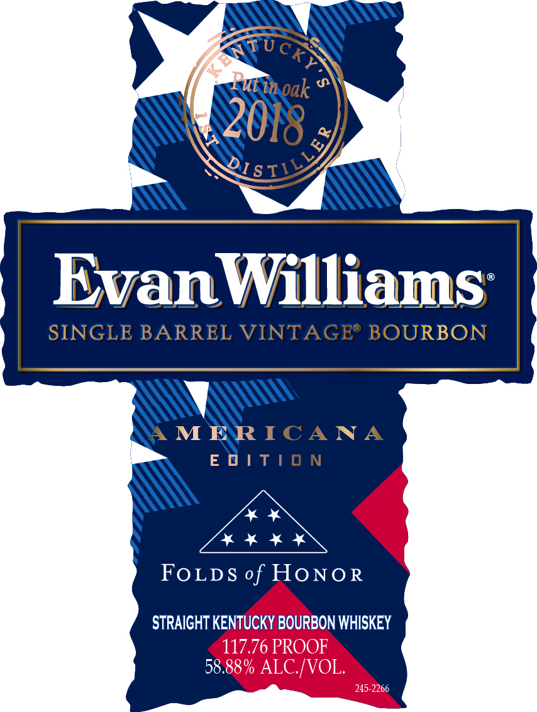

# TTB COLA Label Images - TTBID 26317001000038

**Brand Name:** EVAN WILLIAMS

**Fanciful Name:** SINGLE BARREL AMERICANA EDITION

**Issue Date:** 11/18/2026

**Origin Code:** 22

**Product Class/Type:** 101

**Source:** [TTB Public COLA Registry](https://ttbonline.gov/colasonline/viewColaDetails.do?action=publicFormDisplay&ttbid=26317001000038)

## Label Images

### Back Label

### Label 1

## Extracted Label Text

*Text extracted via OCR - may contain errors*

### Back Label

This
special edition of Bourbon
was
thoughtfully
selected
by
members
of
the
Folds
of
Honor
organization together
with
our
Master
Distiller:
Taken
from
single
barrel,
it
is
the
art
of
Bourbon
making
at
its
finest_
Bottled
unblended
with
other
barrels
to
preserve its individuality
Hand-numbered
as
sign
of its
limited availability
Barreled on
Barrel No
Bottled on
VT-ME 154 REF-IA REF 54 750ML
DISTILLED AND BOTTLED BY
OLD EVAN WILLIAMS DISTILLERY ,
BARDSTOWN, KENTUCKY,40004
Ica CbV}
96749
00124
8
GOVERNMENT WARNING: (1| ACCORDING TO ThE
SURGEON GENERAL; WOMEN SHOULD NOT DRINK
ALCOHOLIC BEVERAGES DURING PREGNANCY Be:
CAUSE OF THE RISK OF BIRTH DEFECTS. (2) CON:
SUMPTHON OF AlCohOLIC BEVERAGeS IMPAIRS
YOUR ABILITY TO dRIVE A CAR OR OPERATE Ma:
CHINERV AND MAV  CAUSe HeALTh PROBLEMS.
245-2267

### Label 1

me Ucss
waoak ° VY
ROS ;
Wis YY
SINGLE BARREL VINTAGE® BOURBON

AMERICANA

EDITION )
FOLDS of HONOR
STRAIGHT KENTUCKY BOURBON WHISKEY

58.
