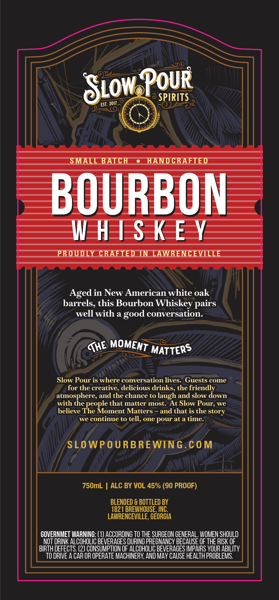

# TTB COLA Label Images - TTBID 26317001000052

**Brand Name:** SLOW POUR SPIRITS

**Issue Date:** 11/19/2026

**Origin Code:** 08

**Product Class/Type:** 141

**Source:** [TTB Public COLA Registry](https://ttbonline.gov/colasonline/viewColaDetails.do?action=publicFormDisplay&ttbid=26317001000052)

## Label Images

### Label 1

## Extracted Label Text

*Text extracted via OCR - may contain errors*

**Detected Proof:** 90

### Label 1

SLow Pour
SPIRITS
EST . 2017
SMALL BATCH
HAND CRAFTED
BOURBON
W H I $ K E Y
PR OUDLY
CRAFTED IN
LAWRENCEVILLE
Aged in New American white oak
barrels, this Bourbon Whiskey
well with a good conversation.
MATTERS
Slow Pour is where conversation lives. Guests come
for the creative, delicious drinks, the friendly
atmosphere; and the chance to laugh and slow down
with the people that matter most. At Slow Pour; we
believe The Moment Matters
and that is the story
we continue to tell, one pour at a time:
SLOWPO URBREWING.C0M
750mL
ALC BY VOL 45% (90 PROOF)
BLENDED & BOTTLED BY
1821 BREWHOUSE, INC
LAWRENCEVILLE, GEORGIA
GOVERNMET WARNING: (1) ACCORDING TO THE SURGEON GENERAL, WOMEN SHOULD
NOT DRINK ALCOHOLIC BEVERAGES DURING PREGNANCY BECAUSE OF THE RISK OF
BIRTH DEFECTS. (2) CONSUMPTION OF ALCOHOLIC BEVERAGES IMPAIRS YOUR ABILITY
TO DRIVE A CAR OR OPERATE MACHINERY, AND May CAUSE HEALTH PROBLEMS.
pairs
MOMENT
THE
