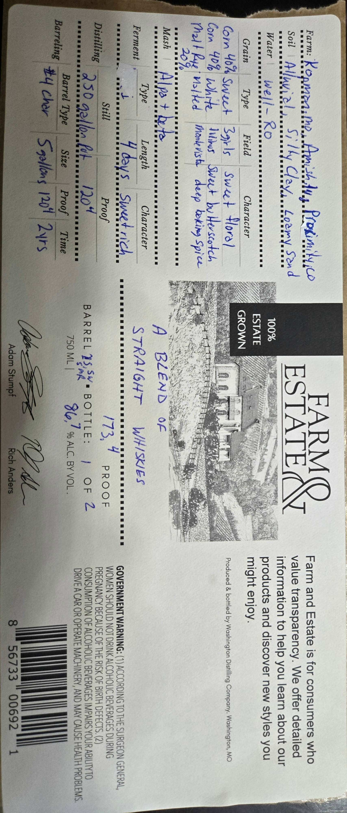

# TTB COLA Label Images - TTBID 26317001000061

**Brand Name:** FARM & ESTATE

**Issue Date:** 11/18/2026

**Origin Code:** 29

**Product Class/Type:** 120

**Source:** [TTB Public COLA Registry](https://ttbonline.gov/colasonline/viewColaDetails.do?action=publicFormDisplay&ttbid=26317001000061)

## Label Images

### Label 1

## Extracted Label Text

*Text extracted via OCR - may contain errors*

### Label 1

ae bide Ateralg LE eke Ld?

Water' jy a RO
‘: Grain | Type Field | Character

Coin Yh Sect ays | Sweet tora)
Corn 410%, Whrte Jidns Sweet by Dou

(he } al | His/ ded th lerede Ast ae 2tp hekiisg Spi Ce.

e Length Character ERE Ps HISerIC
eet S aay STRAIGHT = WHISKIES
x Suetcich,. ee ee eee eee ee ee
“oof £73. 1 pRoor
RREL 95,5¥" BOTTLE: } OF Z

ats ag
50 ML |

= 3b, Top auc, 8 VOL

Farm and Estate is for consumers who
value transparency. We offer detailed
information to help you learn about our
products and discover new styles you
might enjoy.

Produced & bottled by Washington Distilling Company. Washington, MO

GOVERNMENT WARNING: (1) ACCORDING 10 THE SURGEON GENERAL,
WOMEN SHOULD NOT DRINKALCOHOLIC BEVERAGES DURING

PREGNANCY BECAUSE OF THE RISK OF BIRTH DEFECTS. (2)

CONSUMPTION OF ALCOHOLIC BEVERAGES IMPAIRS YOUR ABILITY 10
DRIVEACAR OR OPERATE MACHINERY, AND MAY CAUSE HEALTH PROBLEMS.
