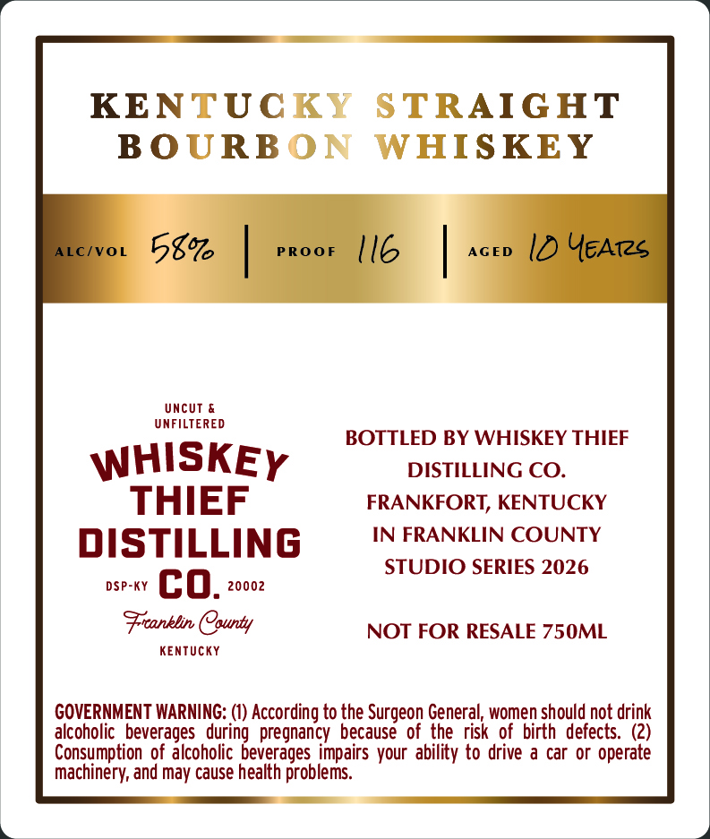
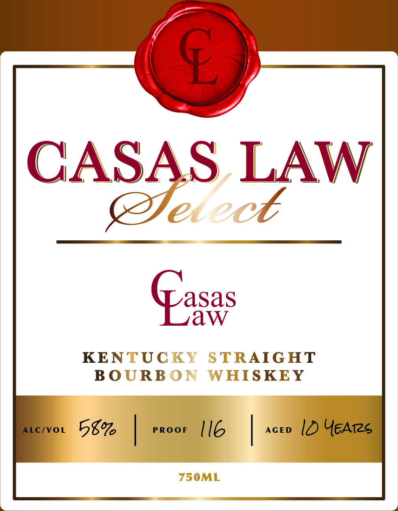

# TTB COLA Label Images - TTBID 26317001000144

**Brand Name:** WHISKEY THIEF DISTILLING CO.

**Fanciful Name:** CASAS LAW

**Issue Date:** 11/18/2026

**Origin Code:** 22

**Product Class/Type:** 101

**Source:** [TTB Public COLA Registry](https://ttbonline.gov/colasonline/viewColaDetails.do?action=publicFormDisplay&ttbid=26317001000144)

## Label Images

### Back Label

### Front Label

## Extracted Label Text

*Text extracted via OCR - may contain errors*

### Back Label

KENTUCKY STRAIGHT
BOURBON WHISKEY

UNCUT &

UNFILTERED
BOTTLED BY WHISKEY THIEF

WHISKEy DISTILLING CO.

THIEF FRANKFORT, KENTUCKY

DISTILLING IN FRANKLIN COUNTY
ssew CQ, won STUDIO SERIES 2026

Peake Cpeoty NOT FOR RESALE 750ML

KENTUCKY

GOVERNMENT WARNING: (1) According to the Surgeon General, women should not drink
alcoholic beverages during pregnancy because of the risk of birth defects. (2)
Consumption of alcoholic beverages impairs your ability to drive a car or operate
machinery, and may cause health problems.

### Front Label

CASAS LAW
etect
KENTUCKY
STRAIG HT
BOURB ON
WHISKEY
ALC/VOL
589
PROOF
1l6
AGED
ID YEATzs
750ML
Gesas
