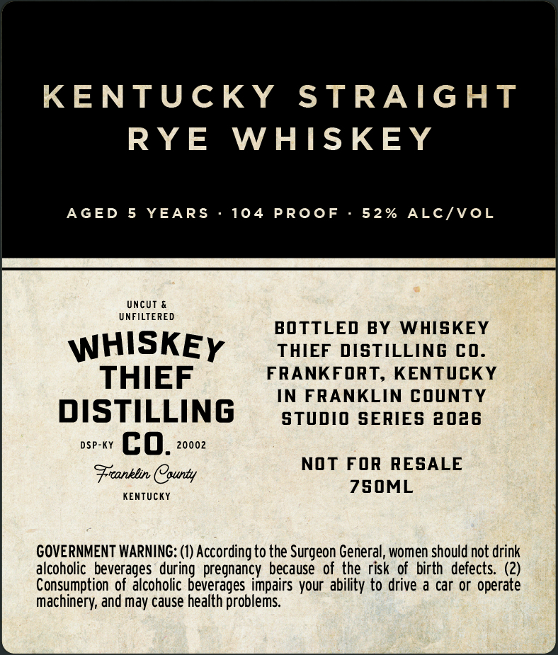
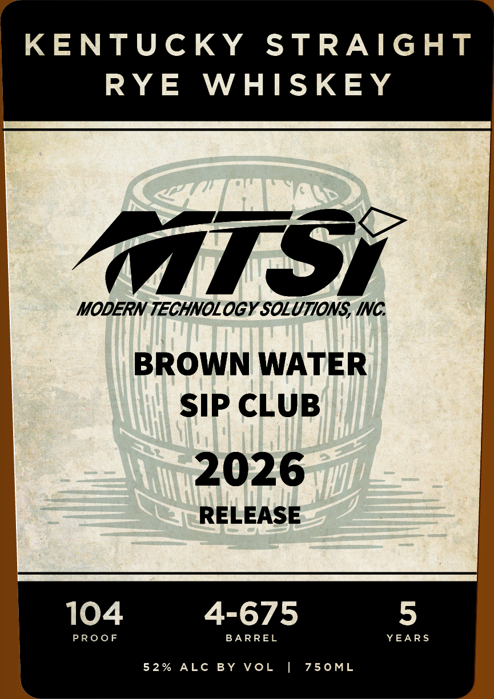

# TTB COLA Label Images - TTBID 26317001000150

**Brand Name:** WHISKEY THIEF DISTILLING CO.

**Fanciful Name:** MTSI

**Issue Date:** 11/18/2026

**Origin Code:** 22

**Product Class/Type:** 102

**Source:** [TTB Public COLA Registry](https://ttbonline.gov/colasonline/viewColaDetails.do?action=publicFormDisplay&ttbid=26317001000150)

## Label Images

### Back Label

### Front Label

## Extracted Label Text

*Text extracted via OCR - may contain errors*

**Detected Proof:** 104
**Detected Age:** 5 Years

### Back Label

KENTUCKY STRAIGHT

RYE WHISKEY

AGED 5 YEARS - 104 PROOF - 52% ALC/VOL

UNFILTERED

BOTTLED BY WHISKEY
WHISKEy © twier ostittine co.
THIEF FRANKFORT, KENTUCKY

IN FRANKLIN COUNTY

DISTILLING = stunio series 2oas
DSP-KY Co. 20002

Franklin County

KENTUCKY

NOT FOR RESALE
750ML

GOVERNMENT WARNING: (1) According to the Surgeon General, women should not drink
alcoholic beverages during pregnancy because of the risk of birth defects. (2)
Consumption of alcoholic beverages impairs your ability to drive a car or operate
machinery, and may cause health problems.

### Front Label

KENTUCKY STRAIGHT

RYE WHISKEY

Agri

MODERN TECHNOLOGY SOLUTIONS, INC.

BROWN WATER

SIP CLUB

2026

RELEASE

104

PROOF

4-675

BARREL

YEARS

5

52% ALC BY VOL | 750ML
