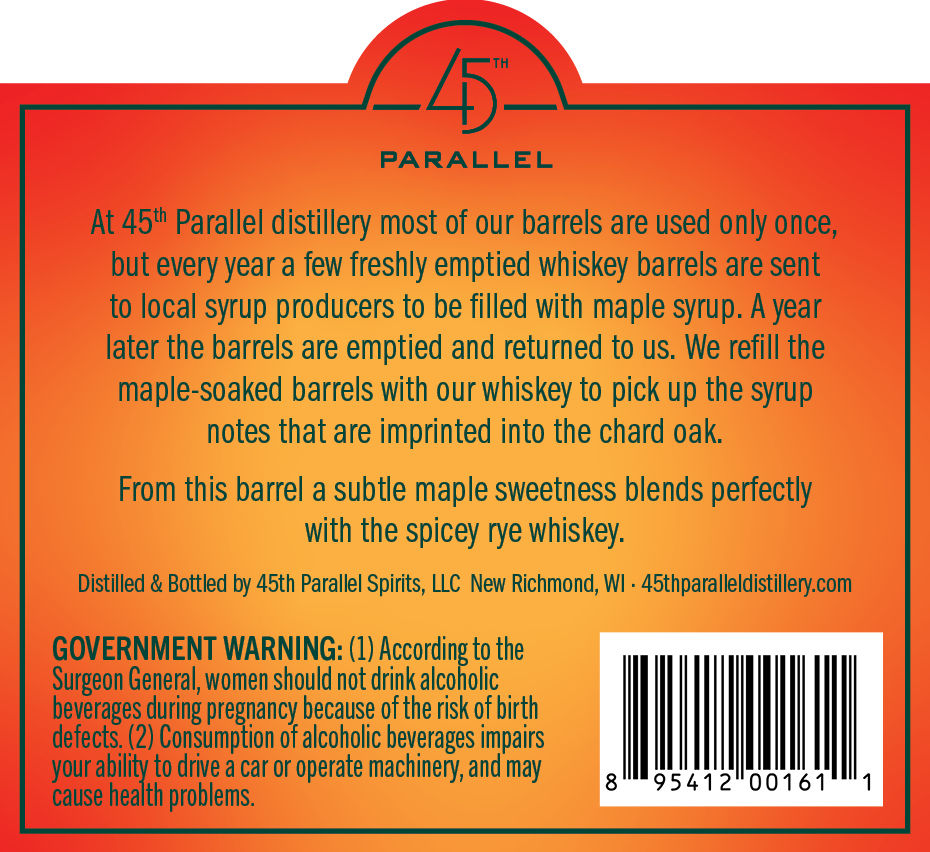
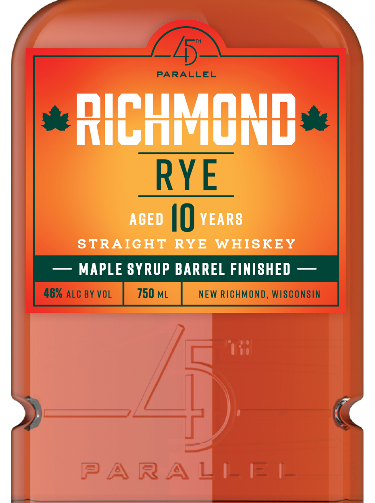

# TTB COLA Label Images - TTBID 26317001000179

**Brand Name:** 45TH PARALLEL

**Fanciful Name:** RICHMOND MAPLE SYRUP BARREL FINISHED

**Issue Date:** 11/18/2026

**Origin Code:** 48

**Product Class/Type:** 102

**Source:** [TTB Public COLA Registry](https://ttbonline.gov/colasonline/viewColaDetails.do?action=publicFormDisplay&ttbid=26317001000179)

## Label Images

### Back Label

### Label 1

## Extracted Label Text

*Text extracted via OCR - may contain errors*

**Detected Proof:** 92

### Back Label

PARALLEL

At 45" Parallel distillery most of our barrels are used only once,
but every year a few freshly emptied whiskey barrels are sent
to local syrup producers to be filled with maple syrup. A year
later the barrels are emptied and returned to us. We refill the

maple-soaked barrels with our whiskey to pick up the syrup
notes that are imprinted into the chard oak.

From this barrel a subtle maple sweetness blends perfectly
with the spicey rye whiskey.
Distilled & Bottled by 45th Parallel Spirits, LLC New Richmond, WI - 45thparalleldistillery.com

GOVERNMENT WARNING: (1) peony to the

Surgeon General, women should not drink alcoholic
beverages during pregnancy because of the risk of birth
defects. (2) Consumption of alcoholic beverages impairs
your ability to drive a car or operate machinery, and may
cause health problems.

### Label 1

PARALLEL
RichMONp=
RYE
AGED
(O vears
STRAIGHT
RYE
WHISKEY
MAPLE SYRUP BARREL FINISHED
46% ALC BY VOL
750 ML
NEW RichMOND, Wisconsin
PARAZ
_ = _
