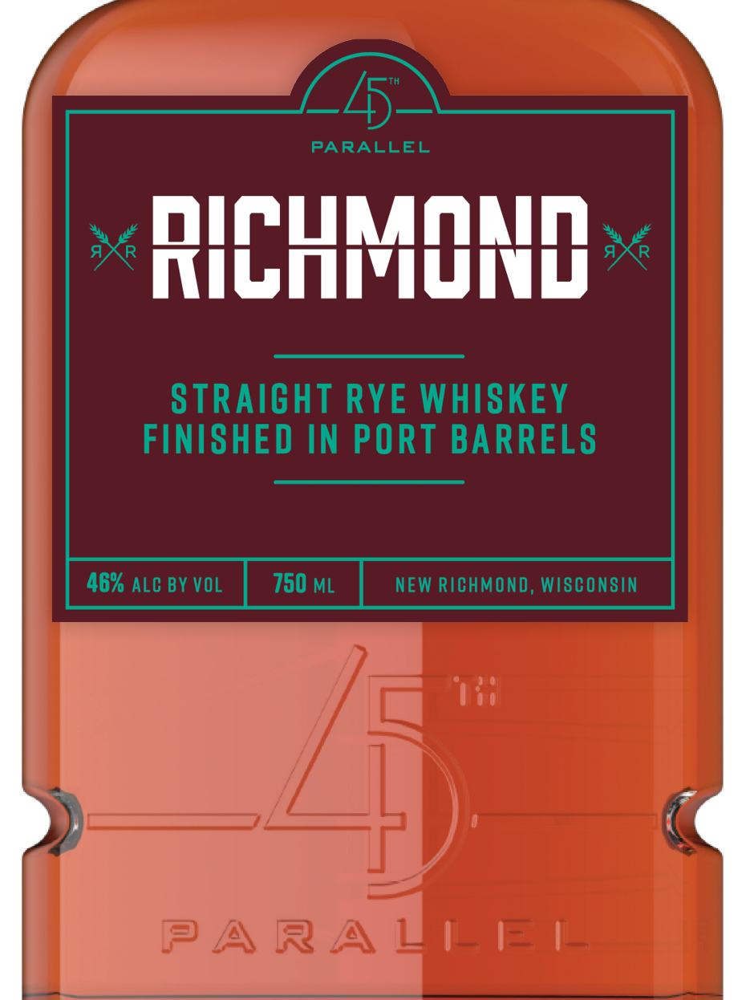
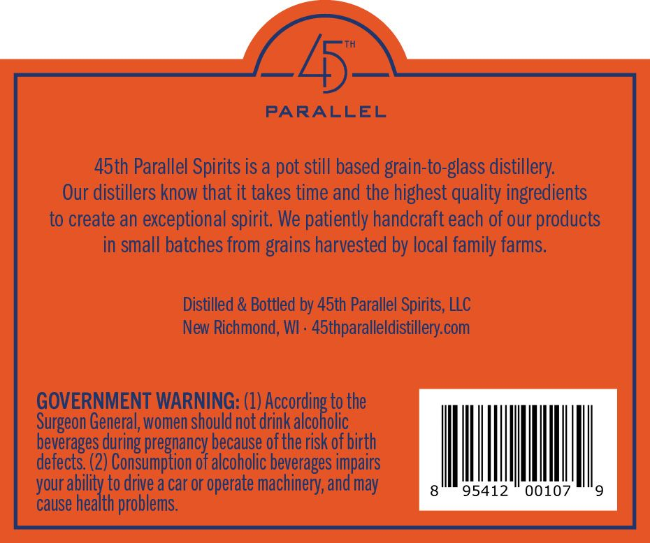

# TTB COLA Label Images - TTBID 26317001000184

**Brand Name:** 45TH PARALLEL

**Fanciful Name:** RICHMOND FINISHED IN PORT BARRELS

**Issue Date:** 11/18/2026

**Origin Code:** 48

**Product Class/Type:** 102

**Source:** [TTB Public COLA Registry](https://ttbonline.gov/colasonline/viewColaDetails.do?action=publicFormDisplay&ttbid=26317001000184)

## Label Images

### Front Label

### Label 2

## Extracted Label Text

*Text extracted via OCR - may contain errors*

### Front Label

Lives

ARALLEL

LEL

AIPLIAANAIN ..

NLAMIUNG

STRAIGHT RYE WHISKEY

FINISHED IN PORT BARRELS

Y

46% AL

NEW RICHMOND, WISCONSIN

### Label 2

PARALLEL

Adth Parallel Spirits is a pot still based grain-to-glass distillery.
Our distillers know that it takes time and the highest quality ingredients
to create an exceptional spirit. We patiently handcraft each of our products
in small batches from grains harvested by local family farms.

Distilled & Bottled by 45th Parallel Spirits, LLC
New Richmond, WI - 45thparalleldistillery.com

GOVERNMENT WARNING: (1) iors tothe

Surgeon General, women should not drink alcoholic
beverages during pregnancy because of the risk of birth
defects. (2) Consumption of alcoholic beverages impairs
your ability to drive a car or operate machinery, and may
cause health problems,
