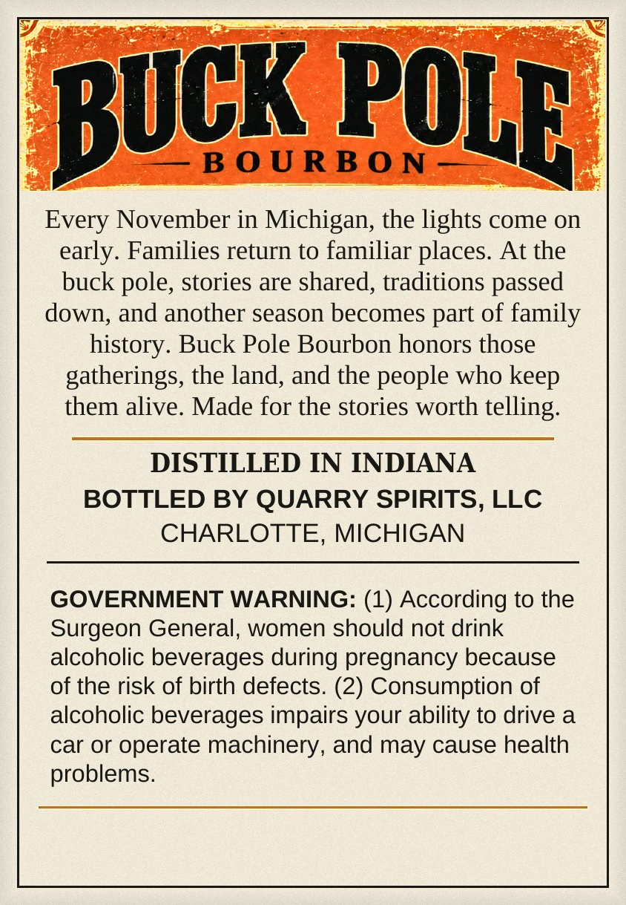
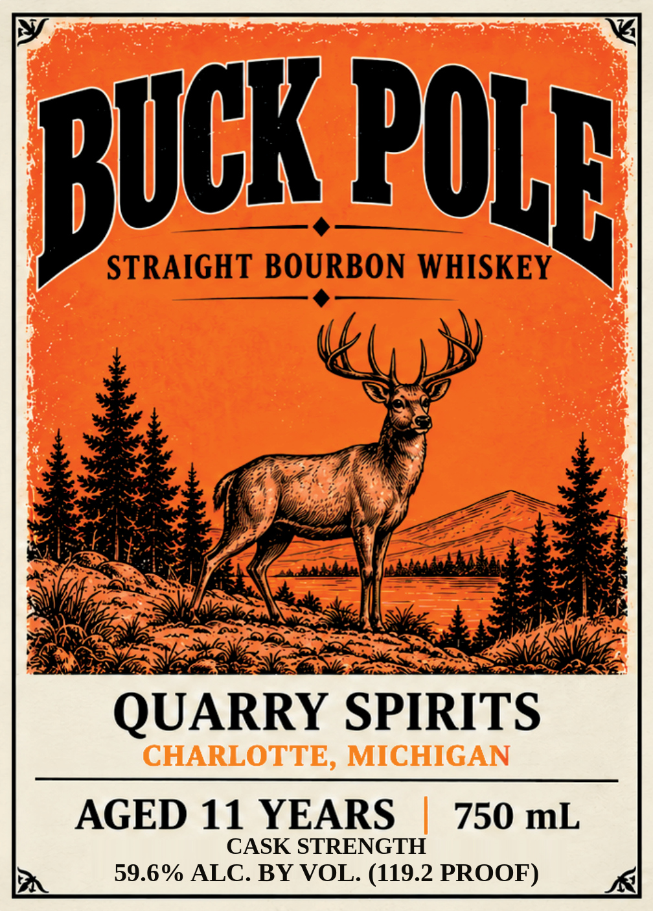

# TTB COLA Label Images - TTBID 26317001000621

**Brand Name:** BUCK POLE

**Fanciful Name:** CASK STRENGTH

**Issue Date:** 11/18/2026

**Origin Code:** 06

**Product Class/Type:** 101

**Source:** [TTB Public COLA Registry](https://ttbonline.gov/colasonline/viewColaDetails.do?action=publicFormDisplay&ttbid=26317001000621)

## Label Images

### Back Label

### Front Label

## Extracted Label Text

*Text extracted via OCR - may contain errors*

**Detected Proof:** 119.2
**Detected Age:** 11 Years

### Back Label

Pol

Every November in Michigan, the lights come on

early. Families return to familiar places. At the

buck pole, stories are shared, traditions passed

down, and another season becomes part of family

history. Buck Pole Bourbon honors those

gatherings, the land, and the people who keep

them alive. Made for the stories worth telling.

DISTILLED IN INDIANA

BOTTLED BY QUARRY SPIRITS, LLC

CHARLOTTE, MICHIGAN

GOVERNMENT WARNING: (1) According to the

Surgeon General, women should not drink

alcoholic beverages during pregnancy because

of the risk of birth defects. (2) Consumption of

alcoholic beverages impairs your ability to drive a

car or operate machinery, and may cause health

problems.

### Front Label

STRAIGHT BOURBON WHISKEY
QUARRY SPIRITS
CHARLOTTE, MICHIGAN
AGED 11 YEARS
750 mL
CASK STRENGTH
59.6% ALC. BY VOL. (119.2 PROOF)
Buck
POLP
