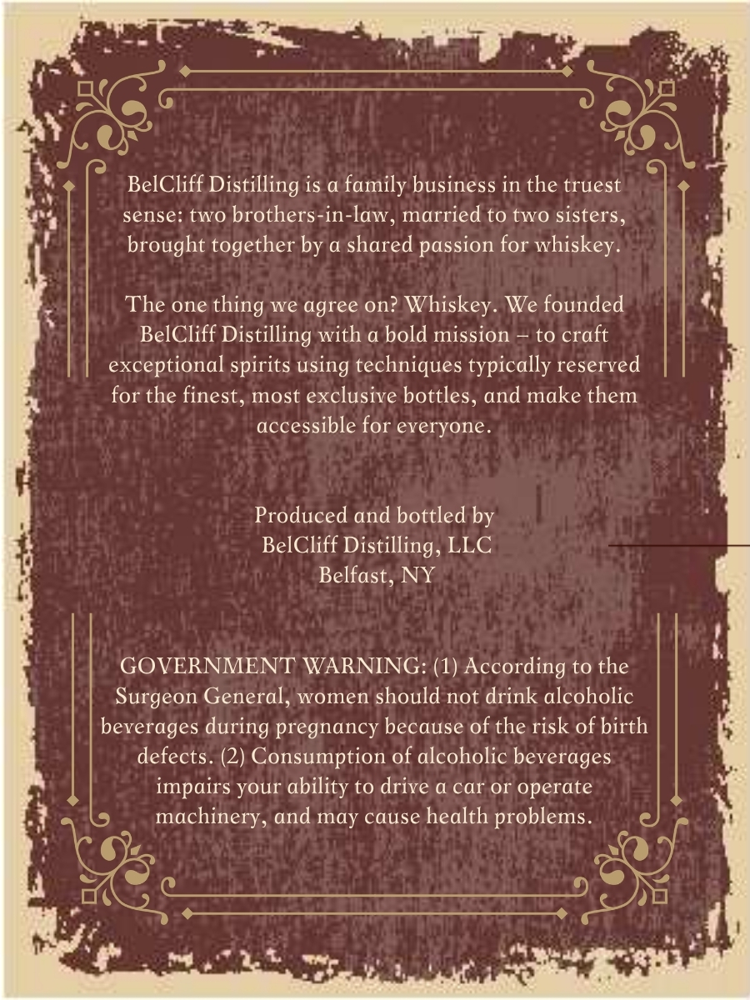
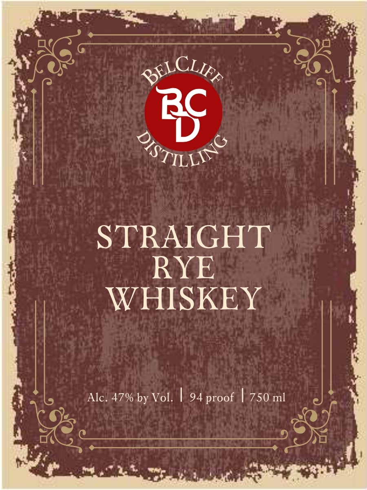

# TTB COLA Label Images - TTBID 26318001000054

**Brand Name:** BELCLIFF DISTILLING

**Issue Date:** 11/19/2026

**Origin Code:** 02

**Product Class/Type:** 102

**Source:** [TTB Public COLA Registry](https://ttbonline.gov/colasonline/viewColaDetails.do?action=publicFormDisplay&ttbid=26318001000054)

## Label Images

### Back Label

### Front Label

## Extracted Label Text

*Text extracted via OCR - may contain errors*

*1 image(s) excluded: text did not meet readability threshold*

### Back Label

BelCliff Distilling is a family business in the truest
sense: two brothers-in-law_
married t0 two sisters,
brought together by a shared passion for whiskey
The one
we agree on? Whiskey: We founded
BelCliff Distilling with a bold mission
to craft
exceptional spirits uS
techniques typically reserred
for the finest, most exclusive bottles, and make them
accessible for ereryone_
Produced and bottled by
BelCliff Distilling, LLC
Belfast, NY
GOVERNMENT WARNING: (1) According to the
Surgeon General, women should not drink alcoholic
beverages during pregnancy because of the risk of birth
defects. (2) Consumption of alcoholic bererages
impairs your ability to drire a car or operate
machinery, and may cause health problems__
thing
sing
