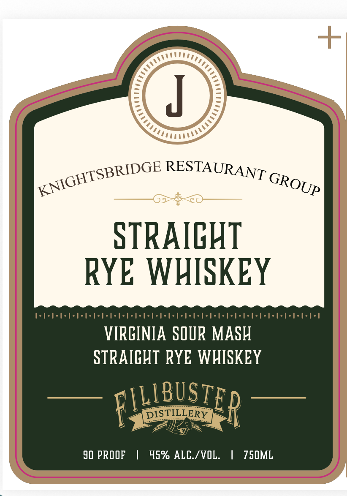
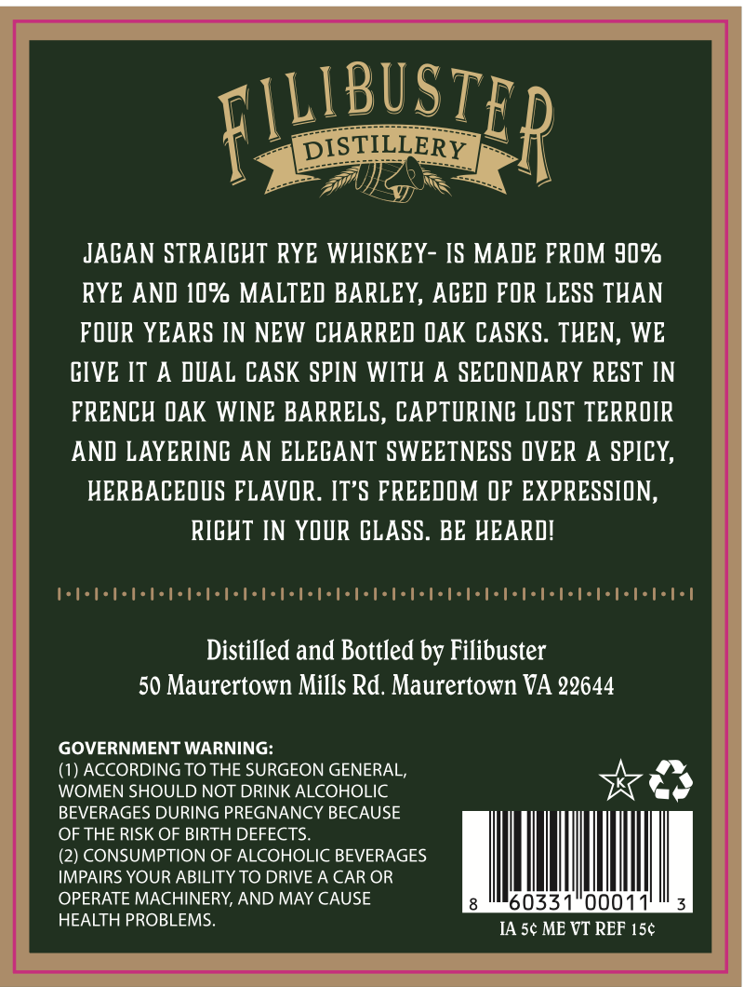

# TTB COLA Label Images - TTBID 26319001000036

**Brand Name:** FILIBUSTER

**Fanciful Name:** KNIGHTSBRIDGE RESTAURANT GROUP

**Issue Date:** 11/24/2026

**Origin Code:** 05

**Product Class/Type:** 102

**Source:** [TTB Public COLA Registry](https://ttbonline.gov/colasonline/viewColaDetails.do?action=publicFormDisplay&ttbid=26319001000036)

## Label Images

### Label 1

### Label 2

## Extracted Label Text

*Text extracted via OCR - may contain errors*

**Detected Proof:** 90

### Label 1

4
RESTAURANT _
STRAICHT
RYE WHISKEY
1*'
VIRGINIA SOUR MASH
STRAICHT RYE WHISKEY
DISTILLERY
p
90 PROOF
45% ALC_/VOL.
750ML
KNIGHTSBRIDGE
GROUP
FLLBUSTE

### Label 2

FILBUSTEE
DISTILLERY
p
JACAN STRAICHT RYE WHISKEY- IS MADE FROM 90%
RYE AND 10% MALTED BARLEY, ACED FOR LESS THAN
FOUR YEARS IN NEW CHARRED QAK CASKS. THEN, WE
CIVE IT
A DUAL CASK SPIN WITH
A SECONDARY REST IN
FRENCH OAK WINE BARRELS, CAPTURINC LOST TERROIR
AND LAYERINC AN ELECANT SWEETNESS QVER A SPICY,
HERBACEOUS FLAVOR. IT'S FREEDOM OF EXPRESSION,
RICHT IN YOUR GLASS. BE HEARDI
Distilled and Bottled by Filibuster
50 Maurertown Mills Rd. Maurertown VA 22644
GOVERNMENT WARNING:
(1) ACCORDING TO THE SURGEON GENERAL,
WOMEN SHOULD NOT DRINK ALCOHOLIC
BEVERAGES DURING PREGNANCY BECAUSE
OF THE RISK OF BIRTH DEFECTS
(2) CONSUMPTION OF ALCOHOLIC BEVERAGES
IMPAIRS YOUR ABILITY TO DRIVE A CAR OR
OPERATE MACHINERY, AND MAY CAUSE
60331
000
HEALTH PROBLEMS.
IA 5c ME VT REF 15c
