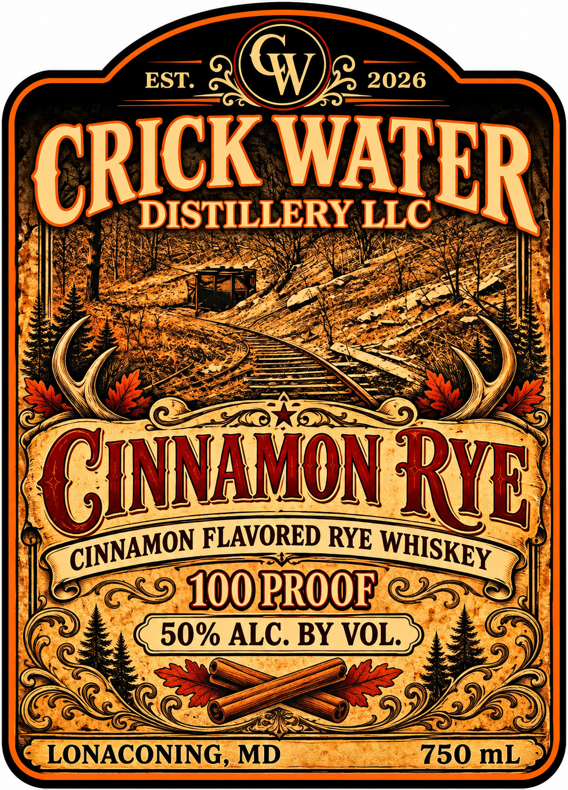

# TTB COLA Label Images - TTBID 26319001000052

**Brand Name:** CRICK WATER

**Fanciful Name:** CINNAMON RYE

**Issue Date:** 11/20/2026

**Origin Code:** 25

**Product Class/Type:** 149

**Source:** [TTB Public COLA Registry](https://ttbonline.gov/colasonline/viewColaDetails.do?action=publicFormDisplay&ttbid=26319001000052)

## Label Images

### Back Label

### Front Label

## Extracted Label Text

*Text extracted via OCR - may contain errors*

*1 image(s) excluded: text did not meet readability threshold*

### Back Label

Cinnamon Flavored Rye Whiskey
Base rye whiskey distilled in Indiana
Bottled by:
Grick Water Distillery LLG
Lonaconing, Maryland
GOVERNMENT WARNING:
(1) According to the Surgeon General,
women should not drink alcoholic
beverages during pregnancy because
of the risk of birth defects.
(2) Consumption of alcoholic beverages
impairs your ability to drive a car or operate
machinery, and may cause health problems:
W
