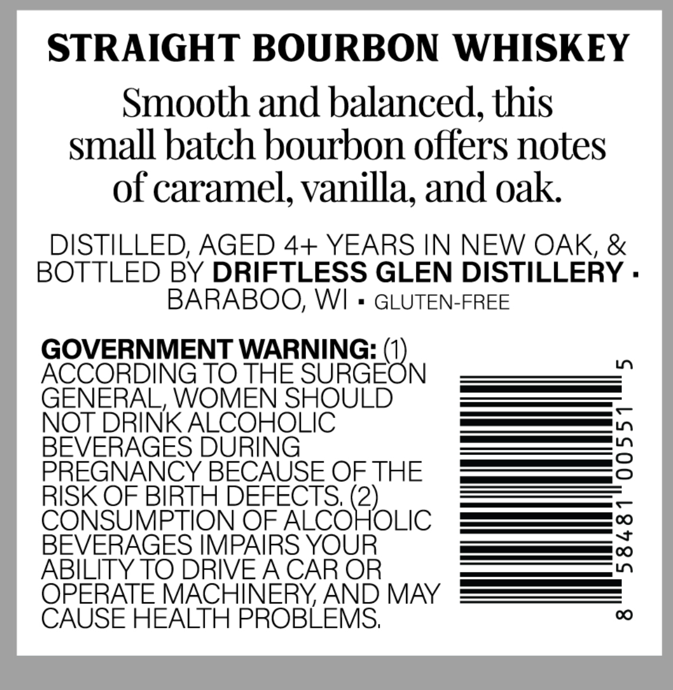
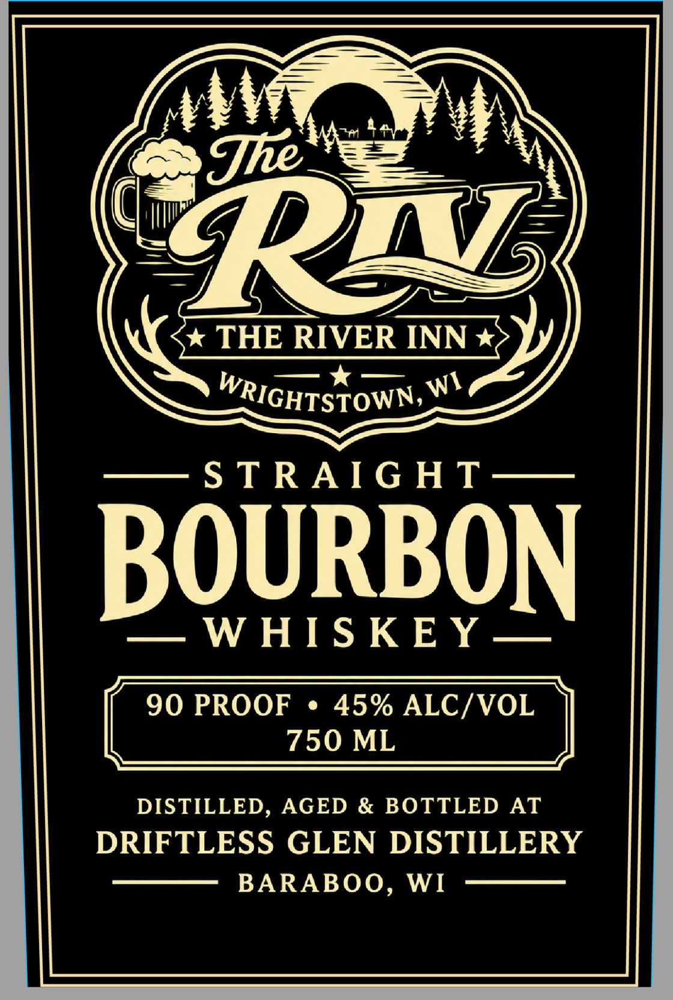

# TTB COLA Label Images - TTBID 26320001000044

**Brand Name:** THE RIVER INN

**Issue Date:** 11/19/2026

**Origin Code:** 48

**Product Class/Type:** 101

**Source:** [TTB Public COLA Registry](https://ttbonline.gov/colasonline/viewColaDetails.do?action=publicFormDisplay&ttbid=26320001000044)

## Label Images

### Back Label

### Front Label

## Extracted Label Text

*Text extracted via OCR - may contain errors*

**Detected Proof:** 90

### Back Label

STRAIGHT BOURBON WHISKEY
Smooth and balanced,this
small batch bourbon offers notes
of caramel, vanilla; and oak
DISTILLED; AGED 4+ YEARS IN NEW OAK, &
BOTTLED BY DRIFTLESS GLEN DISTILLERY .
BARABOO, WI
GLUTEN-FREE
GOVERNMENT WARNING:
ACCORDING TO THE
SURGEBN
1n
GENERAL, WOMEN SHOULD
NOT DRINK ALCOHOLIC
BEVERAGES DURING
2
PREGNANCY BECAUSE OFTHE
RISK OF BIRTH DEFECTS;
CONSUMPTION OF
eoQoLIc
BEVERAGES IMPAIRS YOUR
1
ABILITY TO DRIVEA CAR OR
OPERATE MACHINERYAND MAY
CAUSE HEALTH PROBLEMS;
00

### Front Label

Jhe
THE RIVER INN
WRIGHTSTOWN, _
S TRAIG HT
BOURBON
WHS KEY _
90 PROOF
45% ALC/VOL
750 ML
DISTILLED, AGED & BOTTLED AT
DRIFTLESS GLEN DISTILLERY
BARABOO,
WI
R
WI
