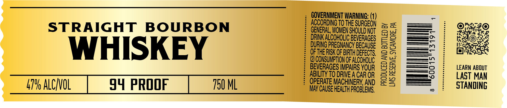
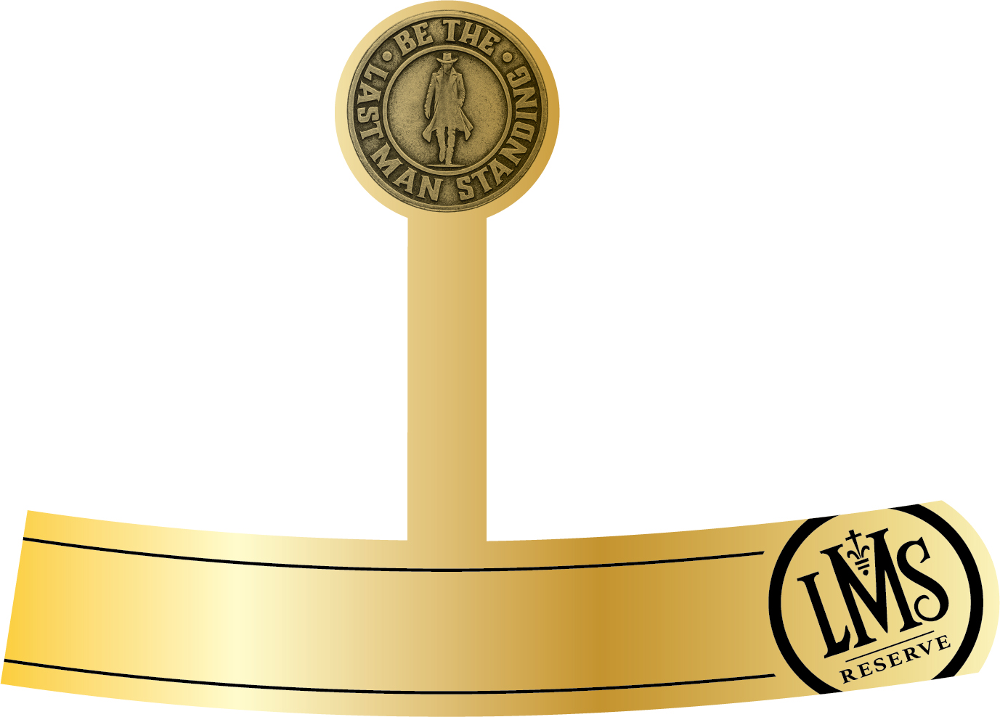

# TTB COLA Label Images - TTBID 26320001000067

**Brand Name:** LAST MAN STANDING

**Fanciful Name:** THE FINAL PROOF

**Issue Date:** 11/19/2026

**Origin Code:** 39

**Product Class/Type:** 101

**Source:** [TTB Public COLA Registry](https://ttbonline.gov/colasonline/viewColaDetails.do?action=publicFormDisplay&ttbid=26320001000067)

## Label Images

### Back Label

### Front Label

### Label 2

### Label 5

## Extracted Label Text

*Text extracted via OCR - may contain errors*

*3 image(s) excluded: text did not meet readability threshold*

**Detected Proof:** 94

### Front Label

STRAIGHT BOURBON

WHISKEY
47% ALCIVOL

780 ML

; GOVERNMENT WARNING: (1)
: ACCORDING TO THE SURGEON
: GENERAL, WOMEN SHOULD NOT
: DRINK ALCOHOLIC BEVERAGES
: DURING PREGNANCY BECAUSE
? OFTHERISK OF BIRTH DEFECTS,
(CONSUMPTION OF ALCOHOLIC
: BEVERAGES IMPAIRS YOUR
: ABILITY TO DRIVE ACAR OR
? OPERATE MACHINERY, AND

MAY CAUSE HEALTH PROBLEMS,

PRODUCED AND BOTTLED BY

LMS RESERVE, SYCAMORE, PA

ies
LEARN ABOUT

LAST MAN
STANDING
