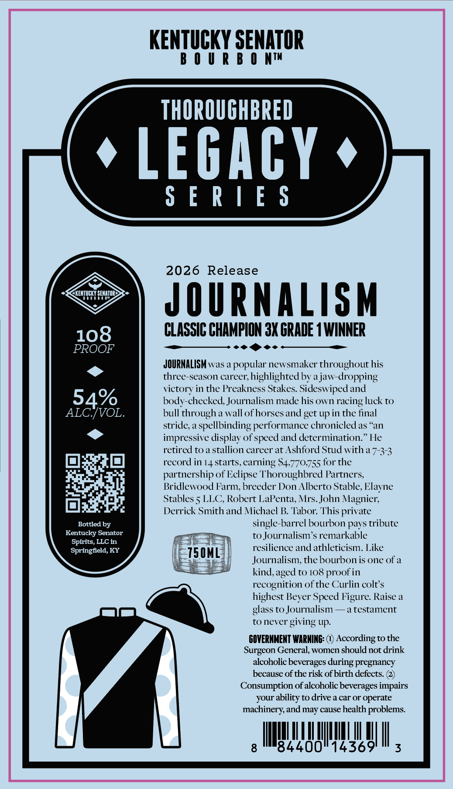
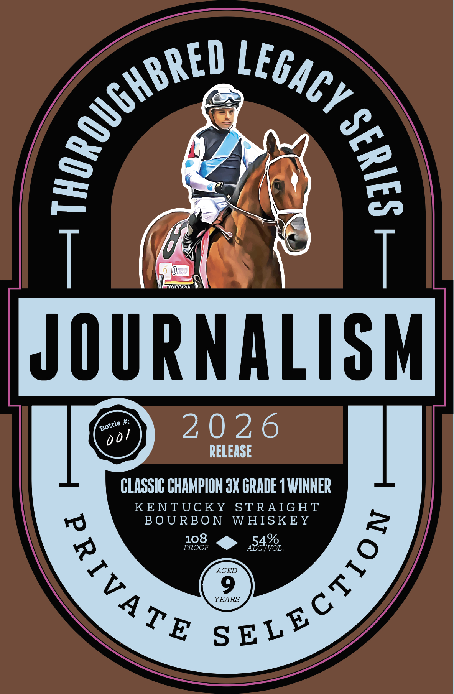

# TTB COLA Label Images - TTBID 26320001000086

**Brand Name:** THOROUGHBRED LEGACY SERIES

**Issue Date:** 11/24/2026

**Origin Code:** 22

**Product Class/Type:** 101

**Source:** [TTB Public COLA Registry](https://ttbonline.gov/colasonline/viewColaDetails.do?action=publicFormDisplay&ttbid=26320001000086)

## Label Images

### Back Label

### Front Label

## Extracted Label Text

*Text extracted via OCR - may contain errors*

**Detected Proof:** 108

### Back Label

KENTUCKY SENATOR

BOURBON™

THOROUGHBRED

¢ LEGACY ¢

SERIES

2026 Release

ZENS

<i>

JOURNALISM

108

CLASSIC CHAMPION 3X GRADE 1 WINNER

PROOF

ee Goo

JOURNALISM was a popular newsmaker throughout his

three

ason career, highlighted by a jaw-dropping

victory in the Preakness Stakes. Sideswiped and

54%

body-checked, Journalism made his own racing luck to

ALC/VOL

bull through a wall of horses and get up in the final

stride, a spellbinding performance chronicled as “an

Sd

impressive display of speed and determination.” He

retired toa stallion career at Ashford Stud with a 7-

3

2-2

3

record in 14 starts, earning $4,770,7:

55 for the

partnership of Eclipse Thoroughbred Partners,

Bridlewood Farm, breeder Don Alberto Stable, Elayne

Stables 5 LLC, Robert LaPenta, Mrs. John Magnier,

Derrick Smith and Michael B. Tabor. This private

Bottled by

single-barrel bourbon pays tribute

Kentucky Senator

ae

to Journalism’s remarkable

Spirits, LLC in

re

ence and athleticism. Like

Springfield,

ETSOML

Journalism, the bourbon is one of a

io

kind, aged to 108 proof in

recognition of the Curlin colt’s

highest Beyer Speed Figure. Raise a

glass to Journalism —a testament

to never giving up.

GOVERNMENT WARNING: (1) According to the

Surgeon General, women should not drink

alcoholic beverages during pregnancy

because of the risk of birth defects.

Consumption of alcoholic beverages impairs

your ability to drive a car or operate

machinery, and may cause health problems.

|

|

my

mL

8)

### Front Label

CLASSIC CHAMPION 3X GRADE 1 WINNER

KENTUCKY STRAIGHT
BOURBON WHISKEY

108 9
PROOF > wpAze
