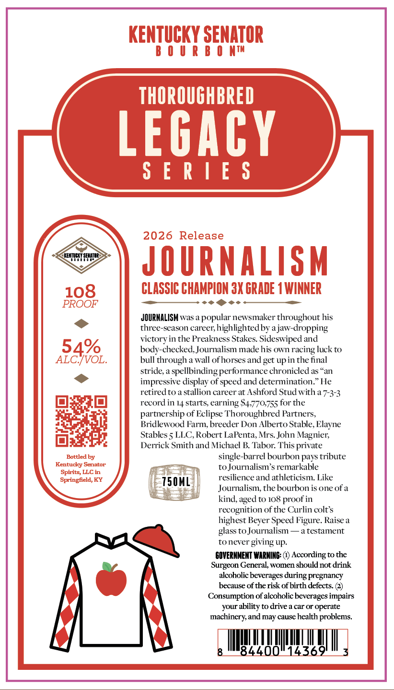
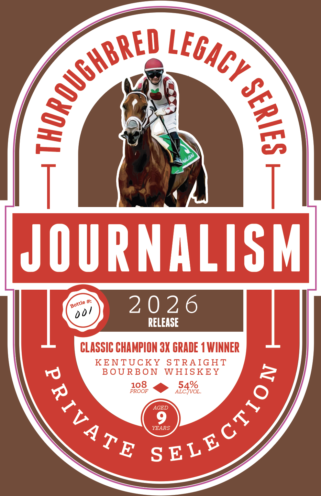

# TTB COLA Label Images - TTBID 26320001000088

**Brand Name:** THOROUGHBRED LEGACY SERIES

**Issue Date:** 11/24/2026

**Origin Code:** 22

**Product Class/Type:** 101

**Source:** [TTB Public COLA Registry](https://ttbonline.gov/colasonline/viewColaDetails.do?action=publicFormDisplay&ttbid=26320001000088)

## Label Images

### Back Label

### Front Label

## Extracted Label Text

*Text extracted via OCR - may contain errors*

**Detected Proof:** 108

### Back Label

KENTUCKY SENATOR
R
0 U
R
B 0 NtM
thorOuGHBRED
LEGACY
S E R / E $
2026 Release
KEWTHEHAHaOR
JOURNALISM
108
CLASSIC CHAMPION 3X GRADE 1 WINNER
PROOF
JOURNALISM was a
newsmaker throughout his
three-season career;
highlightedby ajaw-dropping
victoryin the Preakness Stakes Sideswiped and
54%
body-checked,Journalism made his Own
luck to
ALC IVOL_
bull through a wall ofhorses and get
the final
stride;
spellbinding performance chronicled as
an
impressive display of speed and determination
He
retiredto a stallion career at Ashford Stud with a 7-3-3
record in 14 starts
earning S4,770,755 for the
partnership of Eclipse Thoroughbred Partners,
hi
Bridlewood Farm; breeder Don Alberto Stable, Elayne
Stables 5 LLC, Robert LaPenta, Mrs John Magnier;
Derrick Smith and Michael B Tabor: This private
Bottled by
single-barrel bourbon pays tribute
Kentuck Senator
to Journalism s remarkable
Spirits, LLC in
Springfield, KY
750ML
resilience and athleticism: Like
Journalism; the bourbon is one of a
kind, aged to 108
recognition of the Curlin colts
highest Beyer Speed Figure. Raise a
glass to Journalism
a testament
to never
giving Up
GOVERNMENT WARNING:
According to the
Surgeon General women shouldnot drink
alcoholic beverages
prcgnancy
because of the risk ofbirth defects
Consumption of alcoholic bevcragcs impairs
your
ability to drive a car or operate
machinery,and may cause health problems:
84400"14369
popular _
racing
upin
proof
during

### Front Label

T
JOURNALISM
2 0 2 6
0
RELEASE
CLASSIC CHAMPION 3X GRADE 1 WINNER
KENTUCKY
S TRAIGHT
BOU RBON
W HISKEY
PROOF
454%.
AGED
YEARS
LEGAcY
(
1
Bottle
SELEGTIO `
(
108
