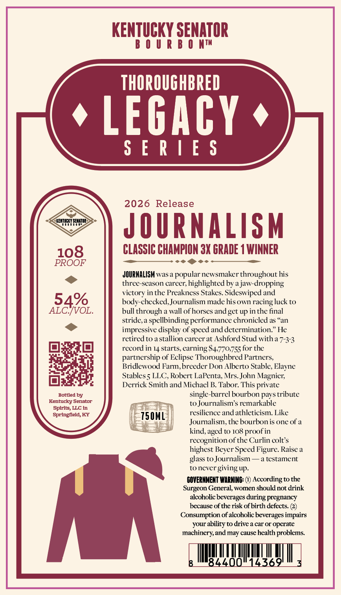

# TTB COLA Label Images - TTBID 26320001000090

**Brand Name:** THOROUGHBRED LEGACY SERIES

**Issue Date:** 11/24/2026

**Origin Code:** 22

**Product Class/Type:** 101

**Source:** [TTB Public COLA Registry](https://ttbonline.gov/colasonline/viewColaDetails.do?action=publicFormDisplay&ttbid=26320001000090)

## Label Images

### Back Label

### Front Label

## Extracted Label Text

*Text extracted via OCR - may contain errors*

**Detected Proof:** 108

### Back Label

KENTUCKY SENATOR
b 0 U R
B
0 Mtm
thOROUGHBRED
LEGACY
S E R | E $
2026
Release
KEHTHEY SrnaoR
JOURNALISM
108
CLASSIC CHAMPION 3X GRADE 1 WINNER
PROOF
JOURNALISH was a popular newsmaker throughout his
three-season career;
highlighted by ajaw-dropping
victory in the Preakness Stakes. Sideswiped and
54%
body-checked,Journalism made his own racing luck to
ALC IVOL.
bull through a wall ofhorses andget up inthe final
stride;a spellbinding performance chronieled as
an
impressive display of speed and determination " He
retiredto a stallion careerat Ashford Stud witha7-3 3
record in 14 starts, earning S4770,755 for the
partnership of Eelipse Thoroughbred Partners,
Bridlewood Farm,breeder Don Alberto Stable; Elayne
Stables5 LLC, Robert LaPenta, Mrs. John Magnier;
Derrick Smith and Michael B Tabor: This private
Bottled by
single barrel bourbon pays tribute
Kentucky Senator
to Journalism $ remarkable
Splrits, LLC In
SprIngfield, KY
750HL
resilience andathleticism. Like
Journalism, the bourbon is one of a
kind,
to 108
proofin
recognition of the Curlin colt's
highest Beyer Speed Figure. Raise a
glass to Journalism
testament
to nevergiving up.
GOVERNMENT WARNING: (2) According to the
Surgeon General, women should not drink
alcoholic bcverages
pregnancy
because of the risk ofbirth defects
Consumption of alcoholic beverages impairs
your ability to drive a
or operate
machinery,and may causc hcalth problems
84400"1436
aged
during -
car

### Front Label

T
JOURNALISM
0
2 0 2 6
RELEASE
CLASSIC CHAMPION 3X GRADE 1 WINNER
KENTUCKY
STRAIGHT
BOURBON
W HISKEY
PROOF
108
45498.
AGED
YEARS
((
LEGACY
0
S AUSPOL(
Bottle _
SELECTIO`
L
