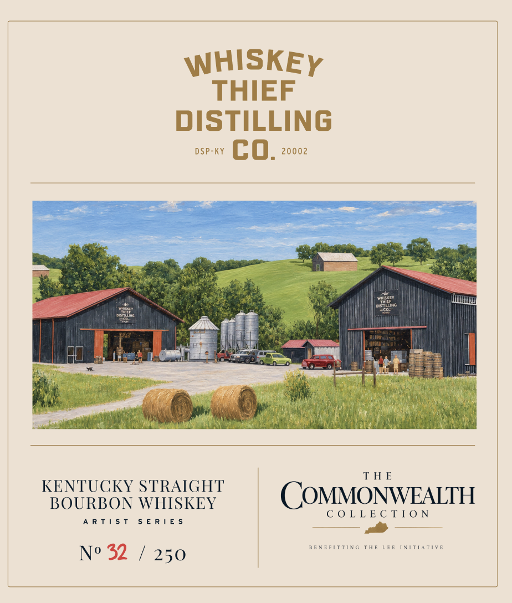
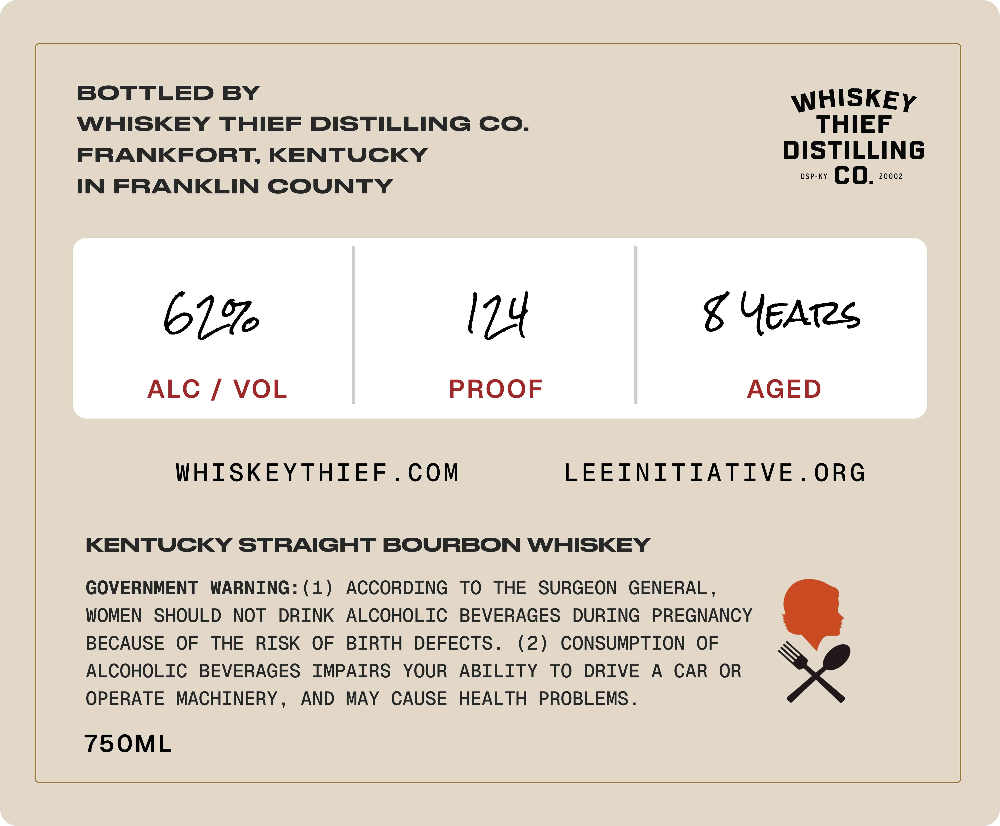

# TTB COLA Label Images - TTBID 26320001000143

**Brand Name:** WHISKEY THIEF DISTILLING CO.

**Fanciful Name:** THE COMMONWEALTH COLLECTION

**Issue Date:** 11/23/2026

**Origin Code:** 22

**Product Class/Type:** 101

**Source:** [TTB Public COLA Registry](https://ttbonline.gov/colasonline/viewColaDetails.do?action=publicFormDisplay&ttbid=26320001000143)

## Label Images

### Label 1

### Label 2

## Extracted Label Text

*Text extracted via OCR - may contain errors*

### Label 1

WHISKEy
THIEF
DISTILLING
DSP-KY CO. 20002
Baan foi Mei awe ee Havent ie a
1 tt TE OE ARH had
THE
KENTUCKY STRAIGHT
BOURBON WHISKEY (COMMONWEALTH
ARTIST SERIES ee ee
N° 32 / 250 aR

### Label 2

BOTTLED
BY
WHISKEY
WHISKEY THIEF DISTILLING CO.
THIEF
FRANKFORT;, KENTUCKY
DISTILLING
DSP-KY
co.
20002
IN
FRANKLIN COUNTY
61,%6
114
g UEATzs
ALC
7
VOL
PROOF
AGED
WHISKEYTHIEF. COM
LEEINITIATIVE.ORG
KENTUCKY STRAIGHT BOURBON WHISKEY
GOVERNMENT
WARNING : ( 1 )
ACCORDING
TO
THE
SURGEON
GENERAL
WOMEN
SHOULD
NOT
DRINK
ALCOHOLIC
BEVERAGES
DURING
PREGNANCY
BECAUSE
OF
THE
RISK
OF
BIRTH
DEFECTS .
(2)
CONSUMPTION
OF
ALCOHOLIC
BEVERAGES
IMPAIRS
YOUR
ABILITY
To
DRIVE
A
CAR
OR
OPERATE
MACHINERY
AND
MAY
CAUSE
HEALTH
PROBLEMS _
75OML
