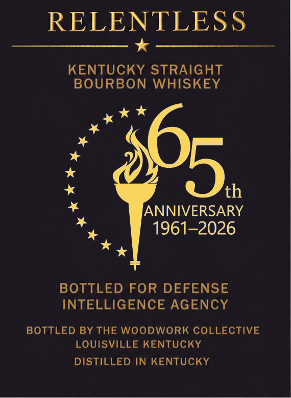
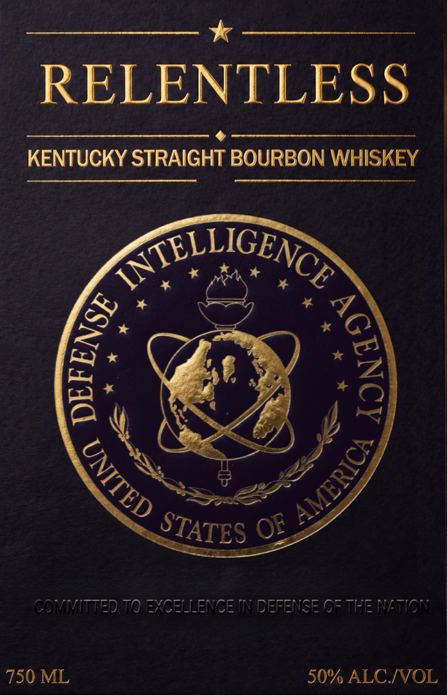
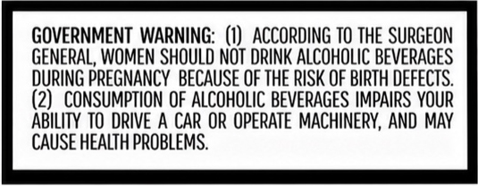

# TTB COLA Label Images - TTBID 26320001000290

**Brand Name:** RELENTLESS

**Issue Date:** 11/20/2026

**Origin Code:** 22

**Product Class/Type:** 101

**Source:** [TTB Public COLA Registry](https://ttbonline.gov/colasonline/viewColaDetails.do?action=publicFormDisplay&ttbid=26320001000290)

## Label Images

### Back Label

### Label 1

### Label 3

## Extracted Label Text

*Text extracted via OCR - may contain errors*

**Detected Proof:** 100

### Back Label

RELENTLESS
——————E

KENTUCKY STRAIGHT
BOURBON WHISKEY

BOTTLED FOR DEFENSE
INTELLIGENCE AGENCY

BOTTLED BY THE WOODWORK COLLECTIVE
LOUISVILLE KENTUCKY

DISTILLED IN KENTUCKY

### Label 1

RELENTLESS
KENTUCKY STRAIGHT BOURBON WHISKEY
KLLIGENOA
OE
GoiiITTED To EXCEL_I_ENCE IN CEFENSE C=TI-E NfTICN
750 ML
50% ALC NVOL
[
5
0
7
STATES

### Label 3

GOVERNMENT WARNING: (1) ACCORDING 10 THE SURGEON

GENERAL, WOMEN SHOULD NOT DRINK ALCOHOLIC BEVERAGES

DURING PREGNANCY BECAUSE OF THE RISK OF BIRTH DEFECTS.

(2) CONSUMPTION OF ALCOHOLIC BEVERAGES IMPAIRS YOUR

ABILITY TO DRIVE A CAR OR OPERATE MACHINERY, AND MAY

CAUSE HEALTH PROBLEMS.
