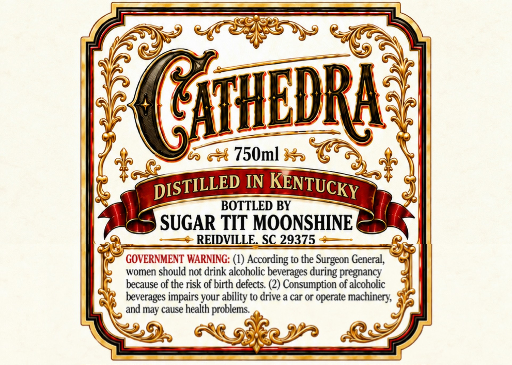
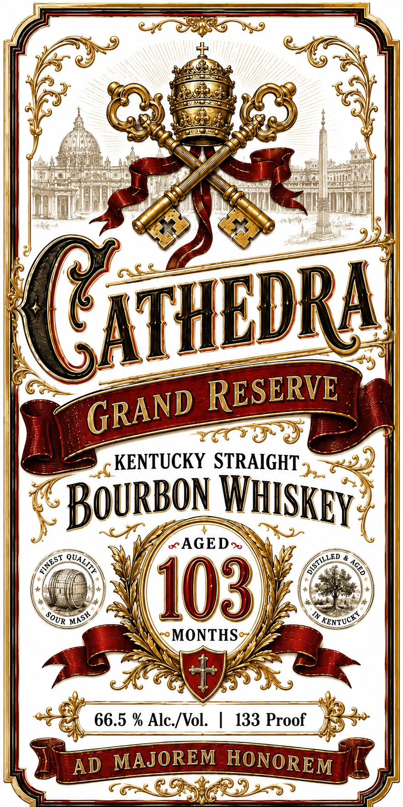

# TTB COLA Label Images - TTBID 26320001000402

**Brand Name:** CATHEDRA

**Issue Date:** 11/23/2026

**Origin Code:** 41

**Product Class/Type:** 101

**Source:** [TTB Public COLA Registry](https://ttbonline.gov/colasonline/viewColaDetails.do?action=publicFormDisplay&ttbid=26320001000402)

## Label Images

### Back Label

### Front Label

## Extracted Label Text

*Text extracted via OCR - may contain errors*

**Detected Proof:** 133

### Back Label

CTHEdRI
750ml
IN
BOTTLED BY
SUGAR TIT MOONSHINE
REIDVILLE SC 29375
GOVERNMENT WARNING: (1) According to the Surgeon General,
women should not drink alcoholic beverages
pregnancy
because of the risk of birth defects: (2) Consumption of alcoholic
beverages impairs your ability to drive a car or operate machinery;
and may cause health problems:
KENTUCKY
DISTILLED
during

### Front Label

CATHEDRy
RESERVE
KENTUCKY STRAIGHT
Bourbon
~AGEDx
103
MONTHS-
66.5 % Alc-/Vol.
133 Proof
AD MAJOREM
GRAND
WISKEY
DISTILLED
QUALITP
FINEST
!
MASH
KENTUCKS
SOUR
HONOREM
