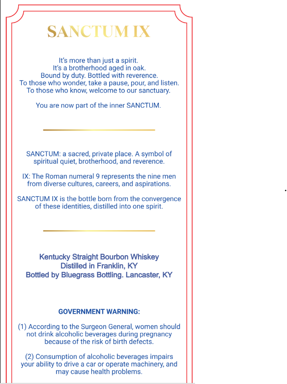
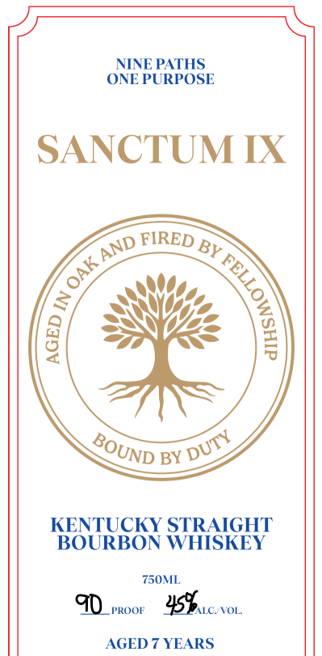

# TTB COLA Label Images - TTBID 26320001000509

**Brand Name:** SANCTUM IX

**Issue Date:** 11/19/2026

**Origin Code:** 22

**Product Class/Type:** 101

**Source:** [TTB Public COLA Registry](https://ttbonline.gov/colasonline/viewColaDetails.do?action=publicFormDisplay&ttbid=26320001000509)

## Label Images

### Back Label

### Front Label

## Extracted Label Text

*Text extracted via OCR - may contain errors*

**Detected Age:** 7 Years

### Back Label

SANCTUM IX
It's more than just
spirit:
Its a brotherhood aged in oak
Bound by duty. Bottled with reverence_
To those who wonder; take
pause, pour; and listen.
To those who know; welcome to our sanctuary:
You are now part of the inner SANCTUM
SANCTUM:
sacred, private place.
symbol of
spiritual quiet; brotherhood, and reverence:
IX: The Roman numeral
represents the nine men
from diverse cultures, careers, and aspirations
SANCTUM IX is the bottle born from the convergence
of these identities, distilled into one spirit.
Kentucky Straight Bourbon Whiskey
Distilled in Franklin; KY
Bottled by Bluegrass Bottling: Lancaster; KY
GOVERNMENT WARNING:
According to the Surgeon General, women should
not drink
Icoholic beverages during pregnancy
because of the risk of birth defects
Consumption of alcoholic beverages impairs
your ability to drive
car or operate
machinery; and
may cause health problems

### Front Label

NINE PATHS
ONE PURPOSE
SANCTUM IX
FIRED By
BY
KENTUCKY STRAIGHT
BOURBON WHISKEY
7S0ML
PROOF
ALC  VOL.
AGED 7 YEARS
(
)
DUTY
BOUND '
45}
