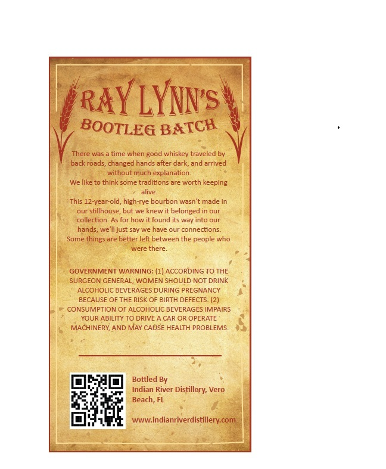
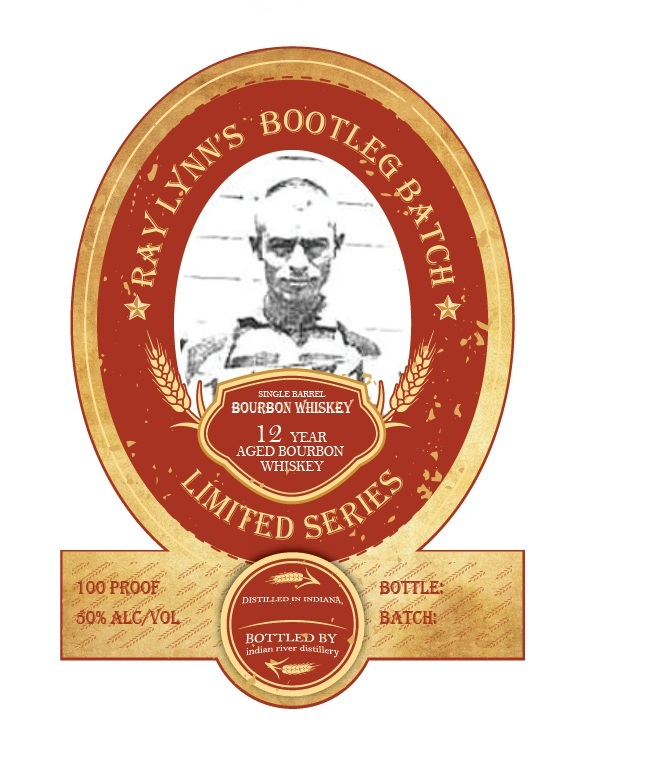

# TTB COLA Label Images - TTBID 26320001000523

**Brand Name:** RAY LYNN'S BOOT LEG BATCH LIMITED SERIES

**Issue Date:** 11/19/2026

**Origin Code:** 16

**Product Class/Type:** 141

**Source:** [TTB Public COLA Registry](https://ttbonline.gov/colasonline/viewColaDetails.do?action=publicFormDisplay&ttbid=26320001000523)

## Label Images

### Back Label

### Front Label

## Extracted Label Text

*Text extracted via OCR - may contain errors*

**Detected Proof:** 100
**Detected Age:** 12 Years

### Back Label

RAY LYNNS
BOOTLEG
There was
time when good whiskey traveled bY
back roads, changed hands after dark, and arrived
without much explanation.
We like to think some traditions are worth keeping
alive
This 12-ear-old, high-rye bourbon wasn
made in
our stillhouse, but we knew
belonged in our
collection. As forhow it found its way into our
hands, we'Il just say we have our connections
Some
are better left between the peope
who
were there.
GOVERNMENT WARNING: (1) ACCORDING TO THE
SURGEON GENERAL, WOMEN SHOULD NOT DRINK
ALCOHOLIC BEVERAGES DURING PREGNANCY
BECAUSE OF THE RISK OF BIRTH DEFECTS.
CONSUMPTION OF ALCOHOLIC BEVERAGES IMPAIRS
YOUR ABILITY TO DRIVE
CAR OR OPERATE
MACHINERY, AND MAY CAUSE HEALTH PROBLEMS
Bottled By
Indian River Distillery; Vero
Beach, FL
WWW indianriverdistillery com
BATCH
things

### Front Label

SINGLE BARFEI
BOURBON WHISKEY
12
YEAR
AGED BOURBON
WHISHEY
4100 PROOF
BOTTLE:
DISTILLTD IN INDUN
50% ALCNOL
BATCH:
BOTTLED BY
TitT
BOOTLEG ,
(
1
LIMITED
'SERIES
atety
Lindian
