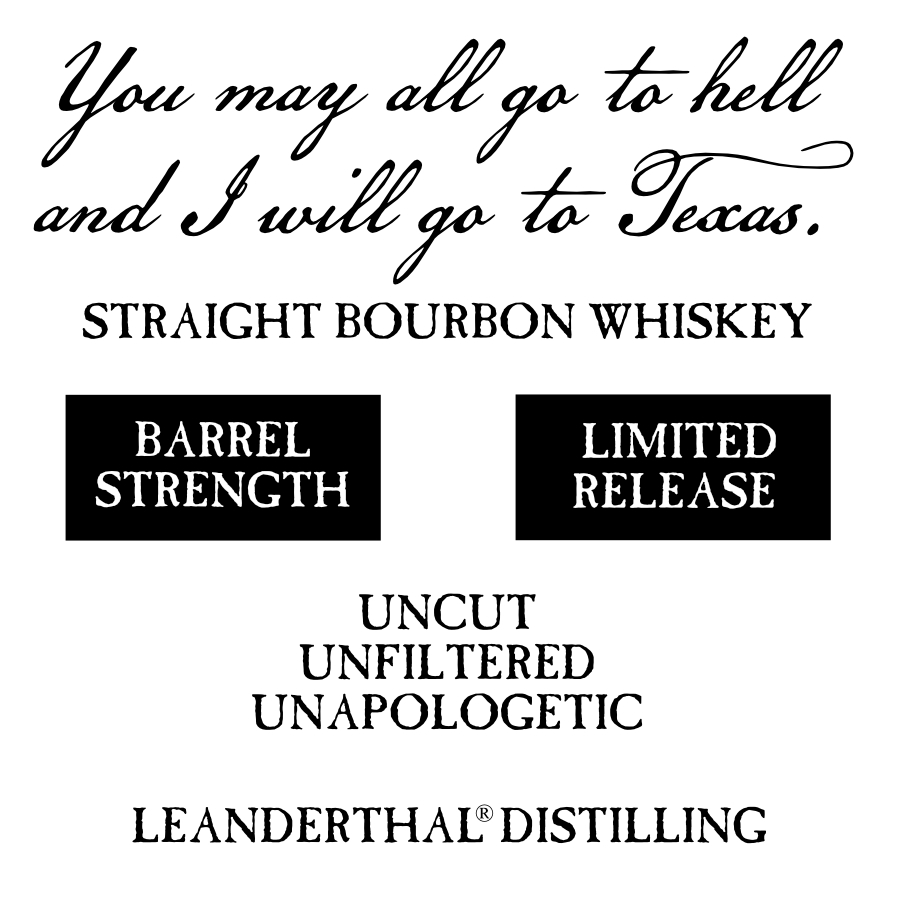
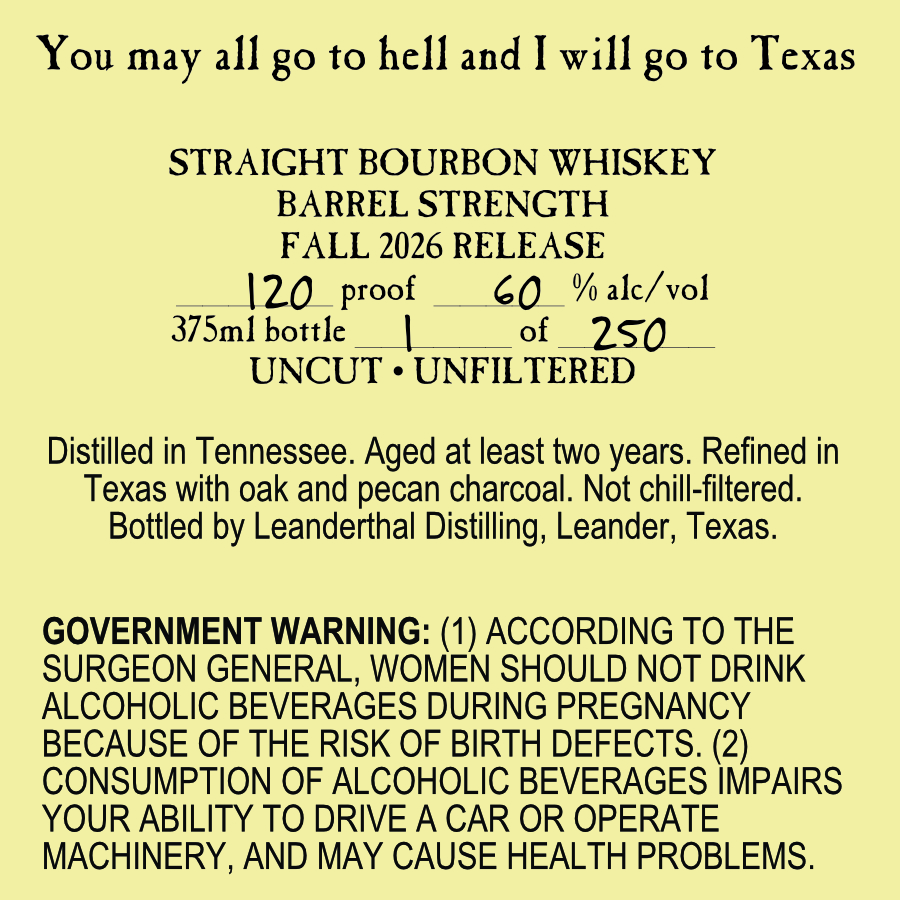

# TTB COLA Label Images - TTBID 26320001000732

**Brand Name:** YOU MAY ALL GO TO HELL AND I WILL GO TO TEXAS

**Issue Date:** 11/20/2026

**Origin Code:** 44

**Product Class/Type:** 101

**Source:** [TTB Public COLA Registry](https://ttbonline.gov/colasonline/viewColaDetails.do?action=publicFormDisplay&ttbid=26320001000732)

## Label Images

### Back Label

### Front Label

## Extracted Label Text

*Text extracted via OCR - may contain errors*

**Detected Proof:** 120

### Back Label

Uou masy all ga t hell
and J uxllga %o %aas.
STRAIGHT BOURBON WHISKEY
BARREL
LIMITED
STRENGTH
RELEASE
UNCUT
UNFILTERED
UNAPOLOGETIC
LEANDERTHALP DISTILLING

### Front Label

You may all g0 to hell and Iwill g0 to Texas
STRAIGHT BOURBON WHISKEY
BARREL STRENGTH
FALL 2026 RELEASE
120
60
% alc/ vol
375m] bottle
of
2S0
UNCUT
UNFILTERED
Distilled in Tennessee. Aged at least two years: Refined in
Texas with oak and pecan charcoal: Not chill-filtered:
Bottled by Leanderthal Distilling; Leander; Texas.
GOVERNMENT WARNING: (1) ACCORDING TO THE
SURGEON GENERAL, WOMEN SHOULD NOT DRINK
ALCOHOLIC BEVERAGES DURING PREGNANCY
BECAUSE OF THE RISK OF BIRTH DEFECTS. (2)
CONSUMPTION OF ALCOHOLIC BEVERAGES IMPAIRS
YOUR ABILITY TO DRIVE A CAR OR OPERATE
MACHINERY, AND MAY CAUSE HEALTH PROBLEMS.
proof
