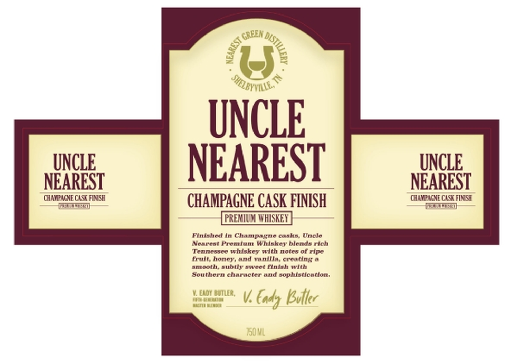
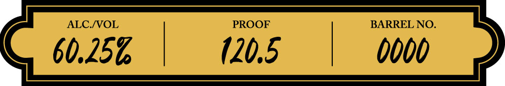
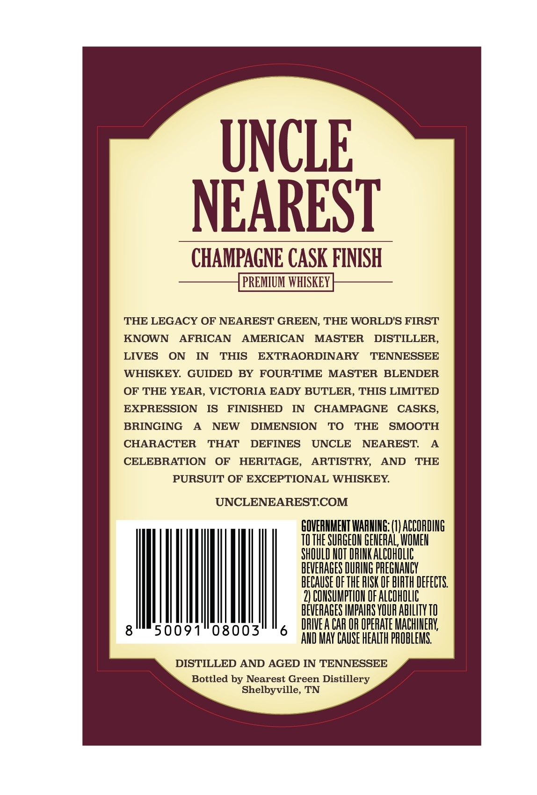

# TTB COLA Label Images - TTBID 26320001000761

**Brand Name:** UNCLE NEAREST

**Issue Date:** 11/24/2026

**Origin Code:** 43

**Product Class/Type:** 140

**Source:** [TTB Public COLA Registry](https://ttbonline.gov/colasonline/viewColaDetails.do?action=publicFormDisplay&ttbid=26320001000761)

## Label Images

### Front Label

### Label 1

### Label 3

### Label 4

## Extracted Label Text

*Text extracted via OCR - may contain errors*

*2 image(s) excluded: text did not meet readability threshold*

### Front Label

4
UNCLE
UNCLE
NEAREST
UNCLE
NEAREST
NEAREST
CHAMAVEXECSFINMI
CHAMPAGNE CASK FINISH
CHAVNNE CUSEEINLSH
PREMIUM WHISKEL
Finished In Chamn"sna Gunks. Uncla
Ncurcot Promtum Whlskor blend: rlch
Tenncooor Ihiskcy Ilth notco ot rlpc
trult honoy, und anill: croating
anooth#ublly gwcct rinich wtth
Southorn charaetcr und gophiettcntton.
Eadi EJIlER ,
V
Iuttec
150ML
GREEN
9
1
SheLBYVILle"
Cadh

### Label 4

UNCLE
NEAREST
CHAMPAGNE CASK FINISH
PREMIUM WHISKEY
THE LEGACY OF NEAREST GREEN, THE WORLD'S FIRST
KNOWN
AFRICAN
AMERICAN
MASTER
DISTILLER,
LIVES
ON
IN
THIS
EXTRAORDINARY
TENNESSEE
WHISKEY
GUIDED
BY
FOURTIME
MASTER
BLENDER
OF THE YEAR, VICTORIA EADY BUTLER, THIS LIMITED
EXPRESSION
IS
FINISHED
IN
CHAMPAGNE
CASKS,
BRINGING
NEW
DIMENSION
TO
THE
SMOOTH
CHARACTER
THAT
DEFINES
UNCLE
NEAREST
AS
CELEBRATION
OF
HERITAGE,
ARTISTRY,
AND
THE
PURSUIT OF EXCEPTIONAL WHISKEY
UNCLENEARESTCOM
GOVERNMENT WARMING: (IL ACCORDING
TOTHE SURGFOH GENERAL,WOMEN
SHOULD NOT DRINK ALCOhlIC
BEVERAGES DURING PPEGHANCY
PECAUSE QF ThE RISK OF BIRTH DEFECTS
2] COHSUMPTION OF ALCOhQLIC
BEVERAGES HMPAIRS VOUF abiLITY TU
DRIVE A CA OR OPERATE MACHINERK;
8
50091
08003
6
AND MAY CAUSE HEALTH PPOBLEMS
DISTILLED AND AGED IN TENNESSEE
Bottled by Nearest Green Distillery
Shelbyville, TN
