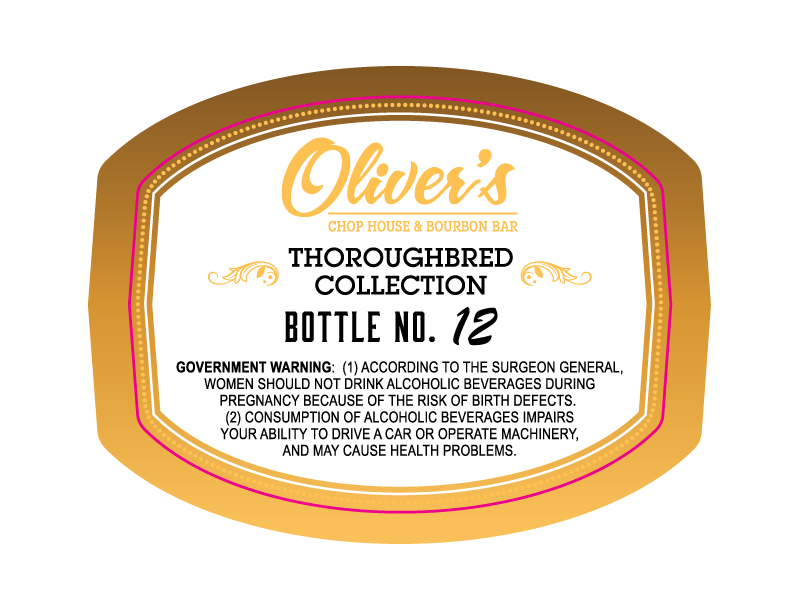
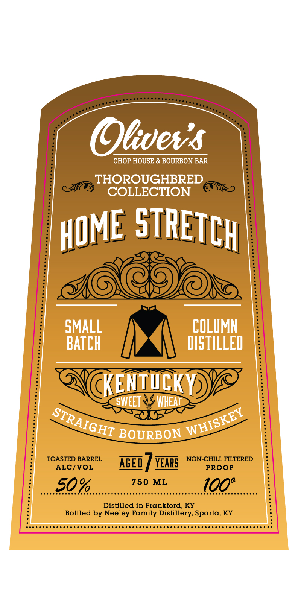

# TTB COLA Label Images - TTBID 26321001000344

**Brand Name:** OLIVERS

**Issue Date:** 11/20/2026

**Origin Code:** 22

**Product Class/Type:** 101

**Source:** [TTB Public COLA Registry](https://ttbonline.gov/colasonline/viewColaDetails.do?action=publicFormDisplay&ttbid=26321001000344)

## Label Images

### Back Label

### Front Label

## Extracted Label Text

*Text extracted via OCR - may contain errors*

### Back Label

Olevis
CHOP HOUSE & BOURBON BAR
THOROUGHBRED
COLLECTION
BOTTLe NI: 12
GOVERNMENT WARNING; (1) ACCORDING TO THE SURGEON GENERAL,
WOMEN SHOULD NOT DRINK ALCOHOLIC BEVERAGES DURING
PREGNANCY BECAUSE OF THE RISK OF BIRTH DEFECTS_
CONSUMPTION OF ALCOHOLIC BEVERAGES IMPAIRS
YOUR ABILITY TO DRIVE A CAR OR OPERATE MACHINERY,
AND MAY CAUSE HEALTH PROBLEMS

### Front Label

Olvevs
CHOP HOUSE & BOURBON BAR
THOROUGHBRED
COLLECTION
SMALL
COLUMN
BATCH
DISTILLED
CKENTUCKY
SWEET
WHEAT
BOURBON
TOASTED BARREL
NON-CHILL FILTERED
ALC/VOL
AGED
YEARS
PROOF
so%
750
ML
100F
Distilled in Frankford, KY
Bottled by Neeley Family Distillery, Sparta, KY
STRETCHL
HOME
STRAIG)
WHISKEY
HT
