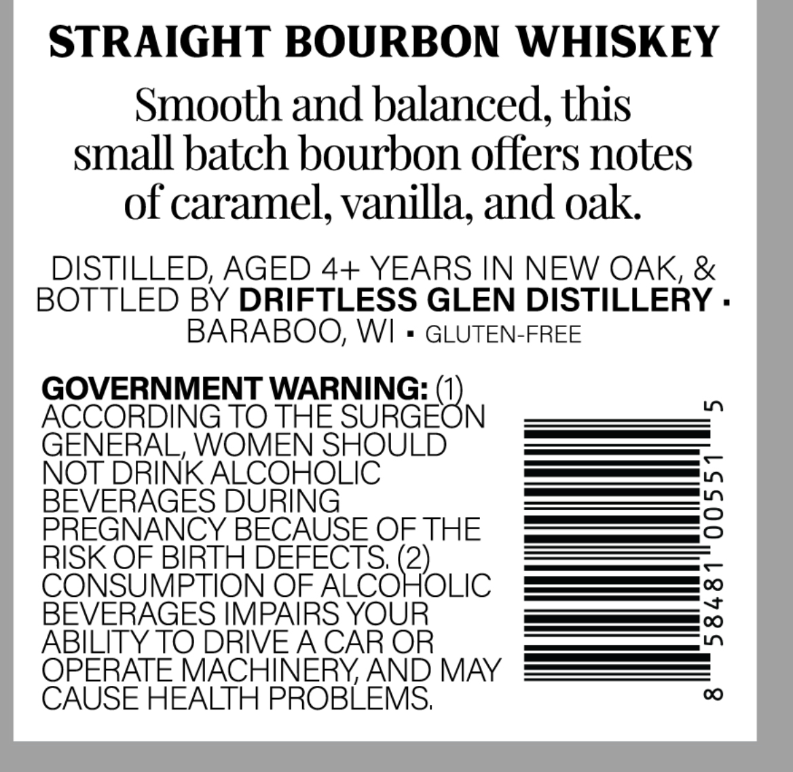
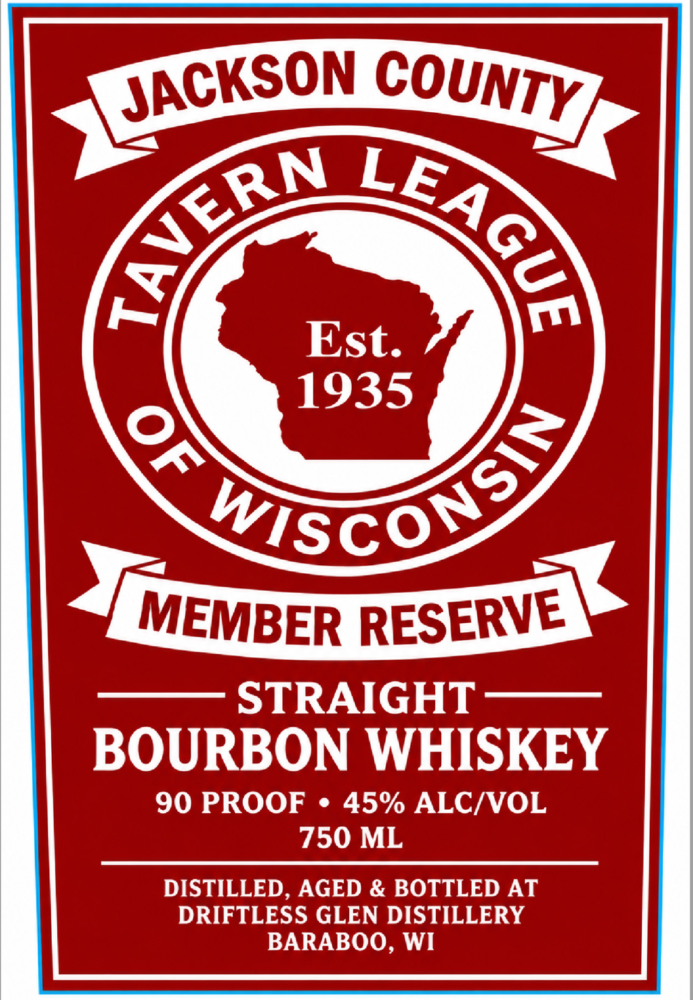

# TTB COLA Label Images - TTBID 26321001000428

**Brand Name:** TAVERN LEAGUE OF WISCONSIN

**Issue Date:** 11/23/2026

**Origin Code:** 48

**Product Class/Type:** 101

**Source:** [TTB Public COLA Registry](https://ttbonline.gov/colasonline/viewColaDetails.do?action=publicFormDisplay&ttbid=26321001000428)

## Label Images

### Back Label

### Front Label

## Extracted Label Text

*Text extracted via OCR - may contain errors*

**Detected Proof:** 90

### Back Label

STRAIGHT BOURBON WHISKEY
Smooth ad balanced,this
small batch bourbon offers notes
of caramel; vanilla, and oak
DISTILLED, AGED 4+ YEARS IN NEW OAK, &
BOTTLED BY DRIFTLESS GLEN DISTILLERY .
BARABOO; WI
GLUTEN-FREE
GOVERNMENT WARNING:
LO
ACCORDING TO THE SURGEON
GENERAL, WOMEN SHOULD
NOT DRINK ALCOHOLIC
BEVERAGES DURING
3
PREGNANCY BECAUSE OF THE
RISK OF BIRTH DEFECTS; (2)
CONSUMPTION OF ALCOHOLIC
BEVERAGES IMPAIRS YOUR
3
ABILITY TO DRIVEA CAR OR
OPERATE MACHINERY AND MAY
CAUSE HEALTH PROBLEMS;
0

### Front Label

Est:
1935
MEMBER
STRAIGHT
BOURBON WHISKEY
90 PROOF
45% ALC/VOL
750 ML
DISTILLED, AGED & BOTTLED AT
DRIFTLESS GLEN DISTILLERY
BARABOO , WI
JACKSON
COUNTY
KAVERN
EAGUS
risconsy
9
RESERVE
