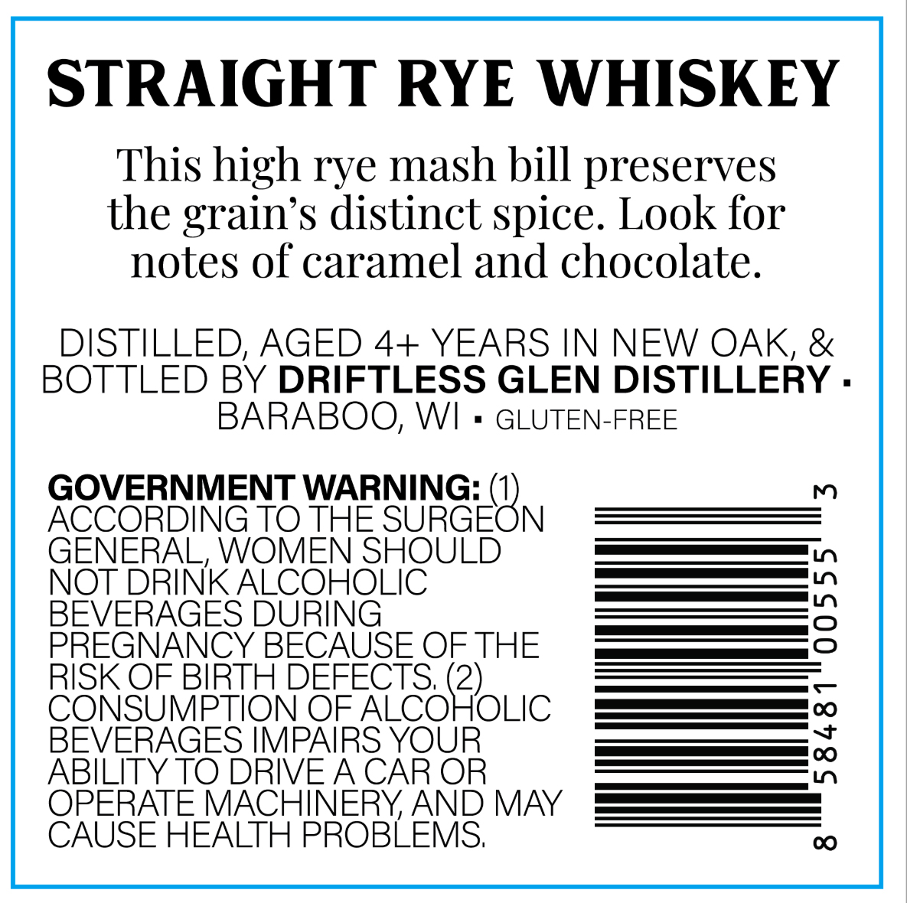
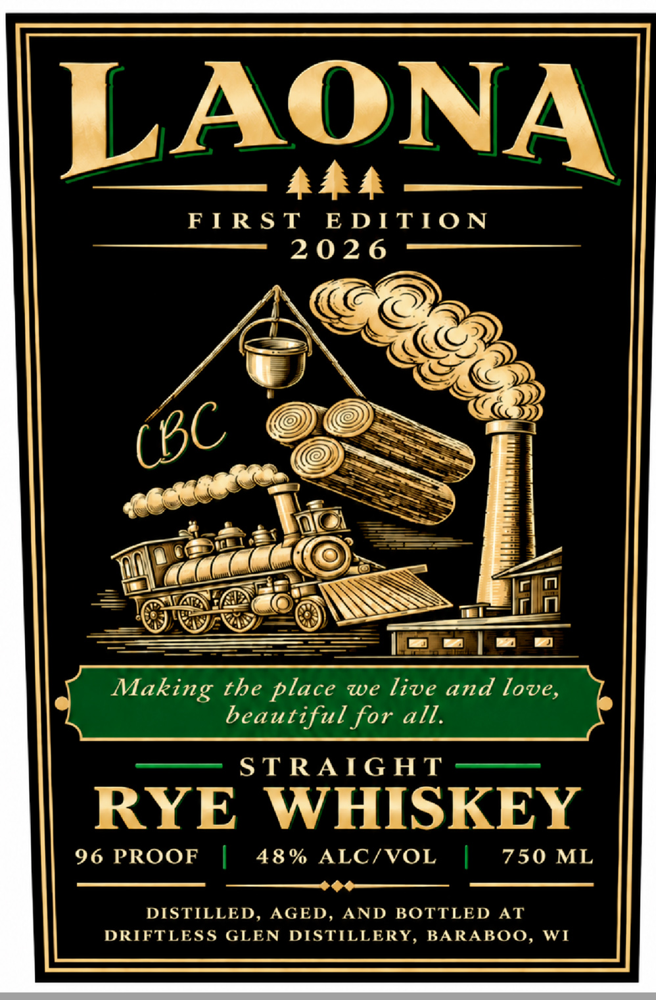

# TTB COLA Label Images - TTBID 26321001000456

**Brand Name:** LAONA

**Issue Date:** 11/20/2026

**Origin Code:** 48

**Product Class/Type:** 102

**Source:** [TTB Public COLA Registry](https://ttbonline.gov/colasonline/viewColaDetails.do?action=publicFormDisplay&ttbid=26321001000456)

## Label Images

### Back Label

### Front Label

## Extracted Label Text

*Text extracted via OCR - may contain errors*

**Detected Proof:** 96

### Back Label

STRAIGHT RYE WHISKEY
This high rye mash bill preserves
the grain's distinct spice. Look for
notes of caramel and chocolate.
DISTILLED; AGED 4+ YEARS IN NEW OAK, &
BOTTLED BY DRIFTLESS GLEN DISTILLERY .
BARABOO; WI
GLUTEN-FREE
GOVERNMENT WARNING:
m
ACCORDING TO THE SURGEON
GENERAL, WOMEN SHOULD
NOT DRINK ALCOHOLIC
BEVERAGES DURING
2
PREGNANCY BECAUSE OF THE
RISK OF BIRTH DEFECTS; (2)
CONSUMPTION OF ALCOHOLIC
BEVERAGES IMPAIRS YOUR
7
ABILITY TO DRIVEA CAR OR
OPERATE MACHINERYAND MAY
CAUSE HEALTH PROBLEMS;
C

### Front Label

AONA

Ahh

FIRST EDITION

Making the place we live and love, :
’ beautiful for all.

STRAIGHT

RYE WHISKEY

96 PROOF | 48% ALC/VOL | 750 ML
-—-eooror- ee OT 8
DISTILLED, AGED, AND BOTTLED AT
DRIFTLESS GLEN DISTILLERY, BARABOO, WI
