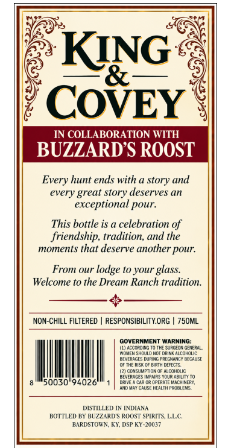
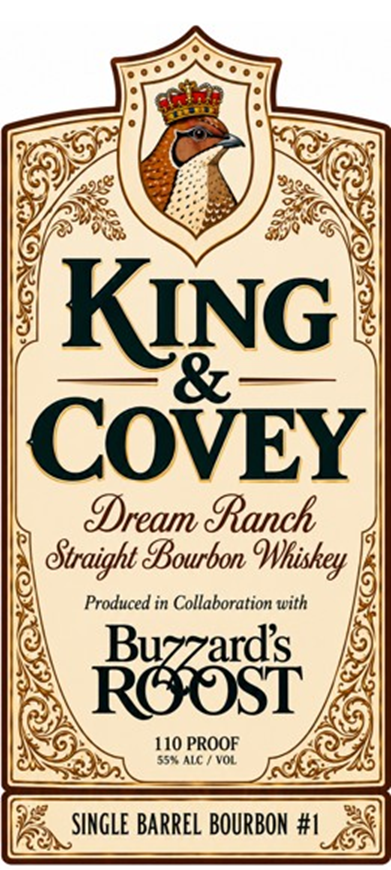

# TTB COLA Label Images - TTBID 26321001000604

**Brand Name:** BUZZARD"S ROOST

**Issue Date:** 11/23/2026

**Origin Code:** 22

**Product Class/Type:** 101

**Source:** [TTB Public COLA Registry](https://ttbonline.gov/colasonline/viewColaDetails.do?action=publicFormDisplay&ttbid=26321001000604)

## Label Images

### Back Label

### Label 1

## Extracted Label Text

*Text extracted via OCR - may contain errors*

**Detected Proof:** 110

### Back Label

KNG
&
COVEY
IN COLLABORATION WITH
BUZZARDS ROOST
Every hunt ends with a story and
every great story deserves an
exceptional pour:
This bottle is a celebration of
friendship, tradition, and the
moments that deserve another pour:
From
lodge to your glass
Welcome to the Dream Ranch tradition:
NON-CHILL FILTERED
RESPONSIBILITYORG
75OML
GOVERNMENT WARNING:
accurning I0 Ike Surgeon GENERAL
WQHEM SHCULd NoT DRINk ALconLiC
Mnkaiesnak "kekAnm
EcaWse
WHEE
uetednanck
Cmpms
Acohcc
BEVERAGES INPAIR S YCUR ABIVTX T0
005
402-
CAR 03 C?ERATE MCHIINEFI ,
nd Mcauaehocimhiprtxii
DISTILLED IN [NDIANA
BOTTLED BY BUZZARD'S ROOST SPIRITS, LLC
RARDSTOWN KY DSP KY-20037
OuT"

### Label 1

KING
&
COVEY
dream Banch
Bourbon
Whiskey
Produced in Collaboration with
Rcosi
110 PROOF
55* AIC
Tol
SINGLE Barrel BOURBON #|
8traight _
